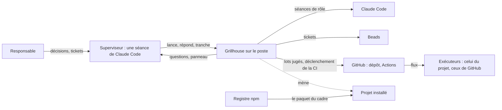
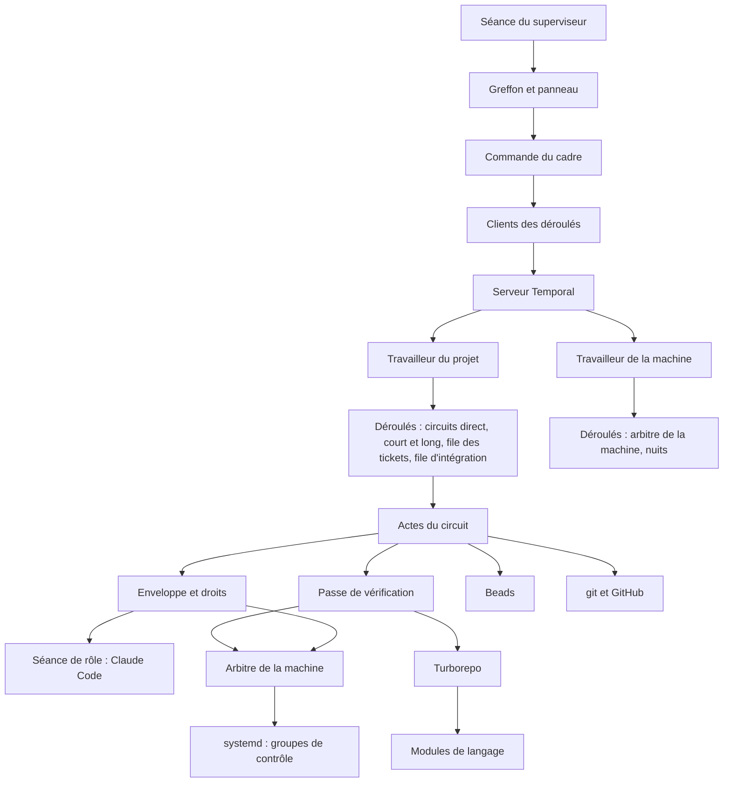
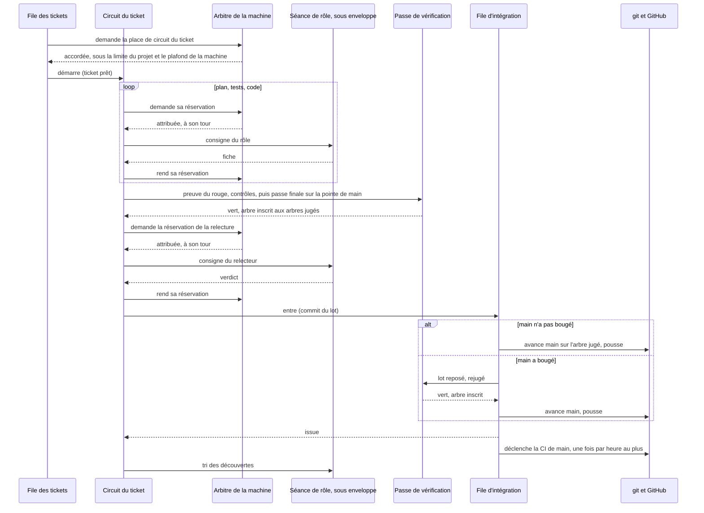
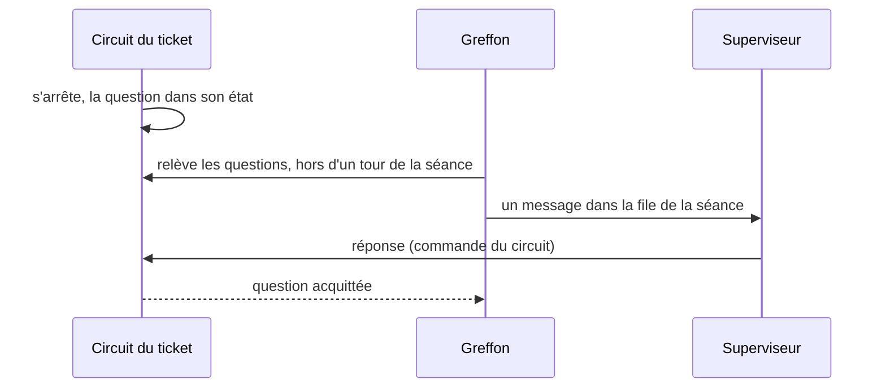

# Roomi's Grillhouse — architecture

Roomi's Grillhouse est un cadre de développement mené par des agents : il fait avancer chaque ticket d'un projet par un circuit d'étapes, chacune tenue par un agent neuf sous des droits écrits, et il fait entrer sur main le seul lot que son circuit a jugé. Il sert un besoin, dans les mots du responsable : « un outil qui marche et qui cadre les dérives d'architecture des projets », sur sa machine, pour ses projets ; il reste donc aussi petit que ce besoin. Ce document décrit la construction cible de l'ensemble, de la machine à la donnée, et renvoie pour chaque mécanisme à son document (section 10) ; là où le code ne l'a pas rejointe, la section 9 dit l'écart et le chantier qui le ferme.

## 1. Contexte

Ce qui traverse les bords du cadre :

- **les décisions et les tickets** du responsable, par le superviseur et par Beads ; **les questions** d'un circuit, qui remontent au superviseur, et ce qui revient au responsable ;
- **les séances de rôle**, des processus de Claude Code que le cadre lance, borne et lit ;
- **les lots**, des commits que le cadre pousse sur la branche main du dépôt du projet, et **les passages des flux** de GitHub Actions qu'il déclenche et lit ;
- **le paquet du cadre**, qu'un projet installe du registre npm, avec le greffon de Claude Code qu'il porte.

Les règles que les agents appliquent vivent dans la charte commune et dans le métacadre ; ce document décrit ce qui est construit pour les tenir.

## 2. Stratégie

Les six choix portent un numéro fixe : un ticket cite un choix par lui (§2.3), et un numéro ne se réattribue pas.

1. **Un état a un seul propriétaire.** Chaque état du cadre est écrit par un seul composant, que le tableau de la section 4 nomme ; les autres le lisent ou le dérivent. L'état d'un ticket en cours vit dans son déroulé sur le serveur Temporal, Beads garde le ticket, et les fichiers posés à côté sont des traces. Raison : un état tenu à plusieurs endroits oblige chaque reprise à choisir lequel croire, et les copies divergent. Modèle : l'exécution durable de Temporal, où l'histoire d'un déroulé est sa seule vérité.
2. **Un lot est jugé une fois, par son circuit, sur l'arbre exact qui entre, et posé une fois.** La passe finale du circuit juge le lot posé sur la pointe de main et inscrit l'arbre jugé ; la file d'intégration fait entrer cet arbre sans le rejouer, et ne fait rejuger que si main a bougé entre-temps. Seul ce jugement inscrit un arbre : une vérification lancée à la main rend son verdict et n'inscrit rien, hors celle de la voie de secours, qui inscrit l'arbre vérifié et le dit au ticket. Raison : main reste vert sans payer deux vérifications par ticket, et ce qui entre a été jugé par le circuit qui le porte. Modèle : bors, qui teste le commit qui entre puis avance la branche sur lui ; la file de fusion de GitHub, où seuls comptent les contrôles joués sur le commit du groupe de fusion.
3. **Une tâche de la machine est admise une fois, par un seul arbitre.** Avant de calculer, une séance ou une passe demande sa réservation à l'arbitre de la machine, attend son tour, puis la rend. L'arbitre est un déroulé sur le serveur Temporal, un pour toute la machine : il attribue par tâche et par projet une quantité de cœurs et de mémoire, d'après la consommation observée de chaque phase de chaque projet, recalculée chaque jour sur une fenêtre glissante, et il ne l'accorde que si la machine a réellement de quoi la jouer à cet instant, et il tient toutes les réservations au même endroit, sans fichier d'état à côté ; une place de séance et une part sont une seule chose, la réservation, prise au lancement de chaque étape et rendue à sa fin. Le nombre de circuits à la fois a deux bornes, la limite de chaque projet et le plafond de la machine, total des places des projets : chaque circuit a une seule place, comptée dans les deux, que l'arbitre tient et que la file des tickets lui demande avant de démarrer un ticket. Le système garde le plafond dur de la machine entière : toutes les tâches du cadre tournent sous une tranche de systemd dont le plafond tient la réserve de l'utilisateur hors de leur portée ; une tâche peut dépasser sa réservation, et seule une menace réelle sur la mémoire de la machine en fait arrêter une, par l'arbitre. Raison : une seule règle décide de ce qui tourne sur la machine, une attente a une seule cause, et une réservation suit ce que la tâche consomme vraiment. Modèle : Slurm, où un travail demande ses cœurs et sa mémoire ; Kubernetes, ses `requests` et ses `limits`. Écart : Temporal ne le fait pas seul, les créneaux de ses travailleurs comptent des tâches et non des ressources ; l'arbitre s'écrit donc comme un déroulé.
4. **Le noyau porte le graphe des tâches et la passe de vérification ; un module de langage ne fournit que ses tâches.** Turborepo est l'outil du noyau pour tous les langages : le noyau joue la passe, rend son verdict et choisit ce qui rejoue ; le module d'un langage déclare ses tâches (construire, tester, typer, ses gardes) et ce que ses outils écrivent. Raison : un projet se vérifie de la même façon quel que soit son langage, et un langage s'ajoute sans toucher la passe. Modèle : Bazel, dont les règles d'un langage déclarent des actions qu'un seul moteur exécute.
5. **La version du cadre se lit à un seul endroit, le paquet installé.** L'outil qui mène le projet, le greffon, les unités du travailleur et ce que le cadre écrit dans le projet découlent du paquet installé, par une seule commande de montée. Raison : monter un projet est un geste, et aucun composant ne tourne à une autre version que les autres. Modèle : `nx migrate`, qui aligne un dépôt sur la version installée.
6. **Un mécanisme a une adresse.** La charte porte des règles courtes ; chaque grand mécanisme a un document de référence, que ce document de tête cite ; un en-tête de code dit ce que fait son fichier, et la description des réglages du cadre vit dans le cadre, non dans la charte de chaque projet. Un ticket cite le paragraphe qui le régit, et un document prescriptif change sur une décision du responsable seulement. Raison : une chose écrite à plusieurs endroits finit fausse à tous sauf un. Modèle : arc42, un plan par document et une matière par section.

## 3. Composants

### 3.1 Les paquets du dépôt

Le dépôt du cadre est un espace de travail npm. Le cadre lit les langages du dépôt dans la colonne « Langage ».

| Composant | Rôle | Langage |
|---|---|---|
| `grillhouse` | le paquet publié : la commande du cadre, le noyau, les déroulés, les modules de langage, et le greffon qu'il embarque | typescript |
| `grillhouse-essais` | les tests de la chaîne entière, montée dans un projet d'essai, que la nuit joue | typescript |
| `grillhouse-matiere` | la matière de test que partagent les paquets | typescript |
| `mods/grillhouse` | le greffon de Claude Code : la charte commune, le métacadre, les agents, les compétences, les crochets, le panneau | typescript |

Le greffon est un composant déclaré comme les autres : il est un paquet de l'espace de travail (`mods/grillhouse/package.json`, privé), ses tests sont la tâche `test:unit` du graphe (`claude plugin test .`) et la garde du code mort le mesure ; la publication le verse dans le paquet publié, qui le porte comme avant. Hors paquets, le dépôt porte le gabarit d'un projet (`templates/`), que la publication verse aussi dans le paquet.

### 3.2 Les composants du cadre

| Composant | Responsabilité | Possède | Appelle |
|---|---|---|---|
| Commande du cadre (`bin/grillhouse.mjs`) | recevoir chaque geste du superviseur, d'un agent, d'un script npm ou d'un flux, et l'aiguiller | rien | le noyau, les clients des déroulés |
| Déroulé du circuit d'un ticket | mener un ticket d'étape en étape par l'un des trois circuits (direct, court, long), s'arrêter sur une question, reprendre sur sa réponse | l'état du ticket en cours | les actes du circuit, la file d'intégration |
| File des tickets d'un projet | démarrer le circuit de chaque ticket prêt, direct compris, après avoir demandé sa place à l'arbitre | rien | Beads (lecture), l'arbitre de la machine, le déroulé du circuit |
| File d'intégration d'un projet | faire entrer sur main, un par un, les lots jugés ; jouer la part du poste après l'entrée d'un lot qui change la version installée du cadre ; déclencher et lire la CI de main | l'ordre d'entrée, la pointe de main, l'état du déclenchement de la CI | git, GitHub, le jugement d'un lot (actes du circuit), l'arbitre de la machine, l'installation et la montée |
| Arbitre de la machine | admettre ce qui tourne sur la machine : attribuer à chaque séance et à chaque passe sa réservation de cœurs et de mémoire, au lancement de chaque étape et dans l'ordre d'arrivée, et tenir la place de chaque circuit, comptée dans la limite de son projet et dans le plafond de la machine ; suspendre l'admission puis arrêter une étape à la fois quand la mémoire de la machine est menacée | les places de circuit, les réservations, le cran de surréservation | la table des consommations (lecture), systemd, les mesures du système |
| Nuits de la machine | jouer la nuit de chaque projet qui a bougé, l'une après l'autre | la file des nuits | la passe de vérification, les tests de nuit et les mesures de temps |
| Actes du circuit | faire ce qu'une étape demande hors du déroulé : préparer la copie, lancer une séance, jouer la preuve du rouge, les contrôles, la passe finale qui juge le lot, poser le commit | la copie et la branche du ticket, ses traces, le registre des arbres jugés | l'enveloppe, la passe, Beads, git |
| Enveloppe et droits | lancer une séance de rôle dans un bac à sable qui montre tout le dépôt et n'ouvre en écriture que les paquets du plan, avec les droits de son rôle | les montages et les options d'une séance | bubblewrap, systemd, Claude Code |
| Passe de vérification | jouer les gardes, le typage, la mise en forme et les tests d'un arbre, et rendre un verdict | rien | Turborepo, les modules de langage, l'arbitre |
| Relevé des consommations | mesurer ce que consomme chaque phase de chaque projet, et en tirer chaque jour, par une commande, la table que lit l'arbitre | le registre des consommations, la table des consommations | systemd (les compteurs des groupes de contrôle) |
| Modules de langage (typescript, cargo, python, c) | déclarer au noyau les tâches, les gardes et les sorties de l'outil d'un langage | rien | l'outil de leur langage |
| Gardes du cadre et dette | refuser un lot qui franchit une règle vérifiable ; geler la dette connue | la dette inscrite (`grillhouse-dette.json`) | dependency-cruiser, knip, API Extractor |
| Installation et montée | poser le cadre dans un projet et l'amener à la version du paquet installé : ce que le cadre écrit dans le projet, les migrations, le greffon, les unités, le serveur, les planifications de la machine | les unités du compte et leurs sommes appliquées, ce que le cadre écrit dans le projet, la marque de la dernière montée | npm, systemd, Claude Code, le serveur Temporal |
| Greffon et panneau (`mods/grillhouse`) | appliquer les crochets du cadre dans chaque séance, pousser les questions au superviseur, montrer le tableau | le verrou du superviseur, le suivi des questions poussées, la liste des projets du panneau | la commande du cadre |
| Tableau et suiveur | mesurer l'avancement sur Beads, le serveur Temporal, les transcriptions et les processus | le repère du jour ; le reste est dérivé | Beads, les clients des déroulés |

### 3.3 Les composants techniques tiers

| Composant | Responsabilité dans le cadre | Possède | Ce que le cadre lui ajoute |
|---|---|---|---|
| Serveur Temporal (serveur de développement, une unité systemd du compte, sur la boucle locale) | exécuter durablement les déroulés, garder leur histoire | sa base SQLite | l'installation épinglée, la rétention, les attributs de recherche |
| Travailleur du projet, travailleur de la machine (une unité systemd chacun) | exécuter les déroulés et leurs activités, chacun sur sa file de tâches | rien | le chemin des outils du compte et du projet |
| systemd du compte | relancer le serveur et les travailleurs ; tenir chaque passe et chaque séance dans un groupe de contrôle, sous une tranche du cadre qui garde le plafond dur de la machine entière ; tuer en dernier recours sous la pression (systemd-oomd) | les unités, les groupes | poids de processeur, la tranche et son plafond, cœurs dédiés à une mesure |
| bubblewrap | isoler une séance de rôle : espace de montage et de processus à elle | rien | la liste des montages de l'enveloppe |
| Claude Code | jouer une séance (superviseur, rôle), charger le greffon, écrire la transcription | les transcriptions, le magasin du greffon | les agents, les compétences, les crochets, les options de chaque rôle |
| Beads (`bd`, base Dolt embarquée dans `.beads/`) | tenir les tickets | les tickets | le préfixe, les étiquettes, les commentaires du circuit |
| Turborepo | ordonner les tâches par le graphe des paquets, relire du cache une tâche inchangée | son cache, local ou distant | les tâches de chaque langage, les tranches |
| Les outils des langages (Vitest et TypeScript ; nextest, clippy et cargo-deny ; uv et pytest ; CMake, CTest, clang-format et clang-tidy) | jouer les tests, le typage et les contrôles des paquets de leur langage ; dans un paquet rejoué, Vitest choisit aussi les tests qu'un changement atteint | leurs rapports | la configuration de base de Vitest, les étiquettes de nuit et de mesure, la base de passe où leurs tests écrivent |
| git | tenir le dépôt, une copie par ticket (`worktree`), le crochet de poussée | le dépôt | la garde de main : seul un arbre jugé part |
| GitHub Actions et ses exécuteurs | jouer la CI de main, la nuit et la sortie : sur l'exécuteur du projet (une machine auto-hébergée que nomme la variable `RUNNER` du dépôt), sinon sur ceux de GitHub | les passages des flux | les flux marqués du cadre, que la montée réécrit |
| Registre npm | publier et servir le paquet du cadre | les versions publiées | la sortie, sur CI verte |
| CodeGraph, RTFM | indexer le code et les documents pour les agents | leurs index dans le dépôt | leur montage en lecture dans l'enveloppe |

### 3.4 La garde de chaque frontière

- **Entre paquets, et entre le noyau et les modules de langage** : le graphe des dépendances (dependency-cruiser) refuse un import qui franchit la frontière, dans les deux sens ; un test lit le noyau et y refuse le nom d'un outil de langage.
- **Entre un déroulé et le reste** : un déroulé n'importe que l'interface de Temporal, ses contrats et les règles pures ; un test tient les décisions du circuit sans entrée ni sortie.
- **Entre un agent et le dépôt** : l'enveloppe n'ouvre en écriture que les paquets du plan, et le verrou du cadre refuse le code et les tests d'un paquet à toute séance hors enveloppe qui n'est pas un agent du cadre.
- **Entre un lot et main** : le crochet de poussée refuse un commit dont l'arbre n'est pas au registre des arbres jugés, que seuls écrivent le jugement d'un circuit et, par exception, la vérification de la voie de secours.
- **Entre un lot et un document prescriptif** : le relecteur rend un lot qui le modifie sans décision ; aucun contrôle automatique ne le tient.
- **« Un état, un propriétaire »** : aucune garde ne lit aujourd'hui qui écrit un état ; le tableau de la section 4 fait foi à la relecture.

## 4. Données

Chaque état a un propriétaire, seul à l'écrire. Un fichier que ce tableau ne nomme pas est une trace ou un cache, qui se refait.

| État | Forme et adresse | Propriétaire | Lu par | Durée de vie |
|---|---|---|---|---|
| Le ticket | titre, description, statut, étiquettes, dépendances, commentaires ; `.beads/` de l'arbre principal | Beads | les agents, la file des tickets, le tableau | le projet |
| L'état d'un ticket en cours | étape, mémoire du circuit, question en attente, compteurs ; l'histoire du déroulé | le déroulé du circuit, le même pour les trois circuits | le tableau, le greffon, la file des tickets | le circuit, puis la rétention du serveur |
| L'ordre d'entrée sur main et le déclenchement de la CI | la file des lots en attente ; l'instant du dernier déclenchement de la CI de main, l'entrée dont le passage n'est pas déclenché, la dernière faute ; l'histoire du déroulé | la file d'intégration | les déroulés des circuits, le tableau | la file |
| Les places et les réservations de la machine | par circuit : une place, comptée dans la limite de son projet et dans le plafond de la machine ; par étape lancée (séance ou passe) et par projet : cœurs, mémoire, rang d'arrivée ; l'histoire du déroulé | l'arbitre de la machine | les passes, les séances, la file des tickets, le tableau | la réservation : une étape ; la place : tant que le circuit la garde |
| Les arbres jugés | la liste des arbres git que le jugement d'un circuit a rendus verts ; dossier commun de git | les actes du circuit, à la passe finale qui juge un lot ; par exception, la vérification de la voie de secours | le crochet de poussée, la file d'intégration | le dépôt |
| Ce qu'il est inutile de rejouer | par tâche : hachage des entrées, sorties, journal | Turborepo | Turborepo | jusqu'à l'éviction |
| La copie et la branche d'un ticket | un `worktree` de git et sa branche ; le lot y est écrit par les agents, dans leur enveloppe | les actes du circuit | les passes, le relecteur | le ticket |
| Les traces d'un ticket | fiches, journal, dossier de travail, à côté de la copie | les actes du circuit | le bilan, le superviseur | le ticket, puis le bilan |
| Le verdict et le journal d'une nuit | la dernière nuit verte, le verdict, un journal par nuit ; dossier commun de git | la nuit du projet | le choix des nuits, le tableau | le dépôt |
| Le registre des consommations | une ligne par phase jouée, séance ou passe : durée, pic de mémoire, cœurs ; dossier commun de git du projet | le relevé des consommations | la commande qui réactualise la table, le bilan | le dépôt |
| La table des consommations | par projet et par phase : les cœurs et la mémoire observés | le relevé des consommations, par sa commande | l'arbitre de la machine | jusqu'à la réactualisation suivante |
| Le suivi d'une question poussée | par question : sa première remontée, sa dernière présentation, sa lecture ; `.claude/worktrees/questions-remontees.json` de l'arbre principal | le greffon, par son relevé des questions | le greffon, le tableau | tant que le circuit reste sur cet arrêt |
| Le repère du jour | une heure ; `<dossier commun de git>/tableau-repere.json` | le tableau, par `grillhouse newday` | le tableau | jusqu'au repère suivant |
| La transcription d'une séance | le fil de la séance, tel que Claude Code l'écrit | Claude Code | le tableau, le bilan, la veille d'une séance immobile | celle que Claude Code lui donne |
| Les réglages du projet | les clés `grillhouse.*` du `package.json` racine, lues dans l'arbre principal, et celles du `package.json` d'un paquet ; leur liste au document de l'installation | le projet ; la montée pour `version` et pour l'entrée d'un flux du cadre dans `flux` | le mécanisme que la liste nomme pour chaque clé | le projet |
| Les réglages du poste | `machine.env`, `turbo-cache.env` et `api.env` sous `~/.config/grillhouse/` | l'utilisateur | l'arbitre de la machine ; le module de langage qui joue Turborepo (le cache distant) ; le lancement des séances (la clé d'API) | le poste |
| La version du cadre | le `package.json` du paquet installé | npm | la montée, l'ouverture de séance | une version |
| Les unités appliquées | les unités du compte et la somme de leur texte | l'installation | l'installation, l'ouverture de séance | une version |
| La dette inscrite | par garde, par fichier et par règle, le compte des constats tolérés ; `grillhouse-dette.json`, commitée | les gardes, par la commande d'inscription et d'élagage, et les migrations des gardes à la montée | les gardes | jusqu'à zéro |

Le tableau et la ligne d'état ne tiennent aucun état hors le repère du jour : ils se mesurent à chaque événement. L'étape d'un ticket que montre le panneau est celle de son déroulé.

## 5. Déroulé

**Un ticket, de son départ à main.**

Une passe demande et rend sa réservation comme une séance : la réservation se prend au lancement de chaque étape et se rend à sa fin. Les trois circuits suivent cette séquence, sur le même moteur. Le circuit long la joue entière ; le circuit court saute ce que son geste ne demande pas ; dans le circuit direct, un seul agent écrit tests et code, sans plan ni preuve du rouge ; il part par la file des tickets, tient sa place et prend ses réservations comme les deux autres, sa passe finale précède sa relecture, le superviseur le pilote par les mêmes commandes, et il entre sur main par la file d'intégration. Hors du moteur, la voie de secours mène un ticket quand le moteur lui-même est en panne (le déroulé, la file des tickets, la passe finale, la file d'intégration) : une commande lance un agent puis un relecteur, sans le moteur, et son usage est écrit au ticket.

Un rouge ou une fiche qui manque suit la règle de décision du circuit : un geste automatique borné, sinon une question. Le détail des étapes, des gestes et des arrêts vit dans le document du circuit.

**Une question atteint le superviseur.**

Sans séance de superviseur, rien n'est poussé : l'ouverture de la séance suivante montre les questions en attente. Le panneau affiche la question depuis l'état du circuit, sans état à lui.

**Une montée de version.** La montée d'un projet est un ticket du circuit court, au geste mécanique : dans la copie, le projet installe la version voulue du paquet, et la commande de montée amène à cette version ce que le cadre écrit dans le projet, puis dit ce qui reste au projet ; le lot est jugé et entre sur main comme un autre. À son entrée, la file d'intégration réinstalle les dépendances de l'arbre principal et joue la part du poste : le greffon, l'outil qui mène le dépôt du cadre, les unités du travailleur et les planifications de la machine.

## 6. Exécution

- **Le poste** : une machine Linux de l'utilisateur, avec le gestionnaire systemd de son compte et les groupes de contrôle délégués. Tout le circuit y tourne : le serveur Temporal, les travailleurs, les séances, les passes, la nuit.
- **Ce qui tourne en permanence** : le serveur Temporal et le travailleur de la machine, un par compte, et un travailleur par projet, chacun une unité que systemd relance. Le serveur n'écoute que la boucle locale.
- **Ce qui tourne à la demande** : une séance de rôle est un groupe de processus que lance une activité, dans son enveloppe et son groupe de contrôle ; une passe tourne dans un groupe de contrôle à elle, sous la tranche du cadre ; sa réservation l'admet sans la borner.
- **Ce qui survit à un redémarrage** : les déroulés et leur état, réservations comprises, dans la base du serveur ; les tickets, dans Beads ; les arbres jugés, les copies et les branches, dans git. Une séance ou une passe interrompue se rejoue : son activité reprend de son dernier signe de vie, et un circuit arrêté attend sa réponse sans tenir aucune réservation ; il garde ou rend sa place de circuit selon ce qu'il attend.
- **Ce qui est synchrone** : une commande du superviseur rend la main dès que le déroulé a reçu sa demande ; une passe lancée à la main attend sa réservation, en disant ce qu'elle attend, jusqu'à sa borne, et son vert n'inscrit aucun arbre, hors la voie de secours.
- **Hors du poste** : la CI de main, la part de la nuit que le flux du projet joue et la sortie tournent sur GitHub Actions, sur l'exécuteur du projet ou sur ceux de GitHub ; la machine vierge ne part qu'à la main. La file d'intégration n'attend aucun de ces flux.
- **Le jour et la nuit** : le jour joue les tests qu'un lot atteint ; la nuit joue la passe complète, les tests de nuit et les mesures de temps, celles-ci sur des cœurs dédiés.

## 7. Concepts transverses

- **Les rôles** : le superviseur lance, répond, tranche et escalade ; il ne produit rien dans le travail des tickets, hors la voie de secours, où il vérifie, commite et pousse. Chaque rôle du circuit est une séance neuve, qui reçoit les droits que son rôle nomme et rend une fiche ; celui qui relit n'est jamais celui qui a écrit.
- **L'isolement** : une séance de rôle lit tout le dépôt, index du code compris, et n'écrit que les paquets de son plan ; la configuration personnelle de l'utilisateur, sa charte comprise, reste hors d'elle.
- **Les fautes** : un déroulé ne meurt pas d'une faute ; il s'arrête sur une question qui la nomme, avec sa pièce. Une commande refuse avant tout travail, par le nom du réglage fautif. Une passe rend trois verdicts : vert, rouge, « à repasser » quand la machine manque.
- **L'identité** : un ticket se nomme par son identifiant Beads, qui nomme aussi son déroulé, sa copie et sa branche ; un lot se nomme par son arbre git, jugé quel que soit le commit qui le porte.
- **Le déterminisme** : la décision du circuit est une règle pure, que le déroulé rejoue à l'identique ; tout effet passe par une activité. Un changement de la règle qui toucherait un circuit en vol porte son marqueur de version, et le marqueur a son retrait.
- **La conformité** : un ticket cite le paragraphe d'un document prescriptif qui le régit ; l'explorateur vérifie la citation au plan et s'arrête sur une tension ; le relecteur cite le paragraphe à chaque ligne de conformité. Une tension monte au superviseur, qui l'instruit avec la compétence d'architecte et décide avec le responsable.
- **Le langage** : le code du cadre et d'un projet s'écrit en TypeScript typé ; une garde propre à un projet vit dans un paquet des gardes du projet, déclaré à son tableau des composants.

## 8. Qualité

- **La taille** : le cadre garde la taille de son besoin. Un mécanisme sans besoin retrouvé se retire ; un rattrapage automatique qui coûte plus qu'il ne rapporte s'étudie avant d'être retiré ou corrigé. Mesure : les fiches et les bilans des circuits (fréquence de chaque geste, questions montées, coût d'un arrêt).
- **Le temps d'un ticket** : un lot paie une passe finale, et une seconde seulement quand main a bougé. Mesure : le registre des consommations.
- **La machine de l'utilisateur** : la somme des réservations ne dépasse pas le budget, le matériel moins la réserve de l'utilisateur, en mémoire multiplié par le cran de surréservation ; une tâche ne s'arrête que devant une menace sur la mémoire de la machine. Mesure : le journal de l'arbitre, qui donne la cause de chaque attente et de chaque arrêt, et le cran tenu.
- **La preuve** : main n'avance que sur un arbre que son circuit a jugé ; la nuit joue ce que le jour ne joue pas, et son rouge ouvre un ticket.
- **Les frontières** : les gardes de la section 3.4 jouent dans chaque passe de vérification.

## 9. Risques

Le code rejoint cette construction par six chantiers, dans cet ordre. Tant qu'un chantier n'est pas fini, le paragraphe qu'il vise décrit la cible, et le code son état d'avant.

1. **Les documents de référence.** L'architecture du paquet est aujourd'hui un seul document sans plan, qui raconte chaque mécanisme plusieurs fois ; les droits des rôles, le circuit direct, l'installation, les gardes et le greffon n'ont pas de document. Le chantier écrit les six documents de la section 10, fait du greffon un paquet déclaré, avec son manifeste, dans l'espace de travail, ses tests jouant dans le graphe des tâches, et réduit les en-têtes de code ; la description des réglages quitte la charte de chaque projet.
2. **Le circuit direct passe par le moteur des circuits.** Aujourd'hui il est mené hors du serveur Temporal, par une commande qui s'arrête à la relecture : le superviseur joue la vérification, commite et pousse ; son état tient dans les fiches de la copie et un verrou de git ; un lot accepté peut rougir à la vérification, et deux lots acceptés ensemble ne se posent pas l'un sur l'autre ; la charte et la compétence du rôle le disent encore « hors du circuit ». Le chantier en fait un déroulé comme les deux autres : son départ par la file des tickets, son état chez son déroulé, sa passe finale avant sa relecture, les mêmes commandes du superviseur, l'entrée par la file d'intégration ; la commande d'aujourd'hui reste, comme voie de secours réservée aux pannes du moteur.
3. **Un état, un propriétaire** (§2.1). L'état d'un ticket est aujourd'hui réparti entre le déroulé, son mémo, ses attributs de recherche, Beads et plusieurs fichiers ; « ce qui a été vert » tient en six magasins. Le chantier ramène l'état du ticket à son déroulé, retire le registre des régressions et les verts d'étape du circuit, puis, après la mesure de leur usage, dérive du registre des arbres jugés la base d'une passe hors circuit et retire le dernier vert par branche et le registre des résultats.
4. **Le jugement unique, puis l'admission unique** (§2.2, §2.3). Aujourd'hui la passe finale du circuit n'inscrit pas son arbre, la file rejoue la même vérification, le lot est posé trois fois, et une vérification entière lancée à la main inscrit aussi son arbre ; une séance est admise trois fois (place de circuit, place de séance, part), dans deux magasins, les places dans un déroulé et les parts dans des fichiers d'état ; le registre des consommations relève les passes par sorte, sans table par phase. Le chantier fait inscrire l'arbre par la passe finale et retire ce droit à la vérification lancée à la main, hors la voie de secours, puis réunit les places de séance et les parts en réservations de l'arbitre, prises à chaque lancement d'étape d'après la table des consommations, et ramène la place de circuit à une seule, tenue par l'arbitre et comptée dans la limite du projet et le plafond de la machine.
5. **La montée en une commande, et les retraits** (§2.5). Aujourd'hui monter un projet demande quatre gestes et aligne cinq endroits. Le chantier les réunit, et retire les migrations qu'aucun projet installé ne rejoue, l'application d'exemple du gabarit, les restes des règles retirées, le départ quotidien et l'alerte de la machine vierge, et du panneau d'un projet les passes sans ticket des autres projets.
6. **La frontière entre le noyau et les langages, puis la migration TypeScript** (§2.4). Aujourd'hui la passe de tous les langages vit dans le module typescript, et le noyau charge le compilateur TypeScript ; l'essentiel du noyau est en JavaScript non typé. Le chantier remonte la passe au noyau, puis migre par paquet, d'un geste.

Ce qui reste fragile ou inconnu :

- La règle de décision du circuit porte des rattrapages dont le rendement est mesuré, non jugé : trois familles de relances sans effet sont à étudier avant de retirer ou de corriger.
- Le serveur Temporal est un serveur de développement sur une base SQLite : un circuit arrêté au-delà de la rétention se rouvre par une commande, non par son histoire.
- Le besoin « un outil qui marche et qui cadre les dérives d'architecture des projets » entre aux intentions du métacadre ; tant qu'il n'y est pas, rien n'y rattache la règle de la taille.

## 10. Les documents de mécanisme

| Document | Ce qu'il décrit |
|---|---|
| [Le circuit](../packages/grillhouse/docs/architecture/circuit.md) | les étapes, les rôles, la règle de décision, les arrêts et les réponses, les trois circuits (direct, court, long), la voie de secours, la file des tickets |
| [L'entrée sur main, la CI et la nuit](../packages/grillhouse/docs/architecture/entree.md) | la passe finale, les arbres jugés, la file d'intégration, la CI de main, la nuit, la sortie |
| [La machine et l'enveloppe](../packages/grillhouse/docs/architecture/machine.md) | le budget, les réservations, l'arbitre, le relevé et la table des consommations, les groupes de contrôle, l'enveloppe, les droits des rôles, le jugement du lot, le verrou hors enveloppe |
| [Les tests et les langages](../packages/grillhouse/docs/architecture/tests.md) | la passe de vérification, le choix des tests, les modules de langage, les gardes et la dette |
| [L'installation et les réglages d'un projet](../packages/grillhouse/docs/architecture/installation.md) | l'installation, la montée, les clés `grillhouse.*`, les réglages du poste, le gabarit, les unités |
| [Le greffon et le panneau](../packages/grillhouse/docs/architecture/greffon.md) | les crochets, les questions poussées, le tableau, le suiveur, la ligne d'état |
