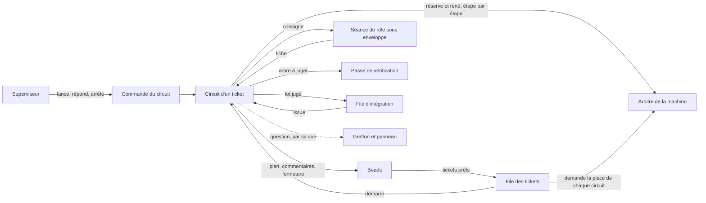
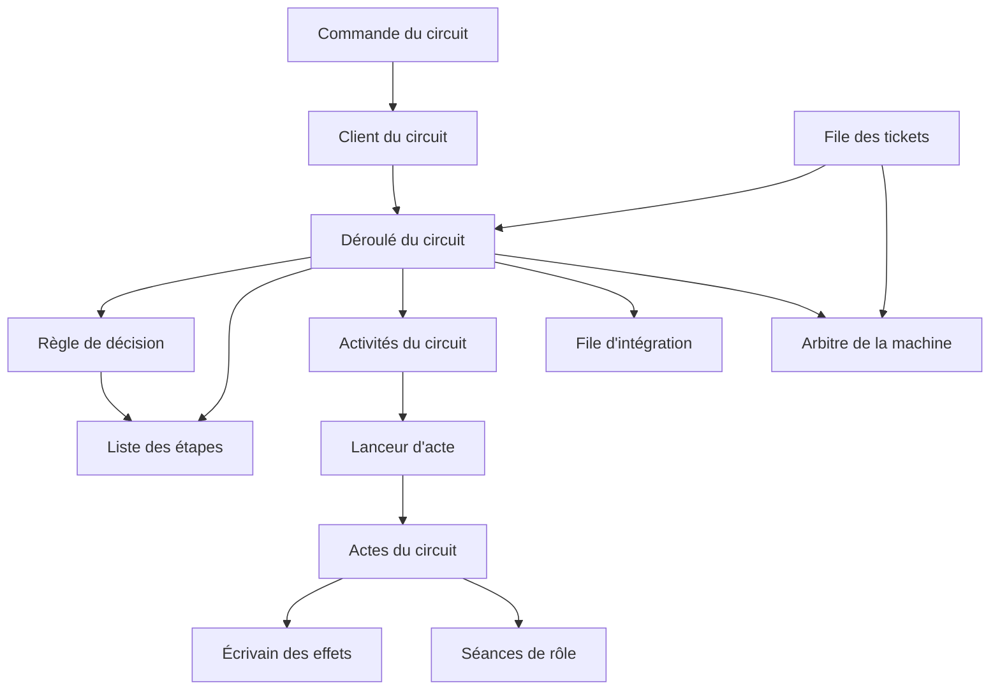
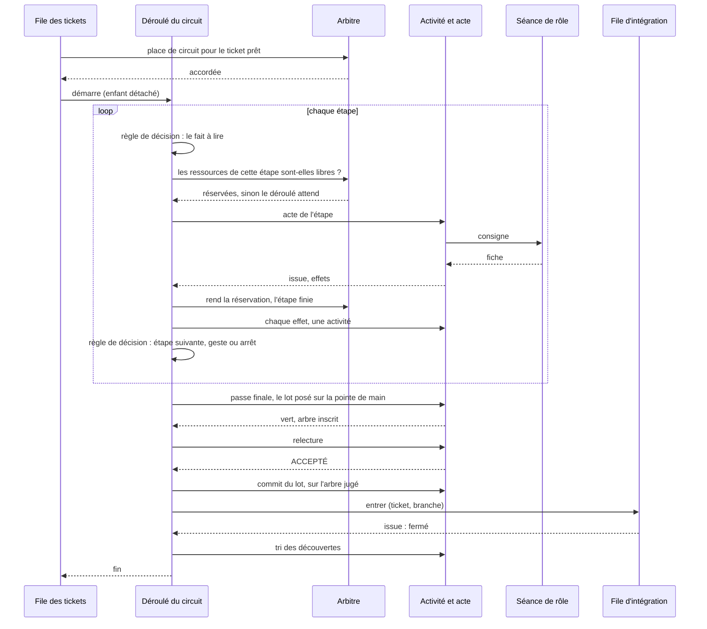

# Le circuit — architecture

Le circuit mène un ticket d'un projet de son départ à la branche main : il enchaîne des étapes, confie chacune à une séance de rôle neuve ou la joue lui-même, s'arrête sur une question quand aucune règle ne tranche, et remet à la file d'intégration le lot qu'il a jugé. Il existe en trois parcours, le circuit long, le circuit court et le circuit direct, que mène le même moteur : un déroulé sur le serveur Temporal. Ce document, à l'adresse `packages/grillhouse/docs/architecture/circuit.md`, décrit la construction cible du circuit et de la file des tickets, de l'infrastructure à la donnée ; il détaille le document de tête (`docs/ARCHITECTURE.md`, §2.1 à §2.3, §3.2, §4, §5), et sa section 9 dit, chantier par chantier, où le code ne l'a pas rejoint.

## 1. Contexte



Ce qui traverse les bords du circuit :

- **les commandes du superviseur** : le départ d'un ticket, la réponse à une question, l'arrêt ;
- **le ticket**, lu dans Beads au départ et à chaque séance, et ce que le circuit y écrit : le plan, ses lignes d'étape, la passation de chaque rôle, la fermeture ;
- **la consigne et la fiche** d'une séance de rôle : la consigne entre dans la séance, la fiche en sort, et le circuit décide sur elle ;
- **les demandes à l'arbitre de la machine** : la place de circuit de chaque ticket qui part, une seule, comptée à la fois dans la limite de son projet et dans le plafond de la machine, qui borne le total des places de tous les projets, que demande la file des tickets ; puis, au lancement de chaque étape, la réservation des ressources de cette étape, que demande le déroulé ;
- **le lot jugé**, une branche et son arbre git, remis à la file d'intégration, qui rend son issue ;
- **la vue du circuit**, que lisent le tableau, le greffon et la file des tickets.

L'arbitre, l'enveloppe et les droits des rôles, la passe de vérification, la file d'intégration et le greffon ont chacun leur document (document de tête, §10) ; celui-ci dit seulement ce que le circuit leur demande.

## 2. Stratégie

Les six choix portent un numéro fixe, qu'un ticket cite (§2.3) et qui ne se réattribue pas.

1. **Un seul moteur mène les trois circuits.** Un circuit est un parcours dans la liste unique des étapes (§5.1) : le circuit long la joue entière, le circuit court saute les tests et leur preuve, le circuit direct confie tests et code à un seul agent, sans plan. Tous trois partent par la file des tickets, comptent dans la limite du projet et sous le plafond de la machine, réservent leurs ressources de la même façon et répondent aux mêmes commandes : le circuit direct ne diffère que par l'agent qu'il appelle. Le même déroulé, les mêmes activités et le même état les mènent ; le parcours est une donnée de l'état (`circuit`). Seule une panne du moteur lui-même ouvre une voie hors de lui, la voie de secours (§5.8). Raison : un ticket s'arrête, se reprend, se juge et entre sur main de la même façon quel que soit son parcours, et un défaut du moteur se corrige une fois. Modèle : un pipeline de GitLab CI, dont les règles d'un job décident s'il joue, sur un seul exécuteur (non lu).
2. **L'état d'un ticket en cours vit dans son déroulé, et nulle part ailleurs.** Le déroulé tient l'étape, la mémoire, la question en attente et les compteurs dans son histoire ; il en publie une seule vue (§4.2), que les lecteurs lisent sans la recopier. Beads garde le ticket ; les fiches, le journal et le dossier de travail sont des traces, que rien ne relit pour décider. Raison : une reprise n'a qu'un endroit à croire (document de tête, §2.1). Modèle : l'exécution durable de Temporal ; un déroulé trop long continue dans une exécution neuve qui reçoit son dernier état en argument, sous le même identifiant (Continue-As-New, lu).
3. **La décision est une règle pure ; tout effet est une activité, sous sa clé.** La règle de décision reçoit l'état, la mémoire et les faits lus, et rend le fait suivant à lire ou la décision ; elle ne lit aucun fichier et ne lance aucun processus. Chaque acte (une séance, une passe, une lecture) est une activité, et chaque écriture hors du déroulé est une activité à elle, sous la clé de cette activité, la même à chaque essai. Raison : le déroulé se rejoue à l'identique sur son histoire, et un acte rejoué après la mort de son travailleur n'écrit rien deux fois. Modèle : un déroulé de Temporal décide sur les résultats de ses activités ; un changement de la règle qui toucherait un circuit en vol passe par un marqueur (`patched`), puis par son retrait en trois temps (`deprecatePatch`, lu).
4. **Un arrêt est une attente durable.** Un arrêt ne finit pas le déroulé : il écrit sa question dans l'état, puis attend la réponse. Un circuit qui attend le superviseur garde sa place de circuit, sa réponse arrivant vite. Un circuit qui attend un événement extérieur lointain (une question au responsable, une question reportée, la fin d'une autre tâche, d'un autre projet ou de la nuit) est mis à l'écart : il rend sa place de circuit et la reprend à l'événement, dans l'ordre d'arrivée, son rang gardé. La réponse est une mise à jour du déroulé, que son validateur refuse hors d'une attente ou quand la question a déjà sa réponse, avant toute écriture dans l'histoire. Seul le mot du superviseur (`--arreter`) finit un déroulé non intégré. Raison : une question ne dépend d'aucun processus vivant, deux réponses ne se croisent pas, et un circuit figé pour longtemps n'empêche aucun autre ticket de partir. Modèle : les Updates de Temporal, validées avant d'entrer dans l'histoire, et ses Signals, sans réponse (lu) ; une tâche manuelle bloquante de GitLab, qui arrête le pipeline à son étage jusqu'au geste d'un humain (lu) ; Jenkins, où une étape qui attend une saisie se met en pause avant d'entrer dans son agent, et où `agent none` évite d'attribuer un exécuteur sans besoin (lu). Qu'un travail en attente ne tienne pas de place d'exécuteur chez Kubernetes, Temporal ou GitLab : non lu.
5. **Le lot est jugé par la passe finale de son circuit, et ce jugement seul inscrit son arbre.** La passe finale pose le lot sur la pointe de main, le juge, et inscrit l'arbre vert au registre des arbres jugés ; le commit du lot porte cet arbre ; la file d'intégration le fait entrer sans le rejouer, et ne fait rejouer ce même jugement que si main a bougé. Seule exception : la vérification de la voie de secours inscrit l'arbre qu'elle a vérifié, et le dit au ticket (§5.8). Raison et modèle : document de tête, §2.2.
6. **Le circuit fait les gestes bornés, une vraie question monte.** Les étapes, leurs rôles, leurs boucles et leurs bornes, les gestes automatiques, les arrêts et le texte de chaque question tiennent dans une seule liste, que lisent le déroulé, la règle de décision, le tableau, le bilan et les textes. Un geste est borné ; à sa borne, il devient un arrêt. Raison : ce que le circuit fait seul se lit à un endroit, et se mesure (fréquence de chaque geste, questions montées). Modèle : une CI applique ses règles (rejouer, régénérer, sauter un job sans objet) sans appeler personne (non lu).

## 3. Composants



### 3.1 Les composants du circuit

| Composant | Responsabilité | Possède | Appelle |
|---|---|---|---|
| Commande du circuit (`grillhouse circuit` ; `src/temporal/circuit/commande.ts`, `appel.ts`) | lire l'appel du superviseur, refuser avant tout travail un ticket que le circuit ne peut pas mener, et transmettre | rien | le client du circuit, Beads |
| Client du circuit (`src/temporal/circuit/client.ts`) | démarrer un déroulé, lui envoyer une réponse ou un arrêt, lire la vue des circuits d'un projet | rien | le serveur Temporal |
| Contrat du circuit (`src/temporal/circuit/contrat.ts`) | nommer le type du déroulé, son identifiant, ses mises à jour, ses signaux, sa requête, et donner la forme de l'état, de la vue, de la question, de la réponse et des activités | rien | rien |
| Déroulé du circuit (`circuitDuTicket`, `src/temporal/circuit/deroule.ts`) | mener un ticket d'étape en étape, s'arrêter sur une question, reprendre sur sa réponse, réserver les ressources de chaque étape à son lancement et les rendre à sa fin | l'état du ticket en cours, sa vue | la règle de décision, les activités du circuit, la file d'intégration, l'arbitre |
| Liste des étapes (`scripts/etapes.mjs`) | déclarer les étapes, les circuits qui jouent chacune, les rôles, les boucles et leurs bornes, les gestes, les arrêts et leurs questions | rien : des données fixes | rien |
| Règle de décision (`scripts/transitions.mjs`) | décider, sans entrée ni sortie, du fait à lire ou de l'étape suivante, de l'arrêt ou de la fin | rien | la liste des étapes |
| Activités du circuit et lanceur d'acte (`src/temporal/circuit/activites.ts`, `src/temporal/acte.ts`) | jouer chaque acte dans un processus à lui, envoyer son signe de vie, lui donner la clé de son activité, tuer son groupe à l'annulation | rien | les actes du circuit |
| Actes du circuit (`scripts/faits-du-circuit.mjs` et le code qu'il joue) | faire ce qu'une étape demande hors du déroulé : ouvrir, écrire le plan, préparer la copie sur la pointe de main, lancer une séance et lire sa fiche, jouer la preuve du rouge, les contrôles et la passe finale, poser le commit, publier un arrêt | la copie et la branche du ticket, ses traces, le registre des arbres jugés | l'enveloppe, la passe de vérification, git, l'écrivain des effets |
| Écrivain des effets (`scripts/effets.mjs`) | écrire une fois chaque effet qu'un acte rend : un commentaire, une ligne de fiche, une découverte, le plan, des étiquettes, le bilan | rien | Beads, les fichiers de traces |
| File des tickets (`ticketsDuProjet`, `src/temporal/tickets/`) | démarrer le circuit de chaque ticket prêt, après avoir demandé sa place à l'arbitre ; arrêter le circuit d'un ticket fermé hors de lui | rien : la liste des circuits qu'elle a démarrés se refait du serveur | Beads (lecture), l'arbitre, le déroulé du circuit |
| Commande de secours (`grillhouse direct`, `scripts/direct.mjs`) | mener un ticket hors du moteur quand le moteur lui-même est en panne : un agent, puis un relecteur, dans le processus de la commande | rien : son état se lit aux fiches de la copie | l'enveloppe, les séances de rôle, Beads |

Tous sont du paquet `grillhouse`, en TypeScript ; les adresses sous `scripts/` sont celles d'avant la migration (§9, chantier 6).

### 3.2 Les voisins, et ce que le circuit leur demande

| Voisin | Ce que le circuit lui demande | Son document |
|---|---|---|
| Arbitre de la machine | la place de circuit de chaque ticket, une seule, comptée à la fois dans la limite de son projet et dans le plafond de la machine, qui borne le total des places de tous les projets : demandée par la file des tickets, gardée ou rendue d'un seul geste (§5.4) ; au lancement de chaque étape, la réservation des ressources de cette étape pour ce projet, attendue si elles ne sont pas libres, rendue à la fin de l'étape | La machine et l'enveloppe |
| Enveloppe et droits | lancer la séance d'un rôle sous ses droits, avec en écriture les seuls paquets du plan | La machine et l'enveloppe |
| Passe de vérification | juger un arbre : les contrôles ciblés d'une étape, puis la passe finale | Les tests et les langages |
| File d'intégration | faire entrer sur main la branche d'un lot jugé, et rendre son issue | L'entrée sur main, la CI et la nuit |
| Greffon et panneau | lire la vue du circuit ; pousser la question au superviseur | Le greffon et le panneau |
| Beads | tenir le ticket | tiers |

### 3.3 Les rôles et leurs droits

Chaque rôle est une séance neuve de Claude Code, lancée par un acte, qui finit sur sa fiche (§4.4). Le tableau dit ce que chaque rôle écrit ; le détail des droits et des montages vit dans le document de la machine et de l'enveloppe.

| Rôle | Étapes | Écrit dans la copie | Écrit au ticket | Sous enveloppe |
|---|---|---|---|---|
| explorateur | 1 Plan, 1.1 Geste mécanique, 5.3 Tri des découvertes | rien à la main ; à 1.1, ce que la commande du plan change | non : le circuit écrit depuis sa fiche | à 1.1 seulement |
| questionneur | 1 Plan | rien | non | non |
| testwriter | 2 Tests | les fichiers de test et la matière de test des paquets du plan | sa passation | oui |
| développeur | 3 Code | le code des paquets du plan | sa passation | oui |
| direct | 3 Code, dans le circuit direct | les tests et le code des paquets du plan | sa passation | oui |
| relecteur | 4.3 Relecture | rien | non : le circuit écrit son verdict | non |
| le circuit lui-même | 2.1, 3.1, 4.1, 4.2, 5.1, 5.2 | les références régénérées, le commit | ses lignes d'étape, sous l'auteur `circuit` | sans séance |

### 3.4 La garde de chaque frontière

- **Le déroulé et la règle de décision** : le déroulé n'importe que l'interface de Temporal, les contrats, la liste des étapes et la règle ; un test lit les sources de la règle et y refuse toute entrée ou sortie.
- **Un agent et le dépôt** : l'enveloppe n'ouvre en écriture que les paquets du plan ; une écriture hors du plan arrête la séance, et le circuit s'arrête sur `hors-plan` ou étend le plan par un geste (§5.5).
- **Un lot et main** : le crochet de poussée refuse un commit dont l'arbre n'est pas au registre des arbres jugés, que seuls écrivent l'acte de jugement (§2.5) et, par exception, la vérification de la voie de secours (§5.8).
- **La liste unique** : aucune garde ne refuse aujourd'hui une borne ou un geste déclaré hors de la liste des étapes ; la relecture le tient.
- **Un état, un propriétaire** : aucune garde ; le tableau de la section 4 fait foi à la relecture.

## 4. Données

### 4.1 Les états et leur propriétaire

| Donnée | Forme et adresse | Écrite par | Lue par | Durée de vie |
|---|---|---|---|---|
| L'état du ticket en cours | `EtatDuTicket` (§4.2) ; les variables du déroulé `circuit:<racine>:<ticket>`, dans son histoire | le déroulé du circuit | la règle de décision, les activités (en argument) | le déroulé, puis la rétention du serveur |
| La vue du circuit | `VueDuCircuit` (§4.2) ; le mémo du déroulé, et deux attributs de recherche, `GrillhouseTicket` et `GrillhouseEtape`, qui servent à filtrer | le déroulé du circuit | le tableau, le greffon, la file des tickets, la commande | comme l'état |
| Le ticket | titre (ses paquets après le dernier « — »), description (critères, section « Régi par », sorte, questions ouvertes), une étiquette, `circuit` ou `direct`, qui met le ticket dans la file des tickets et dit son parcours, commentaires ; `.beads/` | Beads, par les effets du circuit et les commandes | les actes, la file des tickets | le projet |
| La place de circuit et les réservations | chez l'arbitre : une place par circuit, une seule, comptée à la fois dans la limite de son projet et dans le plafond de la machine, qui borne le total des places de tous les projets ; une réservation par étape lancée (une séance, une passe), ses cœurs et sa mémoire tirés de la table des consommations pour ce projet et cette étape, pris sur le budget de la machine | l'arbitre de la machine | le déroulé, la file des tickets | la place : tant que le circuit la garde (§5.4) ; la réservation : une étape |
| La copie et la branche du ticket | `.claude/worktrees/<ticket>`, branche `agent/<ticket>` | les actes du circuit ; le lot y est écrit par les séances, sous enveloppe | les passes, le relecteur, la file d'intégration | le ticket |
| Les arbres jugés | la liste des identifiants d'arbre git ; `<dossier commun de git>/grillhouse/arbres-juges.json` | l'acte de jugement (la passe finale) ; par exception, la vérification de la voie de secours | le crochet de poussée, la file d'intégration | le dépôt |
| Les traces du ticket | `<ticket>.fiches.jsonl` (une ligne `{ date, role, fiche }` par fiche, rapport, arrêt, lancement), `<ticket>.log`, `<ticket>.travail/seances/<id>/` (`resultat.json`, `fin`), à côté de la copie | l'écrivain des effets, les actes | le bilan, le superviseur ; jamais la décision | le ticket, puis le bilan |

Un fichier que ce tableau ne nomme pas est une trace ou un cache. La sorte écrite dans la description du ticket et la ligne du journal des états sont des traces : le circuit ne les relit pas.

**Le journal des états** garde la chronologie des circuits, de la file d'intégration et de l'arbitre d'un projet, comme le journal d'un ordonnanceur : une ligne datée par changement d'état, jamais un relevé périodique. Une ligne est `{ ts, genre, ticket, etape, boucle, place, raison }` : `ts` en ISO 8601 avec le décalage local ; `genre` vaut `circuit`, `file` ou `places` ; `raison` est vide pour une transition normale, le nom de l'arrêt pour un arrêt, la cause du retour pour une boucle, la raison de l'attente pour une attente. Le circuit en écrit une à chaque changement de son état, la file au lancement et à la fin d'un circuit, l'arbitre à chaque place prise, rendue ou mise en attente, au début et à la fin de l'attente d'une réservation, et à chaque changement de cran (document de la machine, §5.1, §5.2). Le journal tient un segment par date locale, `<dossier commun de git>/grillhouse-journal/<AAAA-MM-JJ>.jsonl`, non versionné, un par projet, que ses copies partagent ; une écriture ajoute une ligne entière d'un seul ajout (`O_APPEND`), tronquée pour tenir sous 4 096 octets, sans verrou ni attente, et une écriture qui échoue ne retarde ni n'arrête rien, et se dit une fois sur la sortie d'erreur. Ses bornes sont quatorze jours et 50 Mo : le retrait des copies finies (§6) retire les segments plus vieux que quatorze jours, puis, au-delà de 50 Mo, les plus anciens d'abord, sans réécrire un segment ni retirer le plus récent. `npx grillhouse journal [--depuis <instant>] [--jusqu-a <instant>] [--ticket <id>]` rend les lignes de tous les segments dans l'ordre de leur horodatage et, après chaque lancement ou fin de circuit, les tickets en travail contre la limite du projet (« en travail 1/2 : d-1 ») ; un ticket est en travail de sa ligne de lancement à sa ligne de fin. Rien ne relit le journal pour décider.

**Le bilan d'un ticket** sépare les attentes, comme le délai de livraison de DORA sépare l'attente de la revue du temps de travail (non lu) : il répartit l'attente entre celle du superviseur, celle du responsable et la nuit, la plage que déclare `grillhouse.plageDeNuit` (23 h à 8 h par défaut). Chaque question nomme la séance du superviseur qui a lancé ou répondu en dernier (`superviseur` de l'état) ; une attente est celle du responsable quand une personne écrit dans cette séance pendant l'attente, et le bilan ne lit aucun commentaire du ticket. Une séance qui ne change aucun fichier du plan est une relance sans effet ; un arrêt seul ne la rend jamais sans effet. Le bilan donne le temps de bout en bout, ce temps hors des nuits d'attente, et le temps perdu hors des attentes ; le coût d'une séance se recalcule sur ses jetons, au tarif de son modèle, quand sa transcription n'en donne pas le total.

### 4.2 L'état et la vue

```ts
interface EtatDuTicket {
  circuit: 'long' | 'court' | 'direct';
  sorte: { genre: 'comportement'; comportement: 'changé' | 'tests-adaptés' | 'inchangé'; raison: string }
       | { genre: 'mécanique'; commande: string; raison: string } 
       | { genre: 'correction triviale'; raison: string } | null;
  etape: { numero: string; tentative: number; rapport: string | null };
  paquets: string[];                    // le plan : les paquets ouverts en écriture
  boucles: Record<string, number>;      // le compte de chaque boucle bornée, par sa clé
  memoire: Memoire;                     // ce que la règle garde d'une étape à l'autre, une seule liste de champs
  question: Question | null;
  rang: number;                         // le rang d'arrivée du circuit chez l'arbitre
  seance: { role: string; id: string } | null;   // la séance qu'une relance reprend
  superviseur: string | null;           // la séance du superviseur qui a lancé ou répondu en dernier
}
interface Question {
  numero: number;                       // son rang dans le déroulé : distingue une question neuve
  arret: string; fait: string; piece: string; question: string;
  qui: 'superviseur' | 'responsable';
  reportee: string | null;              // l'heure jusqu'à laquelle elle se tait
}
interface VueDuCircuit {
  ticket: string; circuit: EtatDuTicket['circuit'];
  etape: string;                        // un numéro de la liste des étapes
  situation: 'en cours' | 'attend ses ressources' | 'attend une place' | 'question' | 'attend une autre tâche' | 'à repasser' | 'reporté' | 'intégré' | 'arrêté';
  tentative: number; boucles: Record<string, number>;
  rapport: string | null;               // la première ligne du rapport
  question: Question | null;
}
```

La vue est une réduction de l'état, écrite par le déroulé à chaque changement d'étape ou de situation ; un lecteur n'a pas d'autre source. La requête `etatDuCircuit` rend l'état entier quand un travailleur vit ; la vue se lit sur le serveur seul, par des listes que le serveur filtre : une, ou deux quand un déroulé non intégré est fini.

### 4.3 Ce qui traverse le déroulé

| Message | Forme | De | Vers |
|---|---|---|---|
| Entrée du déroulé | `{ racine, ticket, circuit, superviseur, reprise?, etatDArret?, suite? }` ; `suite` porte l'état d'une exécution à la suivante | la file des tickets, le client | le déroulé |
| Réponse (mises à jour `reprendre`, `depuis`, `etendre`, `mecanique`, `planifier`) | `{ genre, contexte?, role?, paquets?, commande?, superviseur? }` ; rend une ligne, ou le refus du validateur (`RefusDuValidateur`) | le client | le déroulé |
| Arrêt (signal `arreter`) | `contexte` | le client, la file des tickets | le déroulé |
| Report et portage (signaux `reporter`, `chezLeResponsable`) | l'heure ; rien | le client | le déroulé |
| Acte (activité) | `{ racine, ticket, etat, paquets, superviseur }` et les paramètres de l'acte ; rend son issue et ses effets `{ genre, … }[]` | le déroulé | une activité |
| Effet (activité `jouerUnEffet`) | `{ genre, … }`, le genre étant `commentaire`, `fiche`, `decouverte`, `registre`, `plan`, `bilan`, `etiquettes` ou `reouverture`, sous la clé `<déroulé>:<exécution>:<activité>` | le déroulé | l'écrivain des effets |
| Entrée dans la file d'intégration (signal `entrer`) | `{ ticket, branche, deroule }` | le déroulé | la file d'intégration |
| Issue de la file (signal `issueDeLaFile`) | `{ etat, raison, conflit? }`, l'état étant `ferme`, `en-file`, `rouvert` ou `echec` | la file d'intégration | le déroulé |
| Réservation d'une étape | `{ tache, racine, ticket, etape, rang }`, la tâche étant `seance` ou `passe` : demandée au lancement de l'étape, accordée quand les ressources que la table des consommations donne à ce projet et à cette étape sont libres, rendue à sa fin ; la forme de l'échange vit au document de la machine | le déroulé | l'arbitre |

### 4.4 La fiche d'un rôle

Une séance finit sur sa fiche, la sortie structurée de son rôle, validée contre son schéma ; le circuit décide sur elle et sur rien d'autre de la séance. Chaque pièce de fichier d'une fiche est vérifiée dans la copie.

| Rôle | Ce que porte sa fiche |
|---|---|
| explorateur, au plan | les critères ajoutés, les paquets, les composants écartés et leur raison, la sorte (un comportement, un geste mécanique, ou une correction triviale, avec sa raison et sa pièce), les noms publiés, les questions ouvertes avec leur motif et leur pièce ; puis sa réponse à chaque question du questionneur (`CHANGE` ou `GARDE`) |
| questionneur | `issue` : `QUESTIONS`, `AUCUNE` ou `DÉSACCORD` |
| testwriter, développeur, direct, explorateur à 1.1 | `statut` : `FAIT`, `BLOQUÉ` (sa raison) ou `BESOIN` (sa question), avec sa pièce ; le motif `aucun-comportement` du testwriter ; le motif `demande-un-plan` de l'agent direct ; la réponse à chaque constat ouvert ; les découvertes |
| relecteur | `verdict` : `ACCEPTÉ` ou `RENDU` ; une ligne de conformité par élément du lot, qui cite le paragraphe qui le régit ; les constats, bloquants ou remarques, chacun adressé à un rôle ; le suivi des constats ouverts ; le motif `comportement-change` |
| explorateur, au tri | un verdict par découverte : `traitee`, `doublon`, `sans-suite`, `a-porter`, `non-confirmee` |

**La pièce** d'une fiche a un seul format : `fichier:ligne` ou `fichier:ligne-ligne` depuis la racine de la copie ; `$ commande` suivie de sa sortie ; pour ce que dit le ticket, `ticket, critère N` ou `ticket, § <section>`. Le circuit cherche chaque pièce de fichier dans la copie, sa ligne comprise, et chaque pièce du ticket dans sa description ; une pièce introuvable refuse la fiche. L'agent qui reprend un fait relit sa pièce avant de s'appuyer dessus.

**Ce que le circuit refuse d'une fiche**, redemandée une fois à la même séance :

- au plan : une question sans motif, un composant du relevé ni gardé ni écarté, un composant du titre écarté sans raison, un composant qu'un fichier du ticket nomme et que le plan écarte ; une sorte absente, hors de ses valeurs ou sans raison, ou un geste mécanique sans commande, vaut « comportement » : le doute va au circuit long ;
- chez le développeur ou l'agent direct : une fiche `FAIT` à laquelle manque la réponse à un constat ouvert ; une fiche `FAIT` qui nomme un critère non tenu faute d'un paquet hors du plan (`hors_plan` : le critère, le paquet, la pièce) arrête le circuit à 3 Code sur `hors-portee` ;
- chez le relecteur : une fiche sans ligne de suivi pour un constat ouvert, une ligne de conformité sans document ni référence, un élément hors de la liste du lot, ou un `ACCEPTÉ` qui garde un constat non levé.

Un plan passé ne se rejoue que si le titre ou les critères du ticket changent. Les noms publiés se réécrivent dans la description à chaque plan : une liste vide les efface, une fiche sans le champ garde ceux que la description porte. La liste des éléments du lot, que le relecteur juge un par un, vient du service de langage et de la différence du rapport d'API ; la consigne du relecteur porte aussi une ligne par flux de la CI que le lot touche (`grillhouse.flux`). Les constats ouverts au lancement d'une séance lui sont donnés en contexte, sans réponse exigée ; ceux qu'un `RENDU` de la passe pose lui sont donnés en tâche, réponse exigée. Toute relecture, bornée ou entière, reçoit les constats ouverts.

## 5. Déroulé

### 5.1 Les étapes et les trois circuits

| Étape | Qui | Long | Court, geste d'une commande | Court, geste écrit à la main | Direct |
|---|---|---|---|---|---|
| 1 Plan | explorateur, puis questionneur | oui | oui | oui | — |
| 1.1 Geste mécanique | explorateur | — | oui | — | — |
| 2 Tests | testwriter | oui | — | — | — |
| 2.1 Preuve du rouge | le circuit | oui | — | — | — |
| 3 Code | développeur ; l'agent direct dans le circuit direct | oui | — | oui | oui, tests et code |
| 3.1 Contrôles | le circuit | oui | oui | oui | — |
| 4.1 Passe finale | le circuit | oui | oui | oui | oui |
| 4.2 Régénération des références | le circuit | au besoin | au besoin | au besoin | au besoin |
| 4.3 Relecture | relecteur | oui | oui | oui | oui |
| 5.1 Commit | le circuit | oui | oui | oui | oui |
| 5.2 File d'intégration | le circuit | oui | oui | oui | oui |
| 5.3 Tri des découvertes | explorateur | oui | oui | oui | oui |

Le circuit d'un ticket se lit à son départ, puis se confirme au plan. L'étiquette `direct` du ticket fait un circuit direct : il n'a pas de plan, le ticket suffit, et ses paquets sont ceux de son titre. Tout autre ticket ouvre sur le plan, où l'explorateur écrit la sorte : un comportement qui change fait un circuit long ; un geste sans comportement neuf fait un circuit court, par 1.1 quand une commande le joue, par le développeur seul quand il s'écrit à la main ; une correction triviale part au circuit direct (§5.6). Un plan « comportement tests-adaptés » garde le circuit long : le testwriter adapte ses tests, la preuve accepte chaque vert, le développeur écrit.

Le circuit direct et le circuit court sont les deux circuits brefs ; ce tableau dit ce qui les distingue et ce qu'ils partagent.

| | Circuit court | Circuit direct |
|---|---|---|
| Ce qu'il sert | un geste sans comportement neuf : aucun test honnête ne peut rougir avant le lot | une correction ou un petit travail que le ticket décrit en entier, comportement compris |
| Le plan | écrit par l'explorateur, lu une fois par le questionneur | aucun : le ticket suffit, ses paquets sont ceux de son titre |
| Les tests | aucun test neuf : la suite existante fait la preuve | écrits par l'agent direct, avec le code ; un défaut corrigé porte le test qui le reproduit, que le relecteur exige |
| Qui écrit le lot | une commande que joue l'explorateur (1.1), ou le développeur | un seul agent, l'agent direct, tests et code ensemble |
| Les contrôles (3.1) | oui | non : la passe finale est sa vérification |
| La passe finale, qui juge et inscrit l'arbre | oui | oui |
| La relecture | oui | oui ; le relecteur tient lui-même la preuve du rouge |
| L'entrée sur main | par la file d'intégration | par la file d'intégration |
| Le tri des découvertes | oui | oui |
| Le départ, la limite du projet, le plafond, les réservations, les arrêts et les réponses | ceux de tout circuit | ceux de tout circuit |

Le circuit direct remplace deux pratiques : le superviseur qui traite un point seul, et le superviseur qui appelle un agent à sa main. Tout travail de cette taille est un ticket étiqueté `direct`, mené et tracé comme tout circuit : son état dans son déroulé, ses fiches, son bilan. Naissent directs, dès leur création : une correction triviale repérée en analyse, un ticket de données, le squelette d'un paquet, et une correction du circuit lui-même qui ne peut pas passer par le circuit long ou court parce qu'il est en défaut.

Trois boucles sont bornées à trois passages, chacune comptée dans l'état : les séances du testwriter après une preuve refusée, les séances de l'auteur du code avec leurs contrôles, les relectures. Le troisième `RENDU` arrête toujours le circuit, dans les trois circuits.

**Le tri des découvertes** (5.3) ne lance aucune séance quand les fiches du ticket n'ont consigné aucune découverte. Sinon l'explorateur, hors de l'enveloppe, dans l'arbre principal, aux droits de la lecture, rend une ligne par découverte, ni plus ni moins ; la pièce d'un `traitee` ou d'un `a-porter` est une commande rejouée sur main et sa sortie, ou `fichier:ligne`. Le circuit écrit chaque verdict au ticket de sa découverte avec son étiquette, et rouvre sous `a-valider` un `a-porter` ou un `non-confirmee`, pour le responsable. Un tri sans fiche conforme laisse les découvertes telles quelles et le dit au ticket ; il ne défait pas l'intégration.

### 5.2 Un ticket, de son départ à main



**La réservation se prend à chaque lancement d'étape, non pour le ticket.** Au lancement d'une étape, une séance d'agent ou une passe, le déroulé demande à l'arbitre si les ressources de ce projet et de cette étape, d'après la table des consommations, sont libres : si oui il les réserve et lance l'étape, sinon il attend, la vue disant « attend ses ressources » ; il les rend à la fin de l'étape. Entre deux étapes, et pendant un arrêt, un circuit ne tient aucune ressource.

Deux mécanismes jouent donc à la fois. Les bornes en nombre de circuits restent : chaque circuit a une place, une seule, comptée à la fois dans la limite de son projet et dans le plafond de la machine, qui borne le total des places de tous les projets ; la limite du projet est `grillhouse.circuits`, et l'arbitre accorde la place quand les deux bornes le permettent. Les ressources, cœurs et mémoire, se réservent à chaque lancement d'étape contre le budget de la machine : le matériel, dont des bornes globales identifiées sont retirées et ne sont jamais réservables, comme la réserve de l'utilisateur (par exemple deux cœurs laissés libres).

Le circuit direct joue la même séquence depuis l'étape 3 : la file des tickets le démarre comme les autres, l'agent direct écrit tests et code, puis la passe finale juge le lot avant que le relecteur le lise, et le lot accepté entre sur main par la file d'intégration.

### 5.3 Le jugement d'un lot

1. Avant chaque passe qui juge le lot, 3.1 Contrôles et 4.1 Passe finale, une reprise comprise, l'acte avance la copie sur la pointe de main ; une copie déjà sur la pointe, ou en avance sur elle, n'avance pas, et une copie qui avance rejoue la passe due sur son arbre neuf. À 4.1, l'acte de la passe finale joue la passe de vérification sur cet arbre, et, verte, inscrit l'arbre au registre des arbres jugés. La copie du ticket est la seule où le lot se pose avant son entrée.
2. À 4.2, une référence que le lot fait bouger se régénère ; l'arbre change, et la passe finale rejuge ce que la régénération change.
3. À 4.3, le relecteur lit le lot jugé. Un `RENDU` renvoie le lot à son auteur ; le lot corrigé repasse par ses contrôles et par 4.1, qui inscrit le nouvel arbre. Le circuit garde chaque lot avec sa base ; après une avance, le lot relu se rejoue sur la pointe neuve (`git merge-tree`), et la relecture qui suit est bornée à ce que le lot a changé depuis, jamais aux commits de main. Un lot accepté que l'avance laisse tel quel reste accepté, comme Gerrit garde les votes d'un rebasage trivial (non lu) ; un rejeu en conflit avec main, ou un fichier engendré que l'avance réécrit, rend la relecture entière.
4. À 5.1, le commit du lot porte l'arbre que la passe finale a jugé ; un arbre qui a changé depuis repart à 4.1.
5. À 5.2, la file d'intégration lit le registre : main n'a pas bougé, l'arbre est jugé, main avance sur lui. Main a bougé : la file repose la branche sur la pointe et appelle le même acte de jugement, qui inscrit l'arbre reposé ; rouge, elle rend l'issue `rouvert`, et le circuit s'arrête sur `integration`.

Une vérification lancée à la main rend son verdict et n'inscrit rien (document de tête, §2.2) ; seule la vérification de la voie de secours fait exception (§5.8).

### 5.4 Un arrêt et sa réponse

```mermaid
sequenceDiagram
  participant D as Déroulé du circuit
  participant A as Arbitre
  participant G as Greffon
  participant U as Superviseur
  participant C as Commande du circuit
  D->>D: la règle rend un arrêt ; la question entre dans l'état
  D->>D: garde sa place de circuit, ne tient aucune réservation
  D->>D: publie la vue : situation « question »
  G->>D: lit la vue
  G->>U: pousse la question
  U->>C: réponse
  C->>D: mise à jour (validée : une question attend, sans réponse encore)
  D-->>C: « repris », ou le refus
  D->>D: reprend à l'étape que la réponse désigne
```

**Ce qui garde sa place, ce qui la rend.** Un circuit a une seule place, comptée dans la limite de son projet et dans le plafond de la machine : il la garde des deux côtés, ou la rend des deux côtés. La gardent : un circuit qui travaille, qui attend les ressources d'une étape, qui rejoue une étape « à repasser », qui attend une réponse du superviseur ou de l'architecte que le superviseur charge, et un circuit reporté à l'heure de la limite d'usage ; sans cela, la première limite d'usage atteinte laisserait partir un ticket de plus à chaque report, et les tickets ouverts s'accumuleraient. La rend un circuit mis à l'écart, parce qu'il attend un événement extérieur lointain : une question au responsable, une question reportée, la fin d'une autre tâche, d'un autre projet ou de la nuit. Dans les deux cas le circuit ne tient aucune réservation, son étape étant finie, et sa copie reste. À l'événement, un circuit à l'écart redemande sa place et la reçoit dans l'ordre d'arrivée, à son rang d'origine, donc avant un ticket arrivé après lui ; la vue dit « attend une place » jusque-là. Le nombre de questions ouvertes à la fois n'a pas de borne propre.

Un arrêt porte un nom, un fait, sa pièce, sa question et qui doit y répondre. Les arrêts, par ce qui les lève :

| Arrêt | Ce qui l'a levé |
|---|---|
| `questionnement` | des questions du plan restent ouvertes après la réponse de l'explorateur |
| `besoin`, `hors-portee` | la fiche d'un agent demande une réponse, ou se dit bloquée hors de sa portée ; l'agent direct juge que son ticket demande un plan (motif `demande-un-plan`) |
| `hors-plan` | une séance écrit hors des paquets du plan, sans geste qui l'étende |
| `sans-fiche`, `bloqué` | une séance finit deux fois sans fiche conforme ; une séance immobile que le circuit a arrêtée |
| `preuve` | la troisième preuve du rouge refuse le lot de tests |
| `controles`, `sans-livraison` | un rouge que le circuit ne rend à personne, ou que trois séances n'ont pas levé ; un auteur qui ne change rien quand le rouge reste |
| `references` | la régénération échoue, ou change un fichier qu'aucune référence n'écrit |
| `relecture-arret` | un constat sans destinataire valide, un lot mécanique rendu, la troisième relecture rendue |
| `integration`, `lot-absent`, `copie-gardee` | la file d'intégration refuse le lot ou rouvre le ticket ; une reprise qui ne trouve pas le lot, ou ne retire pas la copie |
| `lancement` | la séance ne se lance pas, ou la copie n'avance pas sur la pointe de main |
| `a-repasser` | une étape à repasser, rejouée autant de fois que sa borne le permet |
| `limite-d-usage` | la limite d'usage arrête une séance, quand le superviseur a interrompu le report |
| `inattendu` | un acte échoue : l'arrêt nomme l'étape où il est tombé |

Une lecture de la copie qui échoue après la séance du testwriter ou du développeur n'est pas `inattendu` : c'est un rouge rendu à l'agent avec la sortie de l'outil, qui compte dans sa boucle. Toute autre lecture qui échoue est `inattendu`, dont la question porte le message, la pile, l'étape et la commande de reprise, y compris avant la première séance.

Les réponses, les mêmes pour les trois circuits, et les mêmes dans la commande, le texte de chaque question, le panneau et la compétence du superviseur :

| Réponse | Porteur | Effet |
|---|---|---|
| `--reprendre [--contexte]` | mise à jour `reprendre` | l'étape de l'arrêt reprend |
| `--depuis <étape> --contexte` | mise à jour `depuis` | l'étape nommée (`testwriter`, `preuve`, `developpeur`, `direct`, `controles`, `passe-finale`) et les suivantes rejouent, les compteurs remis à zéro |
| `--etendre <paquet>` | mise à jour `etendre` | le plan gagne le paquet, l'étape reprend |
| `--mecanique [<commande>] --contexte` | mise à jour `mecanique` | bascule en circuit court (§5.6) |
| `--planifier --contexte` | mise à jour `planifier` | bascule d'un circuit direct vers le plan (§5.6) |
| `--reporter <heure>` | signal `reporter` | la question se tait jusqu'à l'heure ; le circuit reste en attente |
| `--chez-le-responsable` | signal `chezLeResponsable` | la question passe au responsable (`qui`), et se tait jusqu'à sa réponse |
| `--arreter [--contexte]` | signal `arreter` | le circuit s'arrête où qu'il soit, sa séance tuée ; le déroulé finit et rend son état |
| `--recommencer` | la commande, sur un circuit arrêté | la copie, la branche et les traces sont retirées ; le ticket, son plan gardé, repart dans une copie fraîche |

Une réponse à un circuit que `--arreter` a fini démarre un déroulé neuf sous le même identifiant, qui s'ouvre sur l'état que le déroulé arrêté a rendu. Au-delà de la rétention du serveur, seul `--depuis` rouvre le circuit, sans état.

La commande refuse avant tout déroulé, par le nom de la faute et le code 2 : `--reprendre` sur un état absent ou un lot intégré ; `--etendre` sur un lot intégré ou un déroulé fini sans son issue ; `--arreter` sur un lot intégré ; une réponse qu'une autre a devancée ; jamais `--depuis`. Au départ, elle refuse un ticket illisible, sans section « Régi par », dont le titre ne nomme aucun composant, ou qui nomme un composant absent du disque.

### 5.5 Les gestes du circuit

Un geste est ce que le circuit fait seul sur un cas qu'une règle tranche ; chacun est écrit au ticket, avec sa règle, et compté.

| Geste | Règle | Borne |
|---|---|---|
| à repasser | une passe rend « à repasser » : l'étape rejoue après dix minutes | six rejeux de suite, puis l'arrêt `a-repasser` |
| attente de la machine | les ressources d'une étape, ou la place de circuit, ne sont pas libres : le déroulé attend son tour | sans borne : l'arbitre dit la cause de l'attente |
| report à la limite d'usage | la limite d'usage arrête une séance : le circuit attend l'heure de retour, puis reprend l'étape | l'heure lue |
| séance sans fiche | une séance sans fiche conforme est reprise | une fois, puis `sans-fiche` |
| renvoi au testwriter | une preuve refusée, ou un rouge qui nomme un fichier de test du lot, va au testwriter | la boucle des tests |
| renvoi à l'auteur du code | un rouge des contrôles au code va au développeur, ou à l'agent direct | la boucle du code |
| renvoi après `RENDU` | un constat bloquant va au rôle qu'il nomme | la boucle des relectures |
| rien à livrer | un auteur qui ne change rien quand les contrôles sont verts passe aux contrôles | l'arrêt `sans-livraison` quand un rouge reste |
| régénération | un rouge qui est celui d'une référence déclarée ou engendrée va à 4.2 | une fois par arbre |
| rejeu des engendrés | avant la preuve du rouge, les contrôles et la passe finale, la commande de chaque fichier engendré (`grillhouse.engendres`) dont un motif `lit` couvre un fichier que le lot change se joue dans la copie, comme 4.2 : ses fichiers entrent au lot (Bazel, Nx, Turborepo : une sortie se construit avant les tests qui la lisent) | à chaque passe ; une commande qui échoue arrête à `references` |
| conflit de l'avance | l'avance de la copie sur main laisse des fichiers en conflit : ils vont au rôle qui les écrit | une séance par rôle, puis `lancement` |
| extension du plan | une écriture dans un fichier que le ticket nomme, un composant écarté qui rougit, les tests d'un paquet lecteur que le lot fait rougir : le plan s'étend, la pièce écrite au ticket | les paquets que le ticket ou le relevé du plan nomment |
| arrêt d'un ticket fermé hors de son circuit | la file des tickets arrête le circuit d'un ticket que Beads dit fermé | une fois |

Ces gestes restent ; un geste dont le rendement mesuré est mauvais s'étudie avant d'être retiré ou corrigé (document de tête, §8).

**À qui va un rouge.** Un rouge va à qui écrit le fichier qu'il nomme, comme Gerrit rend un échec à l'auteur du fichier (non lu) :

- un fichier de code, ou un test qui échoue, va au développeur, à l'agent direct dans le circuit direct ;
- un fichier de test du lot que refuse une garde ou le style, ou que nomme le message d'un test hors du lot qui échoue, va au testwriter, l'étape la plus tôt, le développeur rejouant après ; le message d'un test du lot n'est pas lu, et son rouge reste au développeur ;
- le rouge d'une tâche d'un paquet du plan sans fichier nommé (lint, mise en forme, typage, construction) va au développeur, comme un job rouge revient à son auteur ;
- tout autre rouge sans fichier, ou un fichier qu'aucun rôle ne porte, monte au superviseur, jamais deviné.

Un rouge de passe finale dû à un seul fichier de test rejoue ce fichier, par une séance du testwriter bornée à lui et sa seule preuve, puis les contrôles et la passe finale restreints à sa portée. L'arrêt `sans-livraison` ne vaut que pour un rouge du développeur. Le testwriter qu'un renvoi relance reçoit la sortie rouge des derniers contrôles, gardée dans l'état pour une reprise ; la même sortie deux fois de suite arrête le circuit.

**La régénération.** Des contrôles où rougit une référence, mêlée ou non à d'autres rouges, la régénèrent avant qu'aucun rouge n'aille au développeur, puis rejouent sur l'arbre régénéré ; à la passe finale, la passe rejoue restreinte à ce que la régénération change. Les références sont celles que le projet déclare (`grillhouse.references`) et celles du cadre dans chaque projet : l'index des interfaces, les `turbo.json` des paquets, les rapports d'API, la dette des gardes et, pour le module typescript, le verrou npm (document des tests et des langages, §3.4). Elles se régénèrent sans que le plan les nomme, dans l'ordre que déclare ce que chacune lit d'une autre (`lit`), comme make, et le relecteur lit leur différence. La régénération ne réécrit que ses sorties, comme `--update-snapshots` : le constat d'une garde d'une référence sur un fichier du plan que ses fichiers ne couvrent pas va au développeur ; une commande du projet qui refuse, seul écart d'une régénération qu'une passe finale porteuse de rouges du plan a demandée, rend ces rouges au développeur avec la fin de sa sortie, dans la limite de ses séances. Le circuit ne lit pas le code de sortie d'un générateur du cadre : il juge ce qu'il écrit, puis la passe restreinte qui suit, et seule une vraie panne (la commande introuvable, ou tuée par un signal) l'arrête sur `references`, qui porte ses écarts.

**Les conflits de l'avance.** L'avance applique le travail de la copie fichier par fichier : un fichier en conflit garde ses marques, un fichier que git refuse sans marques reste seul dans le lot gardé, les autres s'appliquent. Les fichiers en conflit vont au rôle qui les écrit, le testwriter d'abord ; la séance revient à la passe, qui revoit la copie, les marques cherchées aussi dans les fichiers que l'index tient, et relance l'autre rôle tant qu'un de ses fichiers en garde. Une fiche `FAIT` est refusée tant qu'un fichier de son rôle porte des marques, et un fichier marqué ne ferme jamais la copie, comme git refuse d'enregistrer un chemin non fusionné.

**L'extension du plan à un fichier que le ticket nomme** vaut pour un chemin écrit depuis la racine, nu ou entre accents graves, dans la section « Régi par » ou un critère ; la pièce écrite au ticket est « ticket, § Régi par » ou « ticket, critère N ». Un fichier de la racine, un fichier que le ticket ne nomme pas, et un `ARCHITECTURE.md`, un `CADRE.md` ou un `INTERFACE.md`, qui reviennent au responsable, montent quand même.

**Le report à la limite d'usage** lit l'heure de retour au résultat de la séance, et attend une heure quand elle ne se lit pas ; l'étape reprend sur la copie telle que la séance coupée l'a laissée. La limite ne compte dans aucune borne, et des limites successives n'ont pas de borne.

**Un « à repasser » de la preuve du rouge** n'a rien prouvé : la preuve suit le geste « à repasser » comme une passe, sans compter de test qui ne se charge pas ni relancer le testwriter, et sa mesure ne se garde pas. Une attente de la machine à sa borne, aux contrôles ou à la preuve, se rejoue tout de suite, sans compter, et ne monte jamais en question.

**Après un refus de l'intégration**, une séance relancée qui ne change aucun fichier du lot est relancée une fois avec le refus, puis le circuit s'arrête sur `sans-livraison` ; `--depuis testwriter` oublie le refus.

### 5.6 Les bascules entre circuits

- **Du long au court** : le testwriter s'arrête avec le motif `aucun-comportement`, ou la preuve du rouge s'arrête sur `preuve` ; le superviseur répond `--mecanique`. Avec une commande, la sorte devient mécanique et le circuit reprend à 1.1 ; sans elle, la sorte devient « comportement inchangé » et il reprend à l'étape 3. Le validateur refuse la réponse hors de ces arrêts.
- **Du court au long** : le relecteur rend le lot avec le motif `comportement-change` ; la règle change la sorte et renvoie le ticket à 2 Tests, cette bascule comptant parmi les `RENDU`.
- **La commande explicite l'emporte** : `--depuis testwriter` sur un plan « inchangé » fait jouer le testwriter, la preuve acceptant chaque vert.
- **Du direct au court ou au long** : l'agent direct qui trouve que son ticket demande un plan ou plus d'un agent (une décision à prendre, plusieurs composants à accorder, des tests qu'un autre que l'auteur du code doit écrire) finit sur le statut `BESOIN` ou `BLOQUÉ` avec le motif `demande-un-plan`, sa raison et sa pièce ; le relecteur peut rendre le lot avec le même motif. Le circuit s'arrête, et le superviseur décide sur cette pièce : `--planifier` confirme la bascule : l'étiquette `direct` devient `circuit`, le ticket va à 1 Plan, et l'explorateur y écrit la sorte, qui fait un circuit court ou long. La copie et ce que l'agent direct y a écrit restent, et le plan dit ce qu'il en garde ; la relecture repart de zéro, son compteur compris : le jugement porté sur l'ancien lot est périmé. Modèles : une tâche manuelle bloquante de GitLab arrête le pipeline jusqu'au geste d'un humain (lu) ; chez Google, un relecteur peut refuser un changement au seul motif qu'il est trop gros, et en demander le découpage (lu) ; dans Gerrit, un vote qui n'est pas copié au nouveau jeu de correctifs est périmé (lu) ; GitHub sait retirer une approbation quand de nouveaux commits arrivent (lu) ; dans GitLab, un pipeline enfant ne reprend les artefacts de son parent que sur demande explicite (lu). `--reprendre` avec son contexte garde le circuit direct.
- **Du court ou du long au direct** : au plan, l'explorateur qui juge que le ticket est une correction triviale (une ligne fautive, un mauvais argument, que le ticket décrit en entier) l'écrit dans sa fiche, sorte « correction triviale », avec sa raison et sa pièce, comme il écrit un geste mécanique ; le questionneur lit ce plan une fois. Le plan passé, la règle bascule sans arrêt : l'étiquette `circuit` devient `direct`, et le ticket va à l'étape 3, où l'agent direct écrit tests et code dans les paquets du plan. Le doute va au circuit long.
- **Ce qui reste d'un circuit à l'autre** : le ticket, ses critères, sa copie et sa branche, ses traces ; `circuit` et `sorte` changent dans l'état, l'étiquette au ticket, et les paquets quand un plan s'écrit. La bascule du court au long compte parmi les `RENDU` ; celle du direct vers le plan remet les relectures à zéro.

### 5.7 La file des tickets

Un déroulé par projet (`tickets:<racine>`), réveillé toutes les soixante secondes et à la fin de chaque circuit qu'il a démarré. À chaque réveil, il lit une fois les circuits du projet sur le serveur, puis dans Beads les tickets à partir : ouverts, étiquetés `circuit` ou `direct`, leur section « Régi par » écrite, leurs dépendances fermées, par priorité. Un ticket ne part que s'il reçoit sa place de circuit, une seule, que la file demande à l'arbitre ; l'arbitre la tient et l'accorde sous deux bornes :

- **la limite du projet** (`grillhouse.circuits`) compte les circuits des trois parcours qui gardent leur place (§5.4) : ceux qui travaillent, attendent leurs ressources, attendent le superviseur ou sont reportés à la limite d'usage, comme une carte bloquée compte dans la limite d'un tableau Kanban ; un circuit à l'écart n'y compte pas ;
- **le plafond de la machine** borne le total des places de tous les projets ; sous lui, la place s'accorde dans l'ordre d'arrivée de tous les projets, direct compris.

Un circuit qui sort de l'écart redemande sa place par la même voie, et passe à son rang d'arrivée devant les tickets non partis.

Une dépendance d'un autre projet s'écrit `external:<projet>:<capacité>` : elle tient le ticket tant qu'aucun ticket fermé du projet fournisseur ne porte `provides:<capacité>`, que pose `bd ship <capacité>` ; un projet externe que Beads ne connaît pas, ou des `external_projects` absents, tiennent le ticket aussi, la faute nommée, et le tableau dit « attend <projet>:<capacité> ». L'entrée d'un ticket qui porte `export:<capacité>` livre cette capacité après son commit sur main (document de l'entrée sur main, §3.1), et son échec est une faute nommée. La montée écrit les `external_projects` de chaque projet d'un groupe, chacun relatif à la racine du projet (document de l'installation, §4.4).

Chaque circuit démarré est un enfant détaché : il survit à la file et à son redémarrage. Un ticket dont le circuit vit ne repart pas ; une faute de réglage ne démarre rien, et la requête `etatDesTickets` la nomme. Un ticket dont le lot est sur main ne repart jamais, resté ouvert ou rouvert, comme une file de fusion sort une entrée fusionnée quel que soit l'état de son ticket : un travail à refaire sur un lot intégré est un ticket neuf, et un lot retiré par un revert repart. Le panneau et l'ouverture de séance nomment un ticket en file sans sa section « Régi par », et un ticket en file dont le lot est déjà sur main.

### 5.8 La voie de secours

Quand le moteur lui-même est en panne (le déroulé du circuit, la file des tickets, la passe finale ou la file d'intégration), aucun des trois circuits ne peut porter sa correction. La commande de secours la porte, hors du moteur et pour ce seul cas.

1. Le superviseur lance `npx grillhouse direct <ticket> --panne <texte>` sur le ticket qui corrige la panne ; la commande crée la copie et la branche du ticket, et la verrouille.
2. Une séance de l'agent direct écrit tests et code, sous enveloppe, dans les paquets que nomme le titre du ticket.
3. Une séance du relecteur lit le lot ; un `RENDU` relance l'agent par la même commande, et le troisième arrête.
4. La commande s'arrête sur le lot relu. Le superviseur lance sa vérification complète ; verte, elle inscrit l'arbre vérifié au registre des arbres jugés, seule exception à la règle du jugement (§2.5), écrite au ticket. Puis il commite, avance main et pousse : c'est le seul cas où il le fait.
5. L'usage de la voie de secours est écrit au ticket : la panne du moteur qui la justifie, le verdict, le commit entré.

La voie de secours ne passe ni par la file des tickets ni par l'arbitre des réservations d'étape, et n'a ni question poussée ni bascule : son arrêt est le code de sortie de la commande. Tout autre ticket, une correction du plan, des tests, de la preuve ou des contrôles comprise, passe par le circuit direct du moteur.

## 6. Exécution

- **Où** : les trois déroulés (circuit, file des tickets, file d'intégration) tournent sur le travailleur du projet, sur la file de tâches `grillhouse-projet-<nom>` ; l'arbitre tourne sur le travailleur de la machine.
- **Un acte est un processus** : l'activité lance l'acte dans un processus à lui, dans l'arbre principal du dépôt, chef de son groupe ; elle envoie son signe de vie toutes les cinq secondes, attendu quatre-vingt-dix secondes. Une séance de rôle est un groupe de processus sous cet acte, dans son enveloppe.
- **Ce qui survit** : le déroulé, son état et sa question survivent à l'arrêt du serveur et des travailleurs. Un acte dont le travailleur meurt est rejoué par le suivant : il attend d'abord la fin du groupe laissé, puis reprend le résultat d'une séance déjà finie plutôt que d'en lancer une seconde. Un acte qui échoue n'est pas rejoué : il devient l'arrêt `inattendu`.
- **L'annulation** : `arreter` pendant une étape annule son activité, qui tue son groupe ; les effets déjà décidés s'écrivent jusqu'au bout, hors de l'annulation. L'arrêt d'un travailleur pour une montée de version annule l'acte de la même façon, et le travailleur suivant le rejoue.
- **Ce qui est synchrone** : une commande du superviseur rend la main dès que le déroulé a reçu sa demande ; une mise à jour rend la ligne que le tour a tranchée.
- **La longueur de l'histoire** : au-delà de dix mille événements, le déroulé continue dans une exécution neuve au début d'une étape, son état en argument et sa vue reportée.
- **Une attente ne tient aucune ressource** : un circuit arrêté sur une question n'a ni activité ouverte ni réservation ; un circuit entre deux étapes non plus. Il garde ou rend sa place de circuit selon ce qu'il attend (§5.4) ; sa copie reste, sa taille mesurée une fois.
- **Les copies finies** : à la fin de chaque circuit, comme après chaque nuit (document de l'entrée sur main, §5.3), le retrait des copies finies retire, avec sa branche, chaque copie dont les commits et le travail local sont sur main et qu'aucun circuit ne tient (son ticket en cours, son dossier `.travail`, le verrou d'une séance vivante) ; des tickets en cours illisibles gardent toutes les copies. Une copie gardée dont le ticket est fermé perd ce que les outils de ses langages y écrivent ; son travail suivi reste. Le dossier `.travail` d'un ticket vit autant que lui : aucun balayage n'y touche, et la file l'efface à la fermeture du ticket.
- **Les délais** : une séance dure six heures au plus ; une séance immobile vingt minutes est arrêtée ; une écriture d'effet, cinq minutes.

## 7. Concepts transverses

- **L'identité** : le ticket nomme son déroulé (`circuit:<racine>:<ticket>`), sa copie et sa branche (`agent/<ticket>`) ; un second départ du même ticket est refusé par cet identifiant. Un lot se nomme par son arbre git ; une séance par un identifiant que le circuit fixe, suffixé de l'essai de son activité.
- **Les fautes** : un déroulé ne meurt pas d'une faute. Un acte qui échoue est l'arrêt `inattendu` ; quand l'acte qui publie l'arrêt échoue aussi, l'arrêt tient dans l'état et la vue seuls. Les effets qu'une étape a décidés avant un fait qui échoue s'écrivent avant son arrêt. Un effet qui ne s'écrit pas, après le rejeu de son activité, arrête le circuit quand la décision en dépend (l'état, une fiche, le plan) ; un commentaire, une découverte, une ligne du registre, le bilan, des étiquettes ou une réouverture non écrits se disent au journal, et le circuit continue. Une commande refuse avant tout travail, par le nom de ce qui manque, avec le code 2.
- **L'écriture unique** : un effet qui ne se rejoue pas sans dommage (un commentaire, une ligne de fiche, une découverte, le bilan) porte la clé de son activité et se cherche avant de s'écrire ; les autres écrivent la même chose à chaque essai. La clé ne se calcule jamais dans l'activité à partir de l'état, d'un texte ou d'un événement.
- **La création d'un ticket** : `grillhouse ticket` crée un ticket sous sa mère, et la mère et le titre sont sa clé, comme la clé d'idempotence d'une API de paiement (non lu) : rejouée, la commande rend le ticket qui porte ce titre et n'en crée pas d'autre ; un enfant fermé ne compte que pour une découverte, et une lecture qui échoue ne crée rien. La lecture et la création se font sous un verrou du projet dans l'arbre principal (`.beads/grillhouse-ticket.lock`), jugé à son âge, cinq minutes, puisqu'un numéro de processus ne dit rien d'une enveloppe à l'autre ; une commande coupée le rend avant de finir.
- **Le déterminisme** : la règle de décision se rejoue du début de son étape avec les faits déjà lus ; les mêmes faits donnent la même décision. Un marqueur de version naît avec le ticket de son retrait.
- **La séparation des auteurs** : celui qui relit n'a pas écrit ; le testwriter n'écrit que des tests, le développeur que du code ; dans le circuit direct un seul agent écrit les deux, et le relecteur tient lui-même la preuve du rouge.
- **La conformité** : au plan, l'explorateur vérifie le paragraphe que le ticket cite et s'arrête sur une tension ; le relecteur cite ce paragraphe à chaque ligne de conformité, et rend un lot qui modifie un document prescriptif sans décision.
- **Le superviseur** : il lance, répond, tranche et escalade ; aucun circuit n'attend de lui une vérification, un commit ou une poussée, et il pilote les trois circuits par les mêmes commandes. Dans le travail des tickets, il ne traite aucun point seul et n'appelle aucun agent à sa main : ce travail est un ticket direct ; la réorganisation du cadre, qu'il mène avec le responsable par des agents architectes et rédacteurs, reste à part. La voie de secours (§5.8) est la seule exception.

## 8. Qualité

- **Le temps d'un ticket** : un lot paie une passe finale par arbre présenté au relecteur, et une seconde seulement quand main a bougé. Mesure : le registre des consommations.
- **Les questions** : le circuit ne monte que ce qu'aucun geste ne tranche. Mesure : dans les fiches, le compte de chaque arrêt et de chaque geste par ticket, et l'attente de chaque question.
- **Les bornes** : aucune boucle sans borne hors des attentes de la machine et de l'heure. Mesure : la liste des étapes, qui les déclare toutes.
- **La taille** : la règle de décision se compte en branches, chemin droit, arrêts et gestes ; un geste jamais déclenché ne se chiffre pas, un geste coûteux s'étudie.
- **La reprise** : tuer le travailleur pendant une séance ne perd ni la séance ni un effet. Mesure : un test de nuit.
- **Le rejeu** : une histoire de déroulé enregistrée se rejoue sans écart sur le code courant ; un changement de la règle qui la ferait diverger passe par un marqueur de version (§2.3). Mesure : les tests de rejeu des histoires enregistrées.

## 9. Risques

### 9.1 L'écart entre la cible et le code, par chantier du document de tête

1. **Les documents de référence.** Le circuit est aujourd'hui raconté dans la charte, dans l'architecture du paquet, dans l'en-tête de `scripts/circuit.mjs` et dans l'interface, avec des noms que le code n'a plus. La charte dit « trois voies » et le direct « hors du circuit », et que la file ignore l'étiquette `direct` ; et le départ d'un ticket exige une section « Architecture » là où la cible lit « Régi par ». La liste des étapes n'est pas seule : la borne des tours de passe finale, celle des rejeux et quatre gestes vivent ailleurs, et les réponses nommées au superviseur diffèrent d'un texte à l'autre.
2. **Le circuit direct passe par le moteur.** Aujourd'hui le déroulé mène un ticket direct : il lit son étiquette à la première ouverture, lance l'agent direct à 3 Code, juge le lot par la passe finale et la relecture, et le fait entrer sur main par la file d'intégration. Mais la file des tickets ignore encore l'étiquette `direct`, qui ne compte donc pas dans la limite du projet, et aucune bascule n'existe entre le direct et les autres circuits. Le chantier fait partir un ticket direct par la file des tickets et ajoute les deux bascules et la réponse `planifier`.
3. **Un état, un propriétaire.** Aujourd'hui le déroulé publie son étape dans un attribut de recherche et dans trois champs du mémo, dont un état réduit que la reprise relit ; la mémoire du circuit a plusieurs listes de champs ; le report d'une question s'écrit dans Beads et son portage au responsable dans un fichier ; l'étape d'un circuit prend huit valeurs hors de la liste ; la file des tickets relit la liste du serveur quatre fois par réveil. Le chantier ramène tout à `EtatDuTicket` et à `VueDuCircuit`, et retire de la mémoire les verts d'étape : une étape inchangée se rejoue, et le cache de Turborepo répond.
4. **Le jugement unique, puis l'admission unique.** Aujourd'hui la passe finale du circuit n'inscrit pas son arbre : seules la file d'intégration et une vérification entière lancée à la main l'inscrivent, si bien que la file rejoue la passe ; un tour de plus, borné à deux, rejoue la passe finale après un `ACCEPTÉ`. Un circuit a deux places, comptées à deux endroits : celle de la limite du projet, par la file des tickets, et celle de la machine, par le déroulé de la machine ; tout circuit arrêté sur une question, ou reporté à la limite d'usage, rend la seconde, et celui qui attend le superviseur garde la première. Une séance prend sa place dans son acte, sans table des consommations à lire, et le déroulé ne demande à la machine que sa place de circuit. Le chantier fait inscrire l'arbre par l'acte de la passe finale, fait appeler ce même acte par la file quand main a bougé, puis fait réserver par le déroulé, à chaque lancement d'étape, les ressources que la table des consommations donne à ce projet et à cette étape, ramène les deux places à une seule, gardée ou rendue d'un seul geste selon ce que le circuit attend, et laisse à la seule vérification de la voie de secours le droit d'inscrire un arbre hors du circuit ; le porteur de l'attente d'une autre tâche s'écrit avec ce chantier.
5. **La montée et les retraits.** Trois marqueurs de version restent à retirer dans les déroulés du circuit, de la file des tickets et de la file d'intégration ; chaque geste porte un champ que rien ne lit ; les étapes de reprise sont définies deux fois ; chaque arrêt porte un code de sortie alors que le déroulé finit toujours à zéro.
6. **TypeScript.** La liste des étapes, la règle de décision et les actes sont des modules JavaScript sous `scripts/`, que le déroulé importe ; le chantier les migre et leur donne leur adresse sous `src/`.

### 9.2 Ce qui reste fragile ou inconnu

- **Le registre avant la relecture** : la passe finale inscrit un arbre que le relecteur peut encore rendre ; le crochet de poussée le laisserait partir. Seule la file d'intégration pousse sur main, et elle ne reçoit que des lots acceptés ; aucune garde ne refuse une poussée à la main d'un arbre jugé et non relu.
- **Les rattrapages** : trois familles de relances sans effet (preuves refusées de suite, auteur sans changement puis « rien à livrer », preuves vides) sont à étudier avant de retirer ou de corriger ; cinq familles de gestes n'ont jamais été déclenchées dans les fiches relevées.
- **La rétention** : un circuit que `--arreter` a fini depuis plus longtemps que la rétention du serveur ne se rouvre que par `--depuis`, sans état ; un circuit en attente d'une réponse, lui, n'est jamais purgé.
- **Les bascules du direct** : le motif `demande-un-plan`, la réponse `planifier` et la sorte « correction triviale » sont neufs dans le code.
