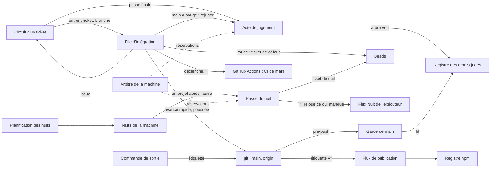
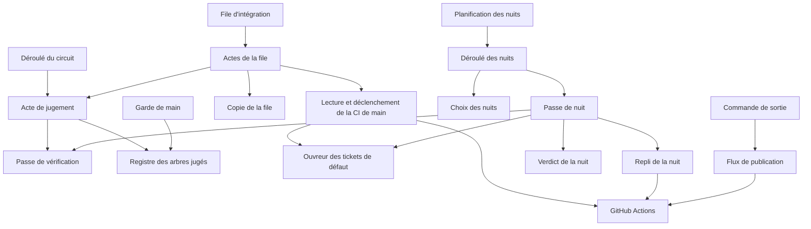
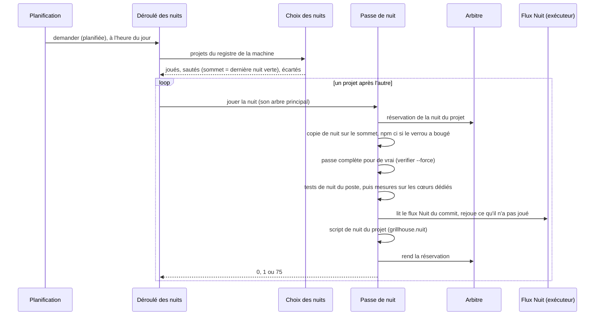

# L'entrée sur main, la CI et la nuit — architecture

Ce mécanisme fait entrer sur la branche main d'un projet les lots que leurs circuits ont jugés, puis rejoue main après eux : la passe finale juge un lot posé sur la pointe de main et inscrit son arbre, la file d'intégration fait avancer main sur cet arbre, un lot à la fois, la CI de main rejoue la passe complète par paquets de lots, la nuit joue ce que le jour ne joue jamais, et la sortie publie une version du cadre. Ce document, à l'adresse `packages/grillhouse/docs/architecture/entree-ci-nuit.md`, décrit la construction cible de ces composants, de l'infrastructure à la donnée ; il détaille le document de tête (`docs/ARCHITECTURE.md`, §2.2, §2.3, §3, §4, §6) et renvoie au document du circuit (`packages/grillhouse/docs/architecture/circuit.md`) pour les étapes qui mènent un lot jusqu'à la file. Sa section 9 dit, chantier par chantier, où le code ne l'a pas rejoint.

## 1. Contexte



Ce qui traverse les bords du mécanisme :

- **le lot jugé**, une branche `agent/<ticket>` dont le commit porte un arbre du registre, que le circuit remet à la file, et **l'issue** que la file lui rend (document du circuit, §4.3) ;
- **les commits de main**, que la file pousse sur `origin` et que la garde de main laisse passer ;
- **les passages des flux** de GitHub Actions, que la file déclenche et lit, et que la passe de nuit lit ;
- **les tickets de défaut**, que la file et la nuit ouvrent dans Beads ;
- **les réservations** de cœurs et de mémoire, que chaque passe demande à l'arbitre de la machine (document de la machine et de l'enveloppe) ;
- **le paquet du cadre**, que la sortie publie sur le registre npm ; la montée des projets vit au document de l'installation.

## 2. Stratégie

Les six choix portent un numéro fixe, qu'un ticket cite (§2.3) et qui ne se réattribue pas.

1. **Un arbre jugé est le seul droit d'entrer sur main.** Le registre des arbres jugés tient les arbres git que l'acte de jugement a rendus verts ; la garde de main refuse de pousser sur la branche main d'`origin` un commit dont l'arbre n'y est pas, dans tout projet. Seul l'acte de jugement écrit le registre, et par exception la vérification de la voie de secours ; une vérification lancée à la main rend son verdict et n'inscrit rien. Un arbre est jugé quel que soit le commit qui le porte : un commit amendé ou rejoué sur le même arbre est jugé. Raison : ce qui entre sur main a été jugé par le circuit qui le porte, et un seul écrivain répond à « qui a jugé » (document de tête, §2.1, §2.2). Modèle : bors, « If that result is "OK", master gets fast-forwarded to reach it » (lu, bors.tech/documentation/getting-started) ; la file de fusion de GitHub, qui exige que le changement passe « all required status checks when applied to the latest version of the target branch » (lu, docs.github.com, « Managing a merge queue »).
2. **La file fait entrer un lot à la fois, par avance rapide, et ne rejuge que si main a bougé.** Pour chaque entrée, dans l'ordre d'arrivée : main est un ancêtre de la branche et son arbre est jugé, main avance sur elle sans rien rejouer ; main a bougé, la file repose la branche sur la pointe dans sa copie et appelle le même acte de jugement sur le commit reposé, cinq fois au plus si main bouge encore. Rouge, main ne bouge pas et le ticket est rouvert. Raison : un lot paie une passe finale, et une seconde seulement quand main a bougé (document de tête, §8). Modèle : bors et la file de fusion de GitHub (lus, ci-dessus). Écart : bors groupe les lots relus en même temps (« as well as any other pull requests that are reviewed around the same time », lu) ; la file en prend un, parce qu'un projet sur une machine fait entrer quelques lots par heure, et qu'un groupe rouge demande de chercher lequel.
3. **Le jour juge un lot sur ce qu'il atteint ; main se rejoue entier ensuite, par paquets de lots.** La passe finale joue les gardes, le typage et les tests que le lot atteint, mesurés contre la pointe de main ; la CI de main joue la passe complète sur la pointe de main, au plus une fois par heure, et un passage juge tous les lots entrés depuis le précédent. La file la déclenche elle-même après l'entrée d'un lot et ne l'attend jamais. Raison : un ticket n'attend pas une passe complète, et main est rejoué entier sans horloge tierce. Modèle : le TAP de Google, qui joue avant l'entrée les tests touchés et après elle la suite complète, par paquets de changements (non lu).
4. **La nuit joue ce que le jour ne joue jamais, une fois par projet qui a bougé, un projet après l'autre.** Une planification du serveur Temporal, une pour la machine, demande chaque jour les nuits des projets dont le sommet n'est pas celui de leur dernière nuit verte ; le déroulé des nuits les joue l'une après l'autre ; chaque nuit joue la passe complète pour de vrai, les tests de nuit, les mesures de temps sur des cœurs dédiés, puis le script de nuit du projet. Raison : la preuve longue et les mesures se prennent au repos, sans charger le jour (charte, « Une mesure de temps joue la nuit »). Modèle : la planification de Temporal, dont la règle de chevauchement `Skip` fait que « the Workflow Execution is not started » (lu, docs.temporal.io/schedule).
5. **Un rouge après l'entrée ouvre un ticket et n'arrête pas la file.** Un rouge de la CI de main ou de la nuit nomme les lots entrés depuis le dernier vert, que git calcule sans état gardé, ouvre un ticket de défaut par cause, et alerte le superviseur ; un lot fautif déjà fermé reste fermé, sa correction est un ticket neuf. Raison : main reste ouvert aux lots jugés, et chaque rouge a son ticket (charte, « Main reste vert »). Modèle : `git bisect run`, dont la commande sort à 0 sur un commit bon et entre 1 et 127, hors 125, sur un mauvais (lu, git-scm.com/docs/git-bisect) ; la nuit donne cette commande pour chaque tâche rouge.
6. **La sortie publie une version depuis son étiquette, sur la CI de l'étiquette, sans jeton gardé.** La commande de sortie écrit la version et date le journal des versions, puis pose l'étiquette annotée `v<x.y.z>` ; la poussée de l'étiquette est un geste du responsable ; le flux de publication joue la CI sur le commit étiqueté et publie le paquet sur le registre npm par publication de confiance. Raison : une version publiée est un commit de main jugé puis rejoué entier. Modèle : la publication de confiance de npm, « using OpenID Connect (OIDC) authentication, eliminating the need for long-lived npm tokens » (lu, docs.npmjs.com/trusted-publishers).

La machine vierge, le flux qui rejoue l'installation à neuf et la vérification complète sur une machine neuve de GitHub, n'entre dans aucun de ces choix : elle ne part qu'à la main, et rien ne lit son verdict.

## 3. Composants



### 3.1 Les composants du mécanisme

| Composant | Responsabilité | Possède | Appelle |
|---|---|---|---|
| Acte de jugement (un acte du circuit ; `jugerLeCandidat` dans `scripts/integration/file.mjs` aujourd'hui) | jouer la passe de vérification sur un lot posé sur la pointe de main, mesurée contre cette pointe, et inscrire l'arbre vert ; rendre vert, rouge (ses rouges nommés, sa sortie au journal du ticket) ou « à repasser » | le registre des arbres jugés | la passe de vérification, le registre |
| Registre des arbres jugés (`scripts/arbres-juges.mjs`) | lire et écrire, d'une écriture atomique, la liste des arbres jugés d'un dépôt | rien : le fichier est à l'acte de jugement | git |
| Garde de main (`refusSurMain` ; le crochet pre-push du cadre) | refuser, dans tout projet, la poussée vers la branche main d'`origin` d'un commit dont l'arbre n'est pas jugé, en nommant les fichiers qui diffèrent du commit | rien | le registre |
| File d'intégration (`fileDuProjet`, `src/temporal/file/`) | faire entrer sur main les lots jugés, un à la fois, dans l'ordre d'arrivée ; rendre son issue à chaque circuit ; déclencher et lire la CI de main | l'ordre d'entrée, l'état du déclenchement de la CI | les actes de la file, l'acte de jugement, l'arbitre |
| Actes de la file (`scripts/integration/file.mjs`) | situer un lot, préparer la branche (la reposer sur la pointe quand main a bougé, régénérer ses fichiers engendrés), avancer main par avance rapide, fermer l'entrée (fermer le ticket « intégré : <commit> », livrer ses capacités, effacer la branche, retirer le dossier de travail, pousser main) | la copie de la file | git, Beads, la commande de chaque fichier engendré |
| Lecture et déclenchement de la CI de main (`scripts/ci-de-main.mjs`) | déclencher le flux CI sur main quand la pointe et l'heure le demandent ; lire son dernier passage fini ; nommer les lots entrés depuis le dernier vert ; dire l'alerte au superviseur et la ligne du tableau | rien : l'état du déclenchement est à la file | `gh`, git, l'ouvreur des tickets de défaut |
| Ouvreur des tickets de défaut | ouvrir, sous un verrou de fichier du projet, un ticket par cause d'un rouge de main, ou commenter celui qui la nomme déjà | rien | Beads |
| Flux CI (`.github/workflows/ci.yml`, du dépôt et du gabarit) | jouer la passe complète en tranches : un job des gardes sans les tests, n tranches de tests, leur fusion | ses passages | la commande du cadre, sur l'exécuteur du projet |
| Planification des nuits (`grillhouse-nuits`, posée par `grillhouse nuit --planifier`) | démarrer chaque jour, à son heure, le déroulé qui demande les nuits | son heure | le serveur Temporal |
| Déroulé des nuits (`nuitsDeLaMachine`, `src/temporal/nuits/`) | recevoir les demandes de nuits (planifiées, ou à la main pour un projet), jouer les nuits l'une après l'autre, chacune après la fin de la précédente quel que soit son verdict | la file des nuits | le choix des nuits, la passe de nuit |
| Choix des nuits (`src/temporal/nuits/choix.ts`) | dire, pour chaque projet du registre de la machine, s'il est écarté (sa racine, sa commande, son script `verifier` ou son commit manque), sauté (son sommet est sa dernière nuit verte) ou joué | rien | git |
| Passe de nuit (`scripts/nuit.sh`, `grillhouse nuit`) | dans la copie de nuit, sur le sommet de main : la passe complète pour de vrai, les tests de nuit et les mesures de temps, la part de l'exécuteur, le script de nuit du projet ; puis le verdict, la marque de la dernière nuit verte, les tickets de nuit, le retrait des copies finies | la copie de nuit, la marque de la dernière nuit verte, le journal de la nuit | la passe de vérification, le repli, le verdict, l'ouvreur des tickets de défaut, l'arbitre |
| Repli de la nuit (`scripts/repli-de-la-nuit.mjs`, `scripts/flux-de-la-nuit.mjs`) | lire le flux Nuit du commit de la nuit ; rejouer sur le poste chaque tranche que l'exécuteur n'a pas démarrée dans les soixante minutes ou a interrompue, et les mesures que le flux déclare mais n'a pas finies | rien | `gh` |
| Flux Nuit (`.github/workflows/nuit.yml`, du dépôt et du gabarit) | jouer sur l'exécuteur du projet, en tranches, les tests de nuit qui n'ont pas besoin du poste ; chez Grillhouse, aussi les mesures de temps | ses passages | la commande du cadre |
| Verdict de la nuit (`scripts/verdict-de-la-nuit.mjs`) | noter le verdict de chaque part, celle du poste et celle de l'exécuteur ; « à repasser » n'écrit rien | les verdicts | rien |
| Commande de sortie (`grillhouse sortie`, `scripts/sortie.mjs`) | écrire la version et dater le journal des versions ; poser l'étiquette ; vérifier qu'une étiquette nomme la version ; écrire l'entrée du greffon dans la place de marché | rien | git |
| Flux de la machine vierge (`templates/projet/.github/workflows/machine-vierge.yml`) | rejouer, lancé à la main seulement, l'installation à neuf (`npm ci`, `grillhouse binaires`) et `npm run verifier` complet sur un exécuteur `ubuntu-latest` de GitHub, jamais sur `RUNNER` ; son verdict se lit dans GitHub, sans alerte ni ticket | ses passages | la commande du cadre |
| Flux de publication (`.github/workflows/release.yml`) | sur une étiquette `v*.*.*`, appeler le flux CI sur le commit étiqueté, puis, vert, publier le paquet sur npm et la version sur GitHub | ses passages | le flux CI, npm |

Tous sont du paquet `grillhouse`, en TypeScript à terme ; les modules sous `scripts/` et le script de nuit en Bash sont ceux d'avant la migration (§9, chantier 6). La commande de sortie sert le seul dépôt du cadre ; un projet n'en joue rien.

### 3.2 Les voisins, et ce que le mécanisme leur demande

| Voisin | Ce qu'il lui demande | Son document |
|---|---|---|
| Déroulé du circuit | jouer l'acte de jugement à la passe finale (4.1), poser le commit du lot sur l'arbre jugé (5.1), entrer dans la file et attendre son issue (5.2) | Le circuit, §5.3 |
| Passe de vérification | juger un arbre : `npm run verifier` mesuré contre une base (la passe finale), ou entier pour de vrai (`--force`, la nuit) ; rendre 0, 1 ou 75 | Les tests et les langages |
| Arbitre de la machine | la réservation de chaque passe : la passe finale, le rejugement de la file, la nuit d'un projet ; et les cœurs dédiés des mesures de temps | La machine et l'enveloppe |
| Greffon et panneau | montrer la file, la ligne de la CI de main et le verdict de la nuit ; pousser au superviseur l'alerte d'un rouge | Le greffon et le panneau |
| Installation et montée | poser les flux marqués du cadre, le crochet pre-push, le travailleur du projet ; relancer la file (signal `relancer`) à la montée | L'installation et les réglages d'un projet |
| GitHub Actions, npm, Beads | tiers | document de tête, §3.3 |

### 3.3 La garde de chaque frontière

- **Un lot et main** : la garde de main refuse la poussée d'un arbre non jugé ; elle ne lit pas qui l'a jugé, et le registre ne distingue pas un arbre jugé avant la relecture d'un arbre accepté (§9.2).
- **L'écrivain du registre** : aucune garde ne refuse aujourd'hui un second écrivain ; la relecture tient la règle (§2.1).
- **La file et main** : seule la file avance la branche main d'un projet dans le circuit ; aucune garde ne refuse une avance à la main d'un arbre jugé.
- **Un flux et le cadre** : un flux qui porte sur sa première ligne la marque « Généré par `npx grillhouse maj` » est au cadre, et la montée le réécrit ; un flux sans la marque est au projet.

## 4. Données

### 4.1 Les états et leur propriétaire

| Donnée | Forme et adresse | Écrite par | Lue par | Durée de vie |
|---|---|---|---|---|
| Les arbres jugés | un tableau JSON d'identifiants d'arbre git, dans l'ordre de leur inscription ; `<dossier commun de git>/grillhouse/arbres-juges.json` | l'acte de jugement ; par exception, la vérification de la voie de secours | la garde de main, la file | le dépôt |
| L'ordre d'entrée | l'entrée en cours et celles qui attendent, `{ ticket, branche, deroule }` chacune ; l'histoire du déroulé `file:<racine>` | la file | le tableau, par la requête `etatDeLaFile` | tant qu'un lot attend |
| L'état du déclenchement de la CI | l'instant du dernier déclenchement, une entrée dont le passage n'est pas déclenché, la dernière faute ; l'histoire du déroulé de la file | la file | la lecture de la CI, en argument | la file |
| La pointe de main | la branche `main` de l'arbre principal, puis d'`origin` | la file, par avance rapide et poussée | les circuits (avance de leur copie), la CI de main, la nuit | le dépôt |
| La copie de la file | un `worktree` détaché, `.claude/worktrees/file`, ses dépendances accordées au verrou (marque `node_modules/.integration-lock`) | les actes de la file | l'acte de jugement | se refait |
| La lecture gardée de la CI | `{ a, lecture }`, `.claude/worktrees/ci-de-main-lue.json`, valable cinq minutes | la lecture de la CI | le tableau, le relevé du superviseur | un cache |
| Le passage de la CI | ses jobs, sa conclusion, son commit | GitHub Actions | la lecture de la CI, le flux de publication | celle de GitHub |
| Le ticket de défaut de main | un ticket `bug` sous `a-valider` qui nomme le flux ou la tâche rouge, son commit, le dernier vert et les lots candidats ; `.beads/` | l'ouvreur des tickets de défaut | le responsable, le superviseur | jusqu'à sa fermeture |
| La planification des nuits | une heure par jour, le fuseau de la machine, chevauchement `SKIP`, rattrapage de 24 h ; serveur Temporal | `grillhouse nuit --planifier` | le serveur | la machine |
| La file des nuits | le projet en cours et son départ, ceux qui attendent, ceux joués (code), sautés, écartés ; l'histoire du déroulé `grillhouse-nuits-de-la-machine` | le déroulé des nuits | le tableau, par la requête `etatDesNuits` | jusqu'à la fin du déroulé |
| La marque de la dernière nuit verte | un identifiant de commit ; `<dossier commun de git>/nuit/dernier-vert` | la passe de nuit, verte seulement, mesures jouées et vertes | le choix des nuits, la nuit suivante (l'intervalle de la bissection) | le dépôt |
| Le verdict de la nuit | `vert` ou `rouge`, par part : `nuit/verdict` (le poste), `nuit/verdict-pc2` (l'exécuteur) | le verdict de la nuit | le tableau | jusqu'à la nuit suivante qui n'est pas « à repasser » |
| Le journal de la nuit | `<dossier commun de git>/nuit/<date>.log` | la passe de nuit, le choix des nuits (un saut) | le ticket de nuit, le superviseur | une trace |
| La copie de nuit | `.claude/worktrees/nuit`, détachée sur le sommet, marque `node_modules/.nuit-lock` | la passe de nuit | la passe de nuit | se refait |
| La version du cadre et son journal | `version` de `packages/grillhouse/package.json`, `packages/grillhouse/CHANGELOG.md`, commités | la commande de sortie | npm, la montée | une version |
| L'étiquette d'une version | une étiquette annotée `v<x.y.z>` | la commande de sortie | le flux de publication | le dépôt |

Un fichier que ce tableau ne nomme pas est une trace ou un cache. Le registre des résultats et le dernier vert par branche, que la passe complète écrit aussi, relèvent du document des tests et des langages ; leur sort attend la mesure de leur usage (document de tête, §9, chantier 3).

### 4.2 Ce qui traverse la file et les nuits

Les signaux `entrer` et `issueDeLaFile` sont décrits au document du circuit (§4.3).

| Message | Forme | De | Vers |
|---|---|---|---|
| Départ de la file | `{ racine, ci?, suite? }` ; `suite` porte les entrées en attente d'une exécution à la suivante ; démarrée par le premier circuit qui entre, enfant détaché (`ABANDON`) | le déroulé du circuit | la file |
| Relance (signal `relancer`) | rien : la file finit son entrée en cours, puis continue dans une exécution neuve | l'installation | la file |
| Préparer la branche (activité `preparerLaBranche`) | rend `{ candidat: { commit } }`, `{ entre: { commit } }` (le lot déjà sur main) ou `{ issue }`, avec ses effets | la file | un acte |
| Juger (l'acte de jugement) | `{ racine, ticket, branche, commit }` ; rend `{ juge: true }` ou `{ issue }`, avec ses effets | la file, quand main a bougé ; le circuit, à 4.1 | l'acte de jugement |
| Avancer main (activité `avancerMain`) | rend `{ entre }`, `{ bouge: true }` (main a bougé entre-temps) ou `{ issue }` | la file | un acte |
| Fermer l'entrée (activité `fermerLEntree`) | rend `{ poussee, raison?, livraison?, fermeture? }` | la file | un acte |
| Surveiller la CI (activité `surveillerLaCiDeMain`) | `{ racine, apresEntree, declenchement }` ; rend `{ etat: 'verte' | 'rouge' | 'non-lue', declenchement }` | la file, à son départ, après chaque entrée et à chaque quart d'heure d'attente | un acte |
| Réservation d'une passe | `{ tache: 'passe', racine, ticket?, phase }`, la phase étant `passe-finale` ou `nuit` ; la forme de l'échange vit au document de la machine | le déroulé du circuit, avant 4.1 ; la file, avant un rejugement ; la passe de nuit | l'arbitre |
| Demande de nuits (signal `demander`) | `{ projet }` (à la main, la marque non lue) ou `{ planifiee: true }` | le déroulé `nuitPlanifiee`, la commande `grillhouse nuit <projet>` | le déroulé des nuits |
| Jouer la nuit (activité `jouerLaNuit`) | `{ racine }` ; rend le code de la passe de nuit : 0 vert, 75 à repasser, tout autre rouge | le déroulé des nuits | la passe de nuit, dans l'arbre principal du projet |

Chaque acte qui écrit hors du déroulé rend ses effets (un commentaire au ticket), que la file écrit un par activité, sous la clé de cette activité, comme le circuit (document du circuit, §2.3).

## 5. Déroulé

### 5.1 Un lot, de sa passe finale à main

```mermaid
sequenceDiagram
  participant C as Déroulé du circuit
  participant J as Acte de jugement
  participant R as Registre
  participant F as File d'intégration
  participant A as Arbitre
  participant G as git et origin
  C->>J: passe finale (4.1), copie avancée sur la pointe de main
  J->>R: arbre vert inscrit
  C->>C: relecture, commit du lot sur l'arbre jugé (5.1)
  C->>F: entrer (5.2)
  alt main est un ancêtre de la branche
    F->>R: l'arbre est-il jugé ? oui
  else main a bougé
    F->>F: branche reposée sur la pointe, engendrés régénérés (copie de la file)
    F->>A: réservation de la passe finale du projet
    F->>J: juger le commit reposé
    J->>R: arbre vert inscrit, sinon issue « rouvert »
    F->>A: rend la réservation
  end
  F->>G: avance rapide de main ; main a bougé entre-temps : reposer, au plus cinq fois
  F->>G: ticket fermé, branche effacée, poussée vers origin/main
  G->>G: garde de main : l'arbre est au registre
  F-->>C: issue « ferme »
  F->>F: déclenche puis lit la CI de main
```

Le circuit porte les étapes qui mènent un lot jusqu'à la file, et leur ordre (document du circuit, §5.3) ; la file porte ce qui suit. Une branche qui ne se repose pas (des fichiers en conflit hors des fichiers engendrés) sort de la file, son ticket rouvert, les fichiers nommés, l'issue portant `conflit` ; une branche sans rien en avance sur main sort sans être rouverte ; une copie qui ne se prépare pas garde la branche en file, l'issue `en-file`. Un fichier engendré que le projet déclare (`grillhouse.engendres`) ne se fusionne jamais : en conflit, la version de main est prise, puis sa commande le réécrit sur la branche reposée, et le rejugement couvre ce qu'elle écrit. Un acte qui échoue rend l'issue `echec` et sa raison, et la file passe à l'entrée suivante ; quand l'échec suit l'avance de main, la raison dit que le main local porte le lot, non poussé, et que la reprise du circuit le repasse par la file, qui le ferme et le pousse. Une fermeture que Beads refuse laisse le lot sur main, le ticket ouvert et l'issue `echec` ; la file des tickets ne relance jamais un ticket dont le lot est sur main.

Une poussée que `origin` refuse est écrite au ticket et n'arrête pas la file. Un lot que la voie de secours mène passe par la même garde : sa vérification a inscrit l'arbre (document du circuit, §5.8).

### 5.2 La CI de main

1. À son départ, après chaque entrée et à chaque quart d'heure d'attente, la file joue l'activité de surveillance, à qui elle passe l'état du déclenchement et qui le lui rend.
2. L'activité lit les passages du flux CI sur main (`gh run list`). Elle déclenche le flux (`gh workflow run ci.yml --ref main`) quand la pointe de main diffère du commit du dernier passage, qu'aucun passage n'est en cours ni en attente, et que le dernier passage ou le dernier déclenchement a une heure ou plus ; sans aucun passage connu, seule une entrée le déclenche. Un passage lancé à la main compte.
3. Elle lit le dernier passage fini du flux CI : un passage annulé ou sauté ne juge rien, le précédent décide. Vert, l'alerte s'efface. Rouge, elle nomme les lots entrés depuis le dernier passage vert du flux (les commits dont le sujet finit par « (<ticket>) », par git), ouvre le ticket de défaut et alerte le superviseur. Non lue (`gh` absent, refusé, illisible), elle est l'alerte « CI de main non lue », jamais le silence.
4. Un déclenchement que GitHub refuse est l'alerte « La CI de main n'a pas pu être déclenchée », à part ; le quart d'heure suivant retente.

Le flux CI joue la passe complète sur l'exécuteur du projet, Node 26 seul : un job des gardes (`npm run verifier -- --sans-tests`, la construction comprise), trois tranches de tests (`--tranche i/3`), puis la fusion, qui refuse un fichier de test qu'aucune tranche ou que deux jouent. Chaque job joue `npm run --if-present ci:preparer` après `npm ci`. Le passage déclenché sur main écrit le cache distant de Turborepo ; tout autre le lit seul.

### 5.3 La nuit



- **Les trois étapes jouent chacune**, même quand une précédente est rouge, comme une CI joue ses jobs indépendants ; la nuit est rouge quand l'une l'est. Une passe complète « à repasser » finit la nuit « à repasser ». Un banc ou un test de nuit qui échoue sous charge (75) attend le repos, quinze minutes au plus, et rejoue une fois.
- **Les deux parts** : quand le projet a un flux Nuit sur l'exécuteur, l'exécuteur joue en tranches les tests de nuit sans l'étiquette `@poste` ; le poste joue les tests `@poste`, puis les mesures de temps, sauf si le flux déclare un job qui les joue (une commande `tests-de-nuit --mesures`, lue des commandes du flux). Le repli lit le passage du flux pour le commit de la nuit : une tranche finie sur l'exécuteur, verte ou rouge, ne se rejoue jamais ; une tranche non démarrée soixante minutes après l'heure du flux est annulée et jouée sur le poste ; une tranche interrompue se rejoue entière ; une tranche encore en cours laisse la part de l'exécuteur « à repasser ». Sans flux Nuit, le poste joue tout.
- **Le verdict** : vert, le sommet devient la marque de la dernière nuit verte, seulement quand les mesures ont été jouées et sont vertes. « À repasser » n'écrit rien : la marque reste, aucun ticket ne s'ouvre, la nuit suivante rejoue. Rouge, chaque tâche rouge (une tâche de la passe complète, les tests de nuit, le script du projet, une tranche, ou la préparation) commente le ticket de nuit ouvert qui la nomme, une fois par nuit, ou ouvre le sien ; le texte donne l'intervalle de la bissection et, pour une tâche de la passe complète, la commande `git bisect run` qui la rejoue seule.
- **Après les étapes**, quel que soit le verdict, la passe retire chaque copie dont le contenu est sur main et qu'aucun circuit ne tient, et vide la sienne de ce que les outils y ont écrit.
- **La nuit ne pousse rien** : main ne reçoit ses lots que de la file ; une demande à la main (`grillhouse nuit <projet>`) joue le projet à son tour, sa marque non lue.

### 5.4 La sortie

1. La version est un ticket direct, dont le lot entre sur main par la file sur sa passe finale : `npx grillhouse sortie <x.y.z>` écrit la version au-dessus de la courante et date « [Unreleased] » ; elle refuse une version qui n'est pas au-dessus et un « [Unreleased] » vide. Le commit de sortie porte ces deux fichiers.
2. Le commit de sortie sur main, le superviseur lance `npx grillhouse sortie --etiqueter`, qui pose l'étiquette annotée sur un arbre de travail propre et nomme la poussée, que le responsable valide.
3. Sur l'étiquette, le flux de publication appelle le flux CI sur le commit étiqueté ; vert, il vérifie que l'étiquette nomme la version, publie le paquet par publication de confiance, puis la version sur GitHub. Un échec ou une annulation ne publie jamais.
4. Grillhouse se mène ensuite avec la version publiée ; la montée des projets vit au document de l'installation.

## 6. Exécution

- **Où** : la file tourne sur le travailleur du projet (file de tâches `grillhouse-projet-<nom>`), une par dépôt, `file:<racine>` ; le déroulé des nuits et sa planification sur le travailleur de la machine, un pour la machine. Chaque acte est un processus à lui, dans l'arbre principal, qui envoie son signe de vie.
- **Les copies** : la file juge dans sa copie, la nuit dans la sienne ; aucune ne prend le verrou de l'autre, et une nuit peut tourner pendant une entrée.
- **Les délais** : un acte de la file dure deux heures au plus, quatre essais ; le jugement six heures, deux essais ; une nuit douze heures, signe de vie attendu cinq minutes, deux essais, l'essai rejoué finissant d'abord le groupe laissé par le mort.
- **Les ressources** : chaque passe (le jugement, la nuit) réserve sa part à l'arbitre et la rend à sa fin ; une mesure de temps joue sur les cœurs dédiés de `grillhouse.mesure`. La file entre deux entrées, et les nuits entre deux projets, ne tiennent aucune réservation. Un circuit qui attend l'issue de la file garde sa place de circuit : il attend son propre lot, non un événement extérieur.
- **Ce qui survit** : la file, son ordre d'entrée et l'état du déclenchement ; la file des nuits et la planification ; le registre, la marque et les verdicts, dans git. Au-delà de dix mille événements la file, et de deux mille le déroulé des nuits, continuent dans une exécution neuve avec ce qui attend.
- **Hors du poste** : le flux CI, le flux Nuit et le flux de publication tournent sur GitHub Actions, le flux CI et le flux Nuit sur l'exécuteur du projet (la variable `RUNNER` du dépôt, `ubuntu-latest` sans elle), la publication sur un exécuteur de GitHub ; le flux de la machine vierge, lancé à la main seulement, sur un exécuteur neuf de GitHub ; le flux CI et le flux Nuit d'un dépôt partagent un groupe de concurrence, sans annulation de l'attente. La file n'attend aucun flux.

## 7. Concepts transverses

- **L'identité** : un lot se nomme par son arbre git ; une entrée par son ticket, qu'elle n'accepte pas deux fois ; une nuit par la racine de son projet ; un ticket de défaut par sa cause (le flux et son passage, ou la tâche rouge de la nuit).
- **Les trois verdicts** : vert, rouge, et « à repasser » (75) quand la machine manque ; « à repasser » ne juge rien : main ne bouge pas, la branche reste en file, la marque de la nuit reste.
- **La reprise sans dommage** : chaque geste d'un acte de la file se rejoue sans effet de plus (une branche déjà reposée, main déjà avancée, un ticket déjà fermé, un commit déjà poussé) ; un lot que l'essai rejoué trouve sur main rend `entre`.
- **Les auteurs** : la file écrit au ticket sous l'auteur `file`, comme le circuit sous `circuit`.
- **Un rouge a son ticket** : un rouge de main est un défaut ouvert tant que son ticket n'est pas fermé ; un test connu rouge se met en quarantaine dans le test lui-même, avec le ticket qui le corrige.
- **Une règle retirée part** : la file, la nuit et la garde ne connaissent aucune clé retirée.

## 8. Qualité

- **Le temps d'un ticket** : un lot paie une passe finale, et une seconde seulement quand main a bougé. Mesure : le registre des consommations, la phase `passe-finale` par ticket.
- **Main reste vert** : main n'avance que sur un arbre jugé. Mesure : la garde de main, à chaque poussée.
- **Le délai d'un rouge** : un rouge de main est vu au plus une heure après l'entrée du lot qui le porte pour ce que la CI joue, la nuit suivante pour le reste. Mesure : l'heure des passages et des nuits, au ticket de défaut.
- **La nuit au repos** : une mesure de temps ne se prend que sur des cœurs dédiés ; un échec sous charge est « à repasser », non rouge.

## 9. Risques

### 9.1 L'écart entre la cible et le code, par chantier du document de tête

1. **Les documents de référence.** Le mécanisme est raconté dans la charte, l'architecture du paquet (la file seule à cinq endroits), les en-têtes du code et le gabarit, avec des écarts : trois textes disent que l'intégration vérifie (`CLAUDE.md` « ce que jouent l'intégration, la file… » ; l'en-tête du rejeu, « the CI of the ticket's branch judges the lot ») alors qu'elle ne vérifie rien ; la charte prête à la CI de main « autres plates-formes, matrice de versions », qu'elle ne joue pas ; l'architecture du paquet dit que le cache distant s'écrit « au run du calendrier », que le flux CI n'a plus ; le ticket de nuit et le script de nuit du projet (`grillhouse.nuit`) ne sont écrits nulle part ; la sortie ne vit que dans `CONTRIBUTING.md`, qui dit l'étiquette posée « once its CI is green » quand la commande ne lit aucune CI. Le chantier fait de ce document la seule adresse, et ramène les autres à un renvoi.
2. **Le circuit direct passe par le moteur.** Aujourd'hui un lot direct entre sur main par le superviseur : sa vérification entière inscrit l'arbre (`garderLeVert`), puis il commite et pousse ; la garde de main le nomme encore « lot direct ». Le chantier fait entrer le lot direct par la file comme les autres ; la vérification de la voie de secours garde seule ce droit.
3. **Un état, un propriétaire.** Aujourd'hui l'état du déclenchement de la CI est un fichier (`.claude/worktrees/ci-de-main-declenchee.json`) que l'acte écrit hors du déroulé ; « ce qui a été vert » tient, pour ce mécanisme, en quatre marques : le registre, le dernier vert par branche écrit au même instant, la marque de la nuit et les deux verdicts. Le chantier fait entrer l'état du déclenchement dans la file ; le registre et la marque de la nuit restent, chacun à son propriétaire ; le dernier vert et le registre des résultats attendent leur mesure.
4. **Le jugement unique.** Aujourd'hui la passe finale du circuit n'inscrit pas son arbre ; deux étapes s'appellent passe finale (4.1 et « 5.2 File : passe finale, main ») ; la file rejoue toujours la passe, à la même base, sauf sur un arbre déjà jugé ; le lot est posé trois fois : dans la copie du ticket, dans la copie d'intégration (l'acte du commit applique le lot en trois voies, installe, régénère et commite là), puis dans la copie de la file ; une vérification entière lancée à la main inscrit aussi son arbre ; la passe de la file prend la part du projet par l'ancien chemin des parts, et la nuit « ne réserve rien » et prend la sienne de même. Le chantier fait inscrire l'arbre par l'acte de jugement à 4.1, poser le commit dans la copie du ticket sur l'arbre jugé, retirer la copie d'intégration, faire appeler par la file ce même acte quand main a bougé, retirer le droit d'inscrire à la vérification à la main, et faire réserver chaque passe à l'arbitre.
5. **La montée et les retraits.** Restent à retirer : le départ quotidien et sur étiquette de la machine vierge, et l'alerte de son rouge (aujourd'hui la lecture de la CI, qui lit tous les flux, la compte), avec les textes qui les décrivent (la charte du gabarit, l'architecture du paquet) ; la clé retirée `grillhouse.poussee` et ses trois lectures (file, nuit, garde) ; la fermeture de la machine par la nuit, dont deux fonctions restent sans appelant (`sauterLaNuit`, `raisonDeLaNuitSautee`) ; le contrôle de la base des flux, sans appelant hors de ses tests ; le cas `skipped` du flux de publication, que le flux CI appelé ne rend jamais ; le marqueur de version `version-de-la-file` et le marqueur déprécié `passe-finale-de-main` de la file ; le nom du fichier de la garde de main (`branche-de-nuit.mjs`). La lecture de la CI lit le dernier passage de chaque flux de la branche, si bien qu'un rouge du flux Nuit ou du flux des pages ouvre aussi un ticket de défaut de main ; le chantier la ramène au seul flux CI. Un rouge de main s'ouvre aujourd'hui sous deux formes, un ticket par passage sous `a-valider` pour la CI, un ticket par tâche sous `nuit` pour la nuit ; le chantier les réunit en un seul ouvreur, un ticket par cause, sous `a-valider`. La passe de nuit tient qu'un projet a une part sur l'exécuteur quand son flux Nuit contient le mot `pc2`, que le flux du gabarit porte comme nom de son groupe de concurrence ; le chantier lit cette part aux commandes du flux, comme les mesures de temps. La promesse de la charte, « autres plates-formes, matrice de versions », quitte la charte : la CI de main joue la passe complète.
6. **TypeScript.** Les actes de la file, la lecture de la CI, le registre, la garde, le repli et la commande de sortie sont des modules JavaScript sous `scripts/`, et la passe de nuit un script Bash de cinq cent cinquante lignes ; le chantier les migre.

### 9.2 Ce qui reste fragile ou inconnu

- **Le registre avant la relecture** : l'arbre s'inscrit à la passe finale, avant que le relecteur l'accepte ; la garde laisserait partir à la main un arbre jugé et rendu. Seule la file pousse, et elle ne reçoit que des lots acceptés.
- **Le registre ne s'élague pas** : il croît d'un arbre par lot jugé (quatre-vingt-neuf arbres, quatre kilo-octets dans le dépôt du cadre) ; aucun élagage n'est prévu.
- **Les tests `@equipee` d'un projet** : le flux Nuit du gabarit les laisse (`--sans-equipement`) et le poste ne joue que les tests `@poste` ; aucun projet n'en porte aujourd'hui.
- **Le registre de la machine a deux écrivains** : les séances y inscrivent leur projet, et le déroulé des nuits ses sauts ; il relève du document du greffon et de l'installation.