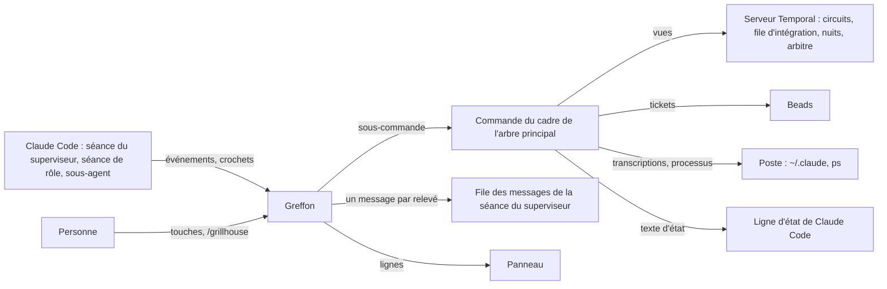
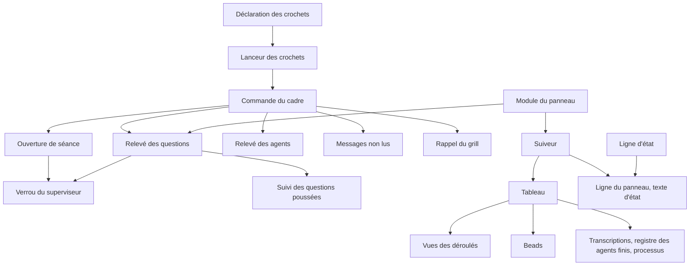
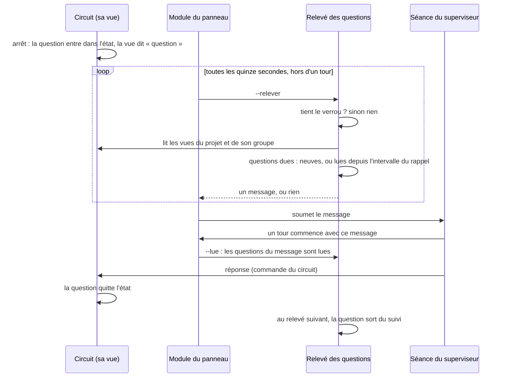
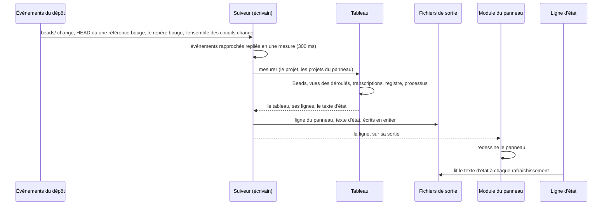

# Le greffon et le panneau — architecture

Le greffon est l'extension de Claude Code que le cadre installe dans chaque projet : il fait jouer les crochets du cadre dans chaque séance du projet, pousse les questions des circuits dans la file des messages de la séance du superviseur, et montre l'avancement du projet dans le panneau et dans la ligne d'état. L'avancement se mesure en un seul point par dépôt, le suiveur, qui lit les tickets, les vues des déroulés, les transcriptions et les processus, et écrit une même mesure pour le panneau et pour la ligne d'état. Ce document, à l'adresse `packages/grillhouse/docs/architecture/greffon.md`, décrit la construction cible des crochets, des questions poussées, du tableau, du suiveur et de la ligne d'état, de l'infrastructure à la donnée ; il détaille le document de tête (`docs/ARCHITECTURE.md`, §2.1, §2.5, §3.2, §4, §5, §7), et sa section 9 dit, chantier par chantier, où le code ne l'a pas rejoint.

## 1. Contexte



Ce qui traverse les bords du mécanisme :

- **les événements de Claude Code** : les crochets que déclare le greffon (ouverture de séance, saisie, appel d'outil, fin d'un sous-agent, fin de séance) et les événements du module du greffon (ouverture, rattachement d'un affichage, début et fin d'un tour, commande, clavier, rendu) ;
- **les vues des propriétaires**, lues sans être recopiées : la vue du circuit de chaque ticket (document du circuit, §4.2), l'ordre d'entrée de la file d'intégration, la file des nuits, le verdict de la nuit et la lecture gardée de la CI de main (document de l'entrée sur main, §4.1), la vue de l'arbitre (document de la machine, §4.3) ;
- **les tickets** de Beads, lus ; le seul statut d'un chantier, écrit à la demande de la personne (§5.4) ;
- **les transcriptions** des séances, que Claude Code écrit, et la liste des processus du poste ;
- **les messages** que le greffon soumet à la séance du superviseur, et **la ligne d'état**, que Claude Code redessine.

Le verrou hors enveloppe est un crochet du greffon, décrit au document de la machine (§3.1, §5.5) ; le crochet de mise en forme à l'écriture est décrit au document des tests et des langages ; l'installation du greffon, sa montée et la déclaration de la ligne d'état dans les réglages d'un projet vivent au document de l'installation. Celui-ci dit ce que le greffon leur demande.

## 2. Stratégie

Les six choix portent un numéro fixe, qu'un ticket cite (§2.3) et qui ne se réattribue pas.

1. **Le greffon appelle, le cadre juge.** Chaque crochet est une ligne qui lance une sous-commande de la commande du cadre de l'arbre principal, celle du paquet installé, avec l'entrée du crochet ; le module du greffon ne porte aucune règle du cadre : il lance le suiveur, demande le relevé des questions et dessine des lignes que le tableau a composées. Raison : une règle change avec le paquet, sans toucher au greffon, et le code qui juge une séance est celui du cadre installé, non celui de la copie qu'il juge (document de tête, §2.5 ; document de la machine, §2.6). Modèle : les crochets de commande de Claude Code, dont la sortie devient le contexte de la séance (« Claude Code adds plain-text stdout as context that Claude can see and act on », lu, code.claude.com/docs/en/hooks).
2. **Une question atteint le superviseur par deux voies.** Le greffon de la séance qui tient le verrou du superviseur la pousse dans la file des messages de cette séance, hors d'un tour ; sans cette séance, l'ouverture de la séance suivante la montre. Aucun crochet de tour ni de fin de tour ne la redit. Une question a trois états, envoyée, lue, répondue ; une question au superviseur ne revient qu'une fois lue, à l'intervalle du rappel compté depuis sa lecture, une question au responsable ne revient jamais, et la réponse au circuit l'acquitte. Raison : une question ne dépend d'aucune attente que la séance relance, et un même besoin n'a qu'une voie par cas (document de tête, §5). Modèle : la file de messages de SQS, dont le délai de visibilité « starts as soon as a message is delivered to you » (lu, docs.aws.amazon.com, « Amazon SQS visibility timeout ») ; l'ensemble d'attention de Gerrit, « users that are currently expected to act on the change » (lu, gerrit-review.googlesource.com/Documentation/user-attention-set.html). Écart : le rappel court depuis la lecture et non depuis la remise, parce qu'un message soumis pendant un tour n'est lu qu'au tour suivant.
3. **Un projet a un seul superviseur, désigné par un verrou du dépôt.** La séance qui ouvre la première prend le verrou du dépôt ; seule la séance qui le tient reçoit les questions, celles de son projet et celles des projets de son groupe qu'aucune autre séance ne supervise. Raison : deux séances qui reçoivent la même question y répondent deux fois. Modèle : aucun lu ; Zuul, que le code cite, admet plusieurs ordonnanceurs (« Larger installations should consider running multiple schedulers », lu, zuul-ci.org/docs/zuul/latest/components.html).
4. **Le tableau est une mesure, prise par un seul suiveur par dépôt.** Le suiveur mesure à chaque événement (un changement des tickets, de l'état de git, de l'ensemble des circuits, du repère du jour) et écrit, de la même mesure, la ligne du panneau et le texte de la ligne d'état ; un seul suiveur écrit par dépôt, les autres relaient ce qu'il écrit. Raison : le panneau et la ligne d'état ne divergent jamais, et la mesure se paie une fois par dépôt quel que soit le nombre de séances. Modèle : un observateur de fichiers qui tient une seule veille et un seul état, comme watchman ou `tsc --watch` (non lus).
5. **Le tableau lit les vues des propriétaires et ne tient aucun état, hors le repère du jour.** L'étape et la question d'un circuit se lisent à sa vue, les places et les réservations à la vue de l'arbitre, la file et la nuit aux requêtes de leurs déroulés, les tickets à Beads, les agents à leurs transcriptions ; rien ne se décide sur le tableau. Le repère du jour, l'heure depuis laquelle le tableau compte « faits aujourd'hui », est son seul état, posé par la personne. Raison : un état a un seul propriétaire (document de tête, §2.1), et un affichage qui recopie un état finit par en montrer un autre. Modèle : l'interface web de Temporal, qui liste les déroulés depuis le serveur (non lu).
6. **Un crochet laisse passer ce qu'il ne sait pas lire, sauf un verrou d'écriture.** Un crochet d'information (l'ouverture, le relevé des agents, les messages non lus, le rappel du grill) qui ne lit pas son entrée, ne trouve pas la commande du cadre ou ne joint pas le serveur rend la main sans rien bloquer ; seul un verrou d'écriture refuse quand la commande manque (document de la machine, §2.6). Une sous-commande que le paquet installé ne connaît pas encore laisse passer. Raison : une séance n'est jamais arrêtée par un affichage, et un greffon plus récent que le paquet ne bloque aucun outil. Modèle : le code 2 d'un crochet de Claude Code, seul code qui bloque (« Exit code 2 behavior per event », lu, code.claude.com/docs/en/hooks).

## 3. Composants



### 3.1 Les composants du mécanisme

| Composant | Responsabilité | Possède | Appelle |
|---|---|---|---|
| Déclaration des crochets (`mods/grillhouse/hooks/hooks.json`) | déclarer à Claude Code chaque crochet du cadre, son événement, son filtre d'outil et sa sous-commande | rien : des données fixes | rien |
| Lanceur des crochets (`mods/grillhouse/hooks/crochet.mjs`) | lancer la sous-commande d'un crochet par la commande du cadre de l'arbre principal (`node_modules/.bin/grillhouse`), dans le dossier de la séance, avec l'entrée et le code de sortie du crochet ; sans la commande, dire à l'ouverture de lancer `npm install` et laisser passer tout autre crochet | rien | la commande du cadre |
| Module du panneau (`mods/grillhouse/hooks/register.tsx`) | dans une séance visible d'un projet du cadre, hors d'une copie de ticket : enregistrer la commande `/grillhouse`, lancer le suiveur et le relancer à sa mort, dessiner ses lignes et la fiche du ticket choisi ; demander le relevé des questions toutes les quinze secondes hors d'un tour, soumettre son message à la séance et marquer lues les questions d'un tour qui commence par lui ; dans toute séance d'un projet du cadre, refuser une commande du shell qui commence par `cd` | la liste des projets du panneau, les messages soumis et non lus | le suiveur, le relevé des questions, Beads |
| Ouverture de séance (`grillhouse session-start`, `scripts/session-start.sh`) | à l'ouverture d'une séance du projet hors d'un rôle : prendre le verrou du superviseur, lister les questions et les circuits du dépôt et les marquer lues ; dire ce qui manque au projet (document de l'installation) | rien | le verrou et le relevé des questions, la commande du cadre |
| Relevé des questions (`grillhouse superviseur --relever`, `--lue` ; `scripts/superviseur.mjs`) | pour la seule séance qui tient le verrou : lire les circuits du projet et de son groupe, rendre le message des questions dues, des fins de circuit et de l'alerte de la CI de main, tenir leur suivi, marquer lues celles qu'un tour a reçues | le verrou du superviseur, le suivi des questions poussées | le client du circuit, la lecture de la CI de main, Beads |
| Suiveur (`grillhouse tableau --suivre`, `scripts/suiveur.mjs`) | veiller sur les événements du dépôt, mesurer le tableau à chacun, écrire de la même mesure la ligne du panneau et le texte d'état, et rendre chaque ligne sur sa sortie ; un seul écrit par dépôt, les autres relaient | rien : ses fichiers sont des sorties, son verrou d'écrivain une marque | le tableau |
| Tableau (`grillhouse tableau`, `scripts/tableau.mjs`) | mesurer l'avancement d'un projet, ou de plusieurs en un, et composer ses lignes, sa vue des états, ses fiches et le texte d'état ; poser le repère du jour (`grillhouse newday`) | le repère du jour | Beads, les clients des déroulés, les transcriptions, le registre des agents finis, le registre des consommations, la liste des processus |
| Ligne d'état (`grillhouse ligne-etat`, `scripts/ligne-etat/`) | composer la ligne d'état de Claude Code : la ligne personnelle de l'utilisateur, ou celle du cadre à défaut, et à sa droite le texte d'état que le suiveur a écrit | rien | la commande personnelle de l'utilisateur |
| Relevé des agents (`grillhouse registre`, `scripts/registre.mjs`) | à la fin d'un sous-agent ou d'une séance, écrire une ligne au registre des agents finis, lue dans sa transcription par un processus détaché ; rattraper les lignes d'une copie à la fin de son enveloppe | le registre des agents finis | les transcriptions |
| Messages non lus (`grillhouse messages-non-lus`) | arrêter une fois la fin d'un agent d'une équipe qui a un message non lu dans sa boîte, en le lui donnant | les messages signalés | les boîtes des équipes de Claude Code |
| Rappel du grill (`grillhouse structure-guard`, `scripts/structure-guard.sh`) | rappeler à une séance hors rôle qu'une demande de décision de structure passe par le grill | rien | rien |

Le module du panneau est en TypeScript, dans le greffon (`mods/grillhouse`) ; les autres composants sont du paquet `grillhouse`, et les adresses sous `scripts/` sont celles d'avant la migration (§9, chantier 6). Le greffon porte aussi les agents, les compétences, la charte commune et le métacadre, que décrivent le document du circuit et celui de la machine.

### 3.2 Les crochets

| Événement de Claude Code | Sous-commande ou geste | Où il agit | Effet |
|---|---|---|---|
| `SessionStart` | `session-start` | toute séance du projet, hors une séance de rôle | l'ouverture (§5.2) |
| `UserPromptSubmit` | `structure-guard` | toute séance hors rôle | le rappel du grill sur une demande de structure |
| `PreToolUse` sur l'écriture | `verrou-hors-enveloppe` | toute séance | document de la machine, §5.5 |
| `PostToolUse` sur l'écriture | `style-a-l-ecriture` | toute séance | document des tests et des langages |
| `SubagentStop`, `SessionEnd` | `registre` | toute séance | une ligne au registre des agents finis |
| `SubagentStop`, `TeammateIdle` | `messages-non-lus` | un agent d'une équipe, comme les agents architectes et rédacteurs que le superviseur lance pour la réorganisation du cadre | arrête sa fin sur un message non lu, une fois |
| appel de l'outil `Bash` | module : refus de `cd` | toute séance d'un projet du cadre, copies comprises | refuse la commande et nomme la forme à prendre (`env -C`, `git -C`) |
| `session.start`, `session.attach` | module : activation | une séance visible hors d'une copie | la commande `/grillhouse`, le suiveur, le relevé périodique |
| `turn.start`, `turn.complete` | module : les tours | la séance qui tient le verrou | aucun relevé pendant un tour ; marque lues les questions du message qui ouvre le tour |

### 3.3 Les voisins, et ce que le mécanisme leur demande

| Voisin | Ce qu'il lui demande | Son document |
|---|---|---|
| Déroulé du circuit | sa vue (`VueDuCircuit`) : l'étape, la situation, la question et son destinataire (`qui`), son report ; le bilan d'un circuit fini | Le circuit, §4.2 |
| File d'intégration, nuits, lecture de la CI de main | l'ordre d'entrée (`etatDeLaFile`), la file des nuits (`etatDesNuits`), le verdict de la nuit, la lecture gardée de la CI et son alerte | L'entrée sur main, la CI et la nuit, §4.1 |
| Arbitre de la machine | sa vue (`lesPlaces`) : le plafond, le budget, les places, les réservations, les attentes et leur raison, la fermeture | La machine et l'enveloppe, §4.3 |
| Installation et montée | installer le greffon pour le projet à la version du paquet, déclarer la ligne d'état dans les réglages du projet, lire les clés `grillhouse.rappel`, `grillhouse.groupe` et `grillhouse.sigle` | L'installation et les réglages d'un projet |
| Beads, Claude Code | tiers | document de tête, §3.3 |

### 3.4 La garde de chaque frontière

- **Le greffon et les règles** : le lanceur ne joue que la commande de l'arbre principal ; aucune garde ne refuse une règle du cadre écrite dans le module du panneau, et la relecture tient le choix §2.1.
- **Le relevé et la séance qui le demande** : le relevé ne lit et n'écrit rien hors de la séance qui tient le verrou du superviseur ; un verrou dont le processus est mort est repris par la séance qui relève, comme à l'ouverture.
- **Le tableau et les états** : aucune garde ne refuse qu'il lise une trace ou recopie un état ; le tableau de la section 4 fait foi à la relecture.
- **Le greffon et le paquet** : ils sortent sous une même version ; l'ouverture nomme un greffon installé à une autre version que le paquet, avec la commande qui les aligne (document de l'installation).
- **Les tests du greffon** jouent par `claude plugin test mods/grillhouse`, le script des gardes du dépôt, hors du graphe des tâches (§9, chantier 1).

## 4. Données

### 4.1 Les états et leur propriétaire

| Donnée | Forme et adresse | Écrite par | Lue par | Durée de vie |
|---|---|---|---|---|
| Le verrou du superviseur | le numéro du processus `claude` de la séance ; `<dossier commun de git>/grillhouse-superviseur.lock` | l'ouverture et le relevé des questions | l'ouverture, le relevé | tant que ce processus vit |
| Le suivi des questions poussées | par arrêt (sa clé, §7) : sa première remontée, sa dernière présentation, sa lecture ; `.claude/worktrees/questions-remontees.json` de l'arbre principal | le relevé des questions | le relevé, le tableau | tant que le circuit reste sur cet arrêt |
| Le suivi des messages sans question | l'heure du dernier relevé et les intégrations rendues, `.claude/worktrees/integrations-rendues.json` ; l'alerte de la CI de main rendue, `.claude/worktrees/ci-de-main-rendue.json` | le relevé des questions | le relevé | jusqu'au vert suivant, ou au relevé suivant |
| Les messages soumis et non lus | le texte de chaque message et l'heure de son envoi, vingt au plus ; la mémoire du module | le module du panneau | le module | la séance |
| La liste des projets du panneau | les dossiers des projets montrés à côté de celui de la séance ; le magasin du greffon, clé `projets:<dossier de la séance>` | le module, par `/grillhouse ajouter` et `retirer` | le module, le suiveur (ses arguments) | le dossier de la séance |
| Le repère du jour | une heure en millisecondes ; `<dossier commun de git>/tableau-repere.json` | le tableau, par `grillhouse newday` ; minuit à la première lecture sans repère | le tableau | jusqu'au repère suivant |
| Le registre des agents finis | une ligne JSON par fin d'agent (§4.2) ; `~/.claude/grillhouse/registre.jsonl` | le relevé des agents | le tableau, le bilan | le poste |
| Les messages signalés | par équipe et par agent, les identifiants déjà signalés ; `~/.claude/grillhouse/messages-signales/<équipe>/<nom>.json` | les messages non lus | les messages non lus | tant que le message est dans la boîte |

Ce qui suit est sorti ou cache, et se refait : la ligne du panneau (`<dossier commun de git>/grillhouse-tableau.ligne`), le texte d'état (`grillhouse-etat.txt`), le verrou d'écrivain du suiveur (`grillhouse-suiveur.verrou`), les dernières lectures réussies des circuits et des tickets (`tableau-lu-circuits.json`, `tableau-lu-tickets.json`) et le cache de lecture des transcriptions (`tableau-cache.json`), tous dans le dossier commun de git. La question, son destinataire et son report sont à l'état du circuit (document du circuit, §4.2) : le suivi ne garde que ce que le relevé a fait d'elle.

### 4.2 Les formes

```ts
interface Tableau {                       // une ligne JSON par mesure, sur la sortie du suiveur
  lignes: Ligne[];                        // composées à 52 colonnes
  vueEtats?: Ligne[];                     // chaque état, son sens, ses tickets
  groupes?: Record<string, Ligne[]>;      // chaque groupe replié, entier
  fiches: Record<string, Fiche>;          // par ticket : numéro, titre, composant, statut, temps, jetons, début de la description
  dernier?: string | null;                // le ticket qui a bougé en dernier
  dossiers?: Record<string, string>;      // tableau de plusieurs projets : le dossier du projet de chaque ticket
  etat: string;                           // le texte de la ligne d'état
}
interface Ligne {
  texte: string;
  ton?: 'titre' | 'alerte' | 'attention' | 'actif' | 'discret';
  ticket?: string; chantier?: boolean; groupe?: string; avancement?: boolean;
  section: 'agents' | 'chantier' | 'faits' | 'etats';
}
interface SuiviDUneQuestion { cle: string; depuis: number; presentee: number; lue?: number }
interface TexteDEtat { texte: string; mesure: number }      // grillhouse-etat.txt
interface LigneDuRegistre {
  projet: string; agent: string; ticket: string | null; role: string;
  debut: string; fin: string;             // dates ISO
  travail: number; tours: [number, number][];   // millisecondes ; chaque tour, son début et sa fin
  jetons: number; cache: number; cout: number | null;
}
```

### 4.3 Ce qui traverse le mécanisme

| Message | Forme | De | Vers |
|---|---|---|---|
| Entrée d'un crochet | le JSON que Claude Code donne au crochet, sur l'entrée standard ; la sortie devient le contexte de la séance, le code 2 bloque | Claude Code | la sous-commande |
| Relevé | `superviseur --relever <dossier>` ; rend le texte du message, ou rien ; code 1 et la faute quand `grillhouse.rappel` est fautive | le module du panneau | le relevé des questions |
| Message poussé | le texte du relevé, soumis à la file des messages de la séance (`$.prompt.submit`) | le module | la séance du superviseur |
| Lecture | `superviseur --lue <dossier> <lueA> <envoyeesAvant>` : les questions envoyées jusqu'à `envoyeesAvant` sont lues à `lueA` | le module, au début d'un tour | le relevé des questions |
| Lignes du tableau | une ligne JSON `Tableau` par mesure, sur la sortie du suiveur ; une ligne qui n'en est pas une se dit au panneau | le suiveur | le module |
| Texte d'état | `TexteDEtat`, écrit en entier par renommage ; périmé au-delà de dix minutes | le suiveur | la ligne d'état |
| Fin d'un agent | les champs de l'entrée du crochet, passés à un processus détaché (`registre --ecrire`) | le relevé des agents | le registre |
| Bascule d'un chantier | `bd update <id> --status` (`in_progress` ↔ `open`), dans le dossier du projet du ticket | le module, sur la touche `h` | Beads |

## 5. Déroulé

### 5.1 Une question, du circuit au superviseur



- **Ce qui est dû** : une question que le suivi ne connaît pas, ou lue depuis au moins l'intervalle du rappel (`grillhouse.rappel`, en minutes, dix par défaut) ; une question envoyée et non lue ne repart jamais. Une question dont le destinataire est le responsable (`qui`), d'emblée ou parce que le superviseur l'y a portée par la commande du circuit, part une fois et ne revient pas : le superviseur la porte une fois au responsable, et les questions qui attendent le responsable se lisent à la demande, au panneau et dans la liste que le superviseur donne quand on la lui demande. Une question reportée (`reportee`) se tait jusqu'à son heure (document du circuit, §5.4).
- **Un message par relevé** : il regroupe les questions dues, chacune sur trois lignes (la tête « Question · ticket · étape · arrêt », la question sans la liste des réponses, la commande du circuit), un rappel sur une ligne (« Toujours sans réponse · … »), chaque circuit intégré depuis le relevé précédent (« Intégré · ticket »), et l'alerte de la CI de main, une fois par passage. Une part venue d'un projet du groupe porte son sigle et la commande à jouer dans son dossier.
- **Aucun relevé pendant un tour** : un message soumis pendant un tour attendrait sa fin dans la file de la séance, où rien ne le reprend ; la première période après la fin du tour relève les circuits tels qu'ils sont alors. Un sous-agent ne retient aucun relevé : Claude Code ne signale le début d'un tour que pour la boucle principale.
- **La lecture** : le module garde le texte des messages qu'il soumet ; un tour qui commence par l'un d'eux marque lues, à son heure, les questions envoyées jusque-là. Un message jamais reconnu est lu par l'ouverture de la séance suivante, qui marque lues les questions qu'elle liste.
- **Sans séance qui tienne le verrou**, ou sans greffon, rien n'est poussé : le panneau montre la question depuis la vue du circuit, et l'ouverture de la séance suivante la liste.

### 5.2 L'ouverture d'une séance

1. Une séance de rôle (son entrée nomme un agent que le greffon définit) ne reçoit rien ; le gabarit du cadre reçoit une phrase qui dit qu'il n'est pas un projet.
2. Le verrou du superviseur est libre, ou tenu par un processus mort : la séance le prend, et reçoit « Les questions des circuits » (ce que fait le greffon, et qu'aucune attente n'est à lancer), puis « Les circuits du dépôt » : chaque circuit qui tourne, chaque circuit arrêté avec sa question et la commande qui y répond, chaque circuit fini sans son issue avec la commande qui le reprend ; les questions listées sont marquées lues. Un serveur qui ne répond pas se dit.
3. Le verrou est tenu par la même séance (après un compactage ou un effacement du fil) : rien n'est dit.
4. Le verrou est tenu par une autre séance vivante : la section « Un autre superviseur tient ce dépôt » nomme son processus et depuis quand, et demande de ne lancer aucun circuit.
5. Puis ce qui manque au projet, ce qui n'est pas encore renseigné et ce qui reste à brancher, que décrit le document de l'installation.

### 5.3 Une mesure du tableau



- **Les événements** : un changement sous `.beads/`, de `HEAD`, de `packed-refs`, des références ou du repère du jour, vus par une veille de fichiers ; un changement de l'ensemble des circuits (leur ticket, leur étape, leur tentative, leur vie), vu par un sondage léger du serveur toutes les quinze secondes. Sans événement, une mesure toutes les cinq minutes ; toutes les dix secondes tant qu'une ligne montre un avancement.
- **Un écrivain par dépôt** : le premier suiveur prend le verrou d'écrivain du dossier commun ; un autre relaie la ligne que l'écrivain écrit, et reprend le verrou quand le processus de l'écrivain a disparu. Le suiveur s'arrête quand le module qui l'a lancé disparaît ; le module relance un suiveur mort après une attente qui double, d'une seconde à cinq minutes.
- **Une lecture qui échoue** (le serveur muet, Beads en faute) cède la place à la dernière lecture réussie, gardée, et son âge entre dans l'alerte qui nomme la faute.
- **Le temps d'un ticket** additionne les tours de ses agents, lus à leurs transcriptions et au registre des agents finis, et les étapes que son circuit joue seul, lues au registre des consommations, chaque instant compté une fois.
- **Plusieurs projets** : le tableau d'un panneau qui montre d'autres projets les mesure ensemble ; chaque ticket, alerte et chantier porte le sigle de son projet, et le texte d'état reste celui du projet de la séance. Une passe sans ticket ne s'affiche qu'au panneau de son projet.

### 5.4 Ce que la personne fait au panneau

- `/grillhouse` ouvre le panneau, à côté du fil en plein écran sur au moins 110 colonnes, sinon au-dessus de la saisie ; `/grillhouse ajouter <chemin>` et `retirer <chemin>` changent la liste des projets montrés, un dossier dont le `package.json` ne déclare pas le paquet du cadre étant refusé par son nom ; `/grillhouse newday` pose le repère du jour de chaque projet du panneau.
- Au clavier : une ligne de ticket choisit sa fiche ; `g` montre toute la description, lue dans Beads ; `e` passe à la vue des états ; `o` ouvre un groupe replié ; `h` bascule le chantier choisi entre `in_progress` et `open` dans Beads, seule écriture du panneau, que le suiveur voit comme tout changement sous `.beads/`.

### 5.5 La fin d'un agent

À la fin d'un sous-agent ou d'une séance, le crochet passe les champs de son entrée à un processus détaché et rend la main aussitôt, si bien qu'une longue séance se ferme sous la limite de temps des crochets. Le processus lit la transcription par morceaux et écrit une ligne au registre, sous un verrou de fichier, sauf si le registre tient déjà cet agent et cette fin. À la fin d'une enveloppe, son lanceur rattrape les lignes des séances de la copie (`registre --copie`) ; `registre --rattraper` écrit celles des agents finis qui manquent. Un agent qui tourne encore se mesure à sa transcription, non au registre.

## 6. Exécution

- **Le module du panneau** tourne dans le processus de Claude Code de chaque séance d'un projet du cadre. Il s'active dans une séance visible, au terminal ou dans un affichage qui s'y rattache, hors d'une copie de ticket ; une séance que rien n'affiche (`claude -p`, une séance de rôle) n'a ni panneau, ni suiveur, ni relevé, mais garde le refus de `cd`.
- **Un crochet** est un processus court que Claude Code lance à son événement, sous sa limite de temps ; le relevé des agents finit son écriture dans un processus détaché.
- **Le suiveur** est un processus enfant du module, un par séance visible, dont un seul écrit par dépôt ; le relevé des questions est un processus court, lancé toutes les quinze secondes par le module de la séance qui tient le verrou ; la ligne d'état est un processus court que Claude Code lance à chaque rafraîchissement, toutes les dix secondes, et qui ne mesure rien.
- **Ce qui survit** : le verrou du superviseur, tant que son processus vit ; le suivi, le repère du jour, le registre et la liste des projets du panneau, sur disque. Les messages soumis et non lus vivent dans la mémoire du module : une séance rouverte ne les reconnaît plus, et son ouverture marque lues les questions qu'elle liste.
- **Ce qui est synchrone** : un crochet rend sa sortie avant que Claude Code poursuive ; la soumission d'un message rend la main sans attendre le tour qu'elle ouvre ; une commande `/grillhouse` répond aussitôt, le tableau arrivant par le suiveur.
- **Hors du poste** : rien ; les flux de GitHub ne chargent pas le greffon.

## 7. Concepts transverses

- **L'éligibilité** : un projet du cadre est un dossier dont le `package.json` déclare `@roomi-fields/grillhouse` ; une copie de ticket est un dossier sous `.claude/worktrees/` ; une séance de rôle se reconnaît à l'agent que son entrée nomme et que le greffon définit, ou à `BEADS_ACTOR`. Chaque crochet dit, dans sa ligne du tableau §3.2, où il agit.
- **L'identité** : une question se nomme par son ticket, l'exécution de son déroulé, son rang dans cette exécution et son arrêt (`ticket:run:numero:arret`), si bien que l'arrêt suivant d'un circuit repris est une autre question ; un projet se nomme par son sigle (`grillhouse.sigle`, sinon le préfixe de ses tickets), et deux projets d'un même panneau au même sigle se disent en alerte.
- **Les tons** : chaque état que montre le tableau a un seul ton, défini une fois : rouge pour ce qui demande une correction, jaune pour ce qui attend quelqu'un, gris pour ce qui attend la machine, cyan pour ce qui tourne.
- **Les fautes** : un crochet qui ne lit pas laisse passer (§2.6) ; une faute de réglage du relevé, une ligne illisible du suiveur ou un suiveur mort se disent dans le panneau, jamais en silence ; une lecture qui échoue montre la dernière réussie, avec son âge.
- **La version** : la première ligne du panneau porte la version du paquet dont le code mesure, lue une fois par processus.

## 8. Qualité

- **Le délai d'une question** : une question neuve part au plus quinze secondes après la fin du tour en cours, et revient une fois lue à l'intervalle du rappel. Mesure : l'heure de remontée et de lecture au suivi, face à l'heure de l'arrêt dans l'histoire du déroulé.
- **Le coût d'un message** : une question coûte trois lignes, un rappel ou une fin de circuit une ligne ; la liste des réponses n'est donnée qu'à l'ouverture.
- **La fraîcheur du tableau** : une mesure suit un événement à trois cents millisecondes près, une ligne d'avancement se remesure toutes les dix secondes, et la ligne d'état se tait quand sa mesure a plus de dix minutes.
- **Une mesure par dépôt** : un seul suiveur écrit, quel que soit le nombre de séances. Mesure : le verrou d'écrivain.
- **Les tests du greffon** : le module se teste par l'outil de test des greffons de Claude Code (les sections, le panneau, les projets, les questions, le suiveur).

## 9. Risques

### 9.1 L'écart entre la cible et le code, par chantier du document de tête

1. **Les documents de référence.** Le mécanisme est raconté dans la charte (« Le greffon pousse les questions… », qui nomme encore le crochet de fin de tour comme voie sans greffon), dans l'architecture du paquet (le relevé, les trois états, le plancher, le panneau, la ligne d'état, à plusieurs adresses), dans la compétence du superviseur, qui tient les questions au responsable dans un suivi écrit à la main (`pitmaster/SUIVI.md`) et les lui redit, et dans les en-têtes du module et des scripts, qui portent des numéros de ticket et citent Zuul pour un seul ordonnanceur. Le greffon n'a ni manifeste de paquet ni place dans l'espace de travail : ses tests jouent par le script des gardes, hors du graphe des tâches. Le chantier fait de ce document la seule adresse, ramène la charte à une règle et un renvoi, retire de la compétence du superviseur le suivi écrit à la main (la question portée au responsable vit dans l'état de son circuit, que le panneau montre), et fait du greffon un paquet déclaré.
2. **Le circuit direct passe par le moteur.** Aujourd'hui le tableau montre un ticket direct par la commande à part qui le mène (le bloc « Direct », l'agent de rôle `direct` lu dans les processus et le registre), hors des circuits du serveur, et ses arrêts ne sont pas poussés. Le chantier le montre et le pousse comme tout circuit, depuis sa vue (`circuit: 'direct'`) ; la voie de secours se montre comme un agent hors circuit, sans question poussée.
3. **Un état, un propriétaire.** Aujourd'hui la marque d'une question portée au responsable est un champ du suivi (`chez`), posé par `superviseur --chez-le-responsable`, que le tableau lit pour nommer le destinataire ; le tableau lit le parcours d'un circuit dans ses fiches (`<ticket>.fiches.jsonl`) et non dans sa vue ; le registre des agents finis a trois écrivains, les crochets, le circuit (une ligne par étape qu'il mène seul, dont le tableau tire le temps de ces étapes) et le déroulé des nuits (une ligne par nuit sautée, et la liste des projets du poste que les nuits lisent). Le chantier tire le destinataire et le report de la question de la vue du circuit, le parcours de sa vue, et retire le champ `chez` et sa commande ; le tableau tire le temps des étapes que le circuit joue seul du registre des consommations (document de la machine, §4.1), et le circuit n'écrit plus au registre des agents finis ; les nuits lisent la liste des projets du poste à l'installation et écrivent leurs sauts au journal de la nuit (document de l'entrée sur main, §4.1), si bien que le registre n'a plus qu'un écrivain, le relevé des agents.
4. **Le jugement unique, puis l'admission unique.** Aujourd'hui le tableau lit les places au déroulé de la machine et les parts dans leurs fichiers d'état, et montre « Parts · n passes · cœurs · Go » et, sur la ligne d'un ticket, la part qu'il tient ou attend. Le chantier lit la vue de l'arbitre seule et montre des réservations : celles d'une étape sur la ligne de son ticket, la situation « attend ses ressources » ou « attend une place » de la vue du circuit, la raison de l'attente que donne l'arbitre.
5. **La montée et les retraits.** Restent à retirer : le crochet de tour (`attente-au-tour`) et le crochet de fin de tour (`attente-a-l-arret`), avec la note de ce qui a bloqué la fin de tour (`.claude/worktrees/signale-a-l-arret.json`) ; le crochet du ticket d'un sous-agent (document de la machine, §9.1) ; les lignes des passes sans ticket des autres projets au panneau d'un projet ; la lecture des anciens formats du suivi et de la note. Le greffon s'inscrit aujourd'hui pour chaque copie de ticket où une séance s'ouvre, et aucune inscription n'est retirée : le document de l'installation porte ce retrait.
6. **TypeScript.** Le tableau (un module de plus de trois mille lignes), le suiveur, le relevé des questions, le relevé des agents, les messages non lus et la ligne d'état sont des modules JavaScript sous `scripts/`, l'ouverture et le rappel du grill des scripts Bash ; le chantier les migre et leur donne leur adresse sous `src/`. Le module du panneau est déjà en TypeScript.

### 9.2 Ce qui reste fragile ou inconnu

- **La reconnaissance d'un message lu** se fait par l'inclusion de son texte dans celui du tour ; un message que Claude Code transformerait ne serait plus reconnu, et ses questions ne seraient lues qu'à l'ouverture suivante.
- **Les messages soumis** vivent dans la mémoire du module : une séance relancée perd le lien entre un message et ses questions, que l'ouverture rattrape en marquant lu ce qu'elle liste.
- **Le refus de `cd`** se fait par une expression régulière sur la commande, qui refuse à tort un `cd` dans une chaîne et laisse passer une forme qu'elle ne reconnaît pas.
- **La version affichée** est celle du processus qui mesure : après une montée, le panneau garde l'ancienne jusqu'à la relance du suiveur.
- **Un dépôt sans séance visible** n'a pas de suiveur : sa ligne d'état se tait après dix minutes, et le panneau d'un autre projet qui le montre le mesure à sa place.
