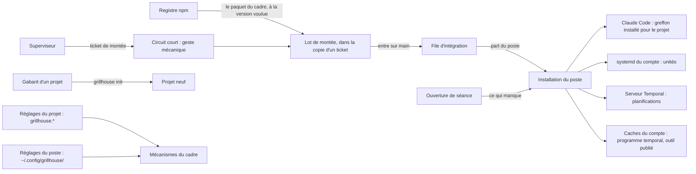
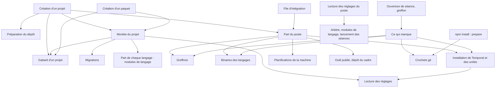

# L'installation et les réglages d'un projet — architecture

L'installation pose le cadre dans un projet et sur le poste, puis les amène à la version du paquet installé : elle crée un projet depuis le gabarit, écrit dans le projet ce que le cadre y écrit, installe le greffon pour le projet, pose les unités systemd du compte et les planifications de la machine, et joue les migrations d'une forme du projet à la suivante. Les réglages disent au cadre ce qui est propre à un projet, par les clés `grillhouse.*` de son `package.json`, et à un poste, par les fichiers de `~/.config/grillhouse/`. Ce document, à l'adresse `packages/grillhouse/docs/architecture/installation.md`, décrit la construction cible de l'installation, de la montée, des réglages du projet et du poste, du gabarit et des unités, de l'infrastructure à la donnée. Il détaille le document de tête (`docs/ARCHITECTURE.md`, §2.5, §2.6, §3.2, §4, §5, §6) ; ce qu'un réglage règle vit au document du mécanisme qui le lit, que celui-ci cite sans le répéter. La section 9 dit, chantier par chantier, où le code ne l'a pas rejoint.

## 1. Contexte



Ce qui traverse les bords du mécanisme :

- **le paquet du cadre**, que le projet installe du registre npm à la version qu'il déclare, avec le greffon qu'il porte (document de tête, §3.1) ;
- **le lot de montée**, les fichiers que le cadre écrit dans le projet, qui entre sur main comme tout lot (document de l'entrée sur main, §2.1, §2.2) ;
- **la part du poste** : le greffon installé pour le projet, que Claude Code tient ; les unités du compte, que systemd relance ; les planifications de la machine, que le serveur Temporal tient ; le programme `temporal` et la version publiée qui mène le dépôt du cadre, dans les caches du compte ;
- **les réglages du projet et du poste**, que lisent les autres mécanismes ;
- **ce qui manque**, que l'ouverture de séance demande à ce mécanisme et que le greffon affiche (document du greffon et du panneau).

## 2. Stratégie

Les six choix portent un numéro fixe, qu'un ticket cite (§2.3) et qui ne se réattribue pas.

1. **La version qui mène un projet est celle du paquet installé, et tout le reste en découle.** Le projet déclare le paquet `@roomi-fields/grillhouse` dans ses `devDependencies` ; npm l'installe ; ce que le cadre écrit dans le projet, le greffon installé pour le projet, l'unité du travailleur du projet et les planifications de la machine se tirent du paquet installé, par la commande de montée. Seul le dépôt du cadre se mène avec une autre version que son code, la version publiée que nomme sa clé `grillhouse.outil` (§5.5). Raison et modèle : document de tête, §2.5 ; `nx migrate`, dont « `nx migrate` applies the package version updates to your `package.json` and writes a `migrations.json` file », puis « `nx migrate --run-migrations` runs the generated migrations to update your configuration files and source code » (lu, nx.dev/docs/features/automate-updating-dependencies).
2. **Une montée est un lot, puis une application au poste.** Monter un projet est un ticket du circuit court, au geste mécanique (charte commune, « Un ticket prend le circuit court », qui nomme la montée du cadre) : le plan nomme la commande, qui installe la version voulue dans la copie du ticket et y écrit ce que le cadre écrit dans le projet ; le lot est jugé et entre sur main comme les autres. À l'entrée d'un lot qui change la version installée du cadre, la file d'intégration réinstalle les dépendances de l'arbre principal et joue la part du poste (§5.3). Raison : ce que la montée écrit dans le projet est jugé avant main comme tout lot, le superviseur ne produit rien, et monter un projet est un seul geste, le départ d'un ticket. Modèle : la demande de montée jugée comme un autre changement, celle de Renovate, « Get pull requests to update your dependencies and lock files » (lu, docs.renovatebot.com), et de Dependabot (non lu pour le cas général) ; l'application au poste après la fusion, celle du GitOps : Argo CD « automates the deployment of the desired application states in the specified target environments » (lu, argo-cd.readthedocs.io/en/stable), Flux est « a tool for keeping Kubernetes clusters in sync with sources of configuration (like Git repositories) » (lu, fluxcd.io/flux). Écart : la part du poste se joue à l'entrée du lot, par la file, et non par une boucle qui compare sans cesse le poste au dépôt ; un poste dérivé se répare à la main, dans l'arbre principal, par les commandes que nomme §5.3, et l'ouverture de séance dit ce qui manque.
3. **Le cadre n'écrit dans un projet que ce qu'un outil tiers lit à une adresse fixe, et chaque chose qu'il écrit a un seul propriétaire.** Les scripts, les compétences, les agents, les crochets de Claude Code, la charte commune et le métacadre vivent dans le paquet installé, et le projet n'en garde aucune copie. Ce que le cadre écrit dans un projet est soit **au cadre**, un fichier entier marqué que la montée réécrit (un flux de GitHub Actions), soit **au projet**, un fichier du projet où la montée ajoute ou remplace ses seules entrées, nommées, et laisse les autres (§4.4). Raison : un projet suit la version qu'il installe sans fichier à recopier, et la montée ne détruit rien que le projet a écrit. Modèle : Husky, dont l'initialisation « creates a `pre-commit` script in `.husky/` and updates the `prepare` script in `package.json` » (lu, typicode.github.io/husky/get-started.html) ; un paquet d'ESLint qui porte son greffon (non lu).
4. **Un projet règle le cadre par ses seules clés `grillhouse.*`, décrites une fois, lues par un seul module, refusées avant tout travail.** La liste des clés vit dans ce document (§4.2) ; chaque clé a un mécanisme qui la lit, dont le document dit ce qu'elle règle. Les clés de la racine se lisent dans le `package.json` de l'arbre principal, jamais dans une copie, si bien qu'un agent ne règle jamais le cadre pour la séance suivante. Un seul module lit et valide les réglages ; une valeur fautive est refusée par le nom de sa clé, et une clé que la liste ne nomme pas est refusée par la garde des réglages. La charte d'un projet ne décrit aucun réglage : elle renvoie à ce document. Raison : une clé décrite à cinq adresses dérive à quatre, et une clé sans lecteur reste dans un projet sans que rien le dise (document de tête, §2.6). Modèle : la validation par schéma de la configuration d'un outil, comme `turbo.json` (non lu).
5. **Une migration change une forme une fois, se rejoue sans effet, et part quand aucun projet du poste ne la rejoue plus.** Une migration porte la version du paquet qui amène sa forme, que la sortie lui donne : avant elle, elle n'en a aucune ; la montée joue celles plus récentes que la dernière montée du projet, dans l'ordre des versions ; chacune rend ce qu'elle a changé et ce qu'elle laisse au projet. Une migration que tous les projets du poste ont passée se retire, avec son test. Raison : le besoin est la machine de l'utilisateur et ses projets ; une migration qu'aucun projet ne rejoue est du code sans usage. Modèle : `@turbo/codemod migrate`, « All the codemods you need to upgrade will be run for you » (lu, turborepo.dev/docs/reference/turbo-codemod).
6. **Les unités du compte s'écrivent depuis la version qui mène chaque projet, s'appliquent une fois, et ne coupent jamais un circuit en vol.** Le compte porte un serveur Temporal et un travailleur de la machine, chaque projet un travailleur ; le texte de chaque unité se calcule d'un seul code, s'écrit quand il diffère, et ce que systemd a appliqué se garde à part, par la somme du texte. L'unité du serveur ne s'applique pas tant qu'un circuit vole. Raison : une montée rejouée ne change rien, une unité écrite mais non appliquée se rattrape au passage suivant, et un circuit ne perd pas son serveur. Modèle : l'exécution durable de Temporal, dont un travailleur se remplace sans perdre un déroulé (document de tête, §2.1) ; le programme épinglé par sa somme, comme le stage0 de rustc (non lu). Écart : Temporal réserve son serveur de développement, sur SQLite, au développement local, et tient un serveur qui dure sur PostgreSQL (non lu) ; le cadre garde le serveur de développement, avec un historique de sept jours, le journal WAL et la priorité du processeur, et PostgreSQL est le pas suivant si cela ne suffit pas.

## 3. Composants



### 3.1 Les composants du mécanisme

| Composant | Responsabilité | Possède | Appelle |
|---|---|---|---|
| Création d'un projet (`grillhouse init`, `scripts/init.mjs`) | créer un projet neuf dans un dossier vide depuis le gabarit, le préparer, le monter, appliquer la part du poste, et finir sur un premier commit | rien | le gabarit, la préparation, la montée du projet, la part du poste, git |
| Préparation du dépôt (`scripts/preparation.mjs`) | faire du dossier un dépôt git doté de Beads sous son préfixe et de l'index de CodeGraph, puis installer ses dépendances | rien | git, Beads, CodeGraph, npm |
| Gabarit d'un projet (`templates/projet/`, `templates/<langage>/`, `templates/paquet/`, `templates/turbo/`) | porter les fichiers qu'un projet reçoit à sa création, et ce que la montée lit de la version (les scripts du cadre, les versions des outils de chaque langage, les flux du cadre) | les fichiers du gabarit | rien |
| Montée du projet (`grillhouse maj`, `scripts/grillhouse-maj.mjs`) | amener ce que le cadre écrit dans le projet à la version du paquet installé : les migrations, les entrées du cadre (§4.4), la part de chaque langage, les fichiers engendrés ; inscrire la dernière montée ; dire ce qui reste au projet | la marque de la dernière montée (`grillhouse.version`), ce que le cadre écrit dans le projet | les migrations, les modules de langage, la lecture des réglages, Beads |
| Migrations (`scripts/migrations.mjs`, un module par forme sous `scripts/migrations/` et sous le dossier de chaque module de langage) | amener le projet d'une forme à la suivante, sans effet quand il l'a déjà ; dire ce qu'elle laisse au projet | rien | rien |
| Part du poste (§5.3) | amener le poste à la version qui mène le projet : le greffon installé pour le projet, les binaires des langages, les unités, les planifications, et pour le dépôt du cadre l'outil publié | rien : chaque état est au composant qu'elle appelle | les greffons, les binaires, l'installation de Temporal, les planifications, l'outil publié |
| Greffons (`scripts/greffons.mjs`) | installer pour l'arbre principal du projet les greffons que ses réglages de Claude Code déclarent, aligner le greffon du cadre sur la version du paquet, retirer les inscriptions du greffon du cadre dont le dossier n'existe plus ; dire ce qui manque | rien : l'inscription est à Claude Code | Claude Code (`claude plugin`) |
| Binaires des langages (`grillhouse binaires`, `scripts/binaires.mjs`) | installer sur le poste les programmes que les langages déclarés du projet exigent, à leur version : ceux de cargo par `cargo binstall`, que cargo installe d'abord quand il manque, uv par l'installeur d'Astral | rien | l'outil de chaque langage (cargo, uv) |
| Installation de Temporal et des unités (`grillhouse temporal installer`, `src/temporal/installation.ts`) | poser le programme `temporal` épinglé, écrire et appliquer les unités du compte, relancer la file d'intégration sous la version installée ; détecter un travailleur périmé ; purger les déroulés fermés au-delà de la rétention et les historiques orphelins, puis compacter la base (`grillhouse temporal purger`) | le programme posé, les unités du compte, les unités appliquées | systemd, le serveur Temporal, l'outil publié |
| Planifications de la machine | poser, une par poste, la planification des nuits et celle du recalcul quotidien de la table des consommations | rien : la planification est au serveur | le serveur Temporal (`grillhouse nuit --planifier`, et la commande de la table pour le recalcul) |
| Outil publié et aiguillage (`grillhouse outil`, `scripts/outil.mjs`, `scripts/aiguillage.mjs`) | dans le dépôt du cadre, installer la version publiée que nomme `grillhouse.outil` et faire tourner l'orchestration par elle | l'outil installé et la marque de son échec | npm |
| Crochets git (`grillhouse hooks`, `scripts/crochets.mjs`) | poser les crochets git du cadre et le pilote de fusion du journal des versions, à chaque installation des dépendances (le `prepare` du projet) | les lignes du cadre dans les crochets, le pilote dans la configuration du dépôt | rien |
| Lecture des réglages du projet | lire et valider chaque clé `grillhouse.*` dans l'arbre principal, la refuser par son nom ; refuser une clé inconnue (la garde des réglages) | rien | rien |
| Lecture des réglages du poste (`scripts/fichier-du-poste.mjs`, `scripts/plafond-de-la-machine.mjs`) | lire un fichier du poste et le joindre à l'environnement, sauf quand l'environnement nomme déjà l'une de ses variables | rien | rien |
| Ce qui manque (les modes `--absents` et `perime` des composants ci-dessus, et la marque des dépendances, `scripts/abi-des-dependances.mjs`) | dire, sans rien écrire, ce que la version installée attend et que le poste ou le projet n'a pas, chaque manque avec la commande qui le pose | rien | les composants ci-dessus |
| Création d'un paquet (`grillhouse paquet`, `scripts/paquet.mjs`) | bâtir le squelette d'un paquet que l'architecture déclare, avec les outils de son langage | rien | le gabarit, la montée du projet, les binaires |

Tous sont du paquet `grillhouse` ; les modules sous `scripts/` et le script d'ouverture de séance en Bash sont ceux d'avant la migration (§9, chantier 6). La création d'un paquet est le troisième des quatre temps de sa naissance (charte commune, « Un paquet naît hors du circuit ») ; la part de son langage et ses refus sont au document des tests et des langages (§5.6).

### 3.2 Les voisins, et ce que le mécanisme leur demande

| Voisin | Ce qu'il lui demande | Son document |
|---|---|---|
| Circuit court | mener le ticket de montée : la commande du plan jouée au geste mécanique (1.1), la passe finale, la relecture | Le circuit |
| File d'intégration | jouer la part du poste après l'entrée d'un lot qui change la version installée du cadre ; repartir sous la version installée (signal `relancer`) | L'entrée sur main, la CI et la nuit |
| Greffon et panneau | appeler à l'ouverture de séance ce qui manque, et l'afficher | Le greffon et le panneau |
| Arbitre de la machine | lire les réglages du poste ; recevoir sa planification du recalcul quotidien | La machine et l'enveloppe |
| Modules de langage | donner leur part de la montée : leurs outils, leurs fichiers, leurs générateurs, leurs binaires, leurs migrations, le fichier du poste qu'ils lisent | Les tests et les langages |

### 3.3 La garde de chaque frontière

- **Un réglage et le cadre** : la garde des réglages refuse une clé `grillhouse.*` que la liste de §4.2 ne nomme pas, et chaque lecteur refuse une valeur fautive par le nom de sa clé, avant tout travail.
- **Ce que le cadre écrit et ce qu'écrit le projet** : un flux marqué est au cadre et la montée le réécrit ; un flux sans la marque est au projet (document de l'entrée sur main, §3.3). Dans un fichier au projet, la montée ne touche que ses entrées (§4.4) ; aucune garde ne refuse un projet qui retouche une entrée du cadre, que la montée suivante réécrit.
- **La montée et main** : le lot de montée passe par la passe finale de son circuit et la garde de main, comme tout lot ; la montée ne joue aucune vérification et n'inscrit aucun arbre.
- **Une copie et le poste** : la part du poste ne se joue que dans l'arbre principal ; la montée jouée dans une copie n'appelle ni Claude Code, ni systemd, ni le serveur, ni l'outil d'un langage qui installe sur le poste. Aucune garde ne le refuse aujourd'hui (§9.1).
- **« Un état, un propriétaire »** : aucune garde ; le tableau de §4.1 fait foi à la relecture.

## 4. Données

### 4.1 Les états et leur propriétaire

| Donnée | Forme et adresse | Écrite par | Lue par | Durée de vie |
|---|---|---|---|---|
| La version installée du cadre | `version` de `node_modules/@roomi-fields/grillhouse/package.json` de l'arbre principal | npm, d'après la plage que le projet déclare et son fichier de verrou | la montée, la part du poste, l'ouverture de séance, la commande du cadre | jusqu'à la montée suivante |
| La plage déclarée | `devDependencies["@roomi-fields/grillhouse"]` de chaque `package.json` qui la déclare | le lot de montée | npm | le projet |
| La marque de la dernière montée | `grillhouse.version`, `x.y.z`, du `package.json` racine | la montée, quand aucune migration ne laisse rien à faire | la montée, qui en tire les migrations à jouer | jusqu'à la montée suivante |
| Ce que le cadre écrit dans le projet | les entrées de §4.4, dans les fichiers du projet | la montée | les outils qui les lisent (npm, Claude Code, git, GitHub Actions, Beads) | une version |
| Les réglages du projet | les clés `grillhouse.*` de §4.2 | le projet (un lot), hors `version` et l'entrée d'un flux du cadre dans `flux`, que la montée écrit | le mécanisme que §4.2 nomme pour chaque clé | le projet |
| Les réglages du poste | les fichiers de §4.3, sous `$XDG_CONFIG_HOME/grillhouse/`, `~/.config/grillhouse/` sans lui | l'utilisateur | les lecteurs que §4.3 nomme | le poste |
| Le greffon installé pour le projet | l'inscription de `grillhouse@roomi-fields` à la portée du projet, chemin de l'arbre principal, dans l'état des greffons de Claude Code | Claude Code, sur la demande des greffons | Claude Code, ce qui manque | jusqu'à la montée suivante |
| Le programme `temporal` | `~/.cache/grillhouse/temporal/<version>/temporal`, à la version et à la somme épinglées (`EPINGLE`) | l'installation de Temporal | les unités, la nuit | un cache, qui se refait |
| Les unités du compte | `~/.config/systemd/user/grillhouse-temporal.service`, `grillhouse-travailleur-<projet>.service`, `grillhouse-travailleur-machine.service` | l'installation de Temporal ; l'unité de la machine, par le projet qui l'a écrite, qu'un autre ne prend que pour la monter | systemd | jusqu'à la montée suivante |
| Les unités appliquées | la somme du texte de chaque unité que systemd a appliquée, par nom d'unité ; `~/.local/state/grillhouse/temporal/unites-appliquees.json` | l'installation de Temporal | l'installation, la détection d'un travailleur périmé | le poste |
| Les projets du poste | les projets dont le compte porte l'unité du travailleur, chacun par son dossier de travail (`WorkingDirectory`) | l'installation de Temporal | le choix des nuits, le recalcul quotidien, le retrait des migrations | le poste |
| Les planifications de la machine | `grillhouse-nuits` et le recalcul quotidien de la table des consommations, au serveur Temporal | la part du poste | le serveur | le poste |
| L'outil publié du dépôt du cadre | `~/.cache/grillhouse/outil/<version>/` et la marque de son échec `<version>.echec` (date, raison) | l'aiguillage | la commande du cadre, l'installation de Temporal, l'ouverture de séance, le tableau | un cache ; la marque jusqu'à l'installation réussie |
| La marque des dépendances | l'interface binaire de Node de l'installation, `node_modules/.grillhouse-abi` | le `prepare` du projet sous `npm ci`, la nuit | ce qui manque | jusqu'à la réinstallation |

Un fichier que ce tableau ne nomme pas est une trace ou un cache, qui se refait : le dossier d'installation à demi posé d'un outil, l'archive téléchargée.

### 4.2 Les réglages du projet

Une clé est **de la racine** quand elle vit dans le `package.json` racine, lu dans l'arbre principal ; **d'un paquet** quand elle vit dans le `package.json` d'un paquet. Absente, une clé ne règle rien, ou prend le défaut que dit la colonne.

| Clé | Où | Forme, défaut | Ce qu'elle règle, et son document |
|---|---|---|---|
| `version` | racine | `x.y.z`, écrite par la montée | la dernière montée (§5.4) ; ce document |
| `outil` | racine, dépôt du cadre seul | `x.y.z` | la version publiée qui mène le dépôt du cadre (§5.5) ; ce document |
| `circuits` | racine | entier ≥ 1 ; 1 | la limite des circuits du projet ; le circuit, §5.4, et la machine, §5.4 |
| `groupe` | racine | le groupe de projets | l'ordre des places entre les projets d'un groupe, les questions relevées pour le groupe, les projets externes de Beads ; la machine, §5.4, et le greffon |
| `mesure` | racine | `{ "coeurs": <entier ≥ 1> }` ; 3 | les cœurs dédiés d'une mesure de temps ; la machine, §5.2 |
| `outils` | racine | `{ "<VARIABLE>": "<chemin>" }`, ou `{ "chemin", "contenu": true }` par outil | les outils hors du dépôt que les tests exigent ; la machine, §5.5, et les tests et les langages |
| `partage` | racine | une liste de chemins de sous-modules | les sous-modules que chaque copie lit dans le dépôt principal ; le circuit |
| `references` | racine | une liste de `{ nom, commande, fichiers, tests?, lit?, gardes? }` | les références que le circuit régénère ; le circuit |
| `engendres` | racine | `{ "<nom>": { commande, fichiers, lit } }` | les fichiers engendrés commités, régénérés et jamais fusionnés ; l'entrée sur main, §5.2 |
| `flux` | racine | `{ "<flux>": ["<paquet>"] }` | les paquets qu'exerce chaque flux de la CI ; l'entrée sur main, et les tests et les langages |
| `matieres` | racine | une liste de dossiers du dépôt | les dossiers de matière de test hors paquet ; les tests et les langages |
| `nuit` | racine | le nom d'un script npm | le script de nuit du projet ; l'entrée sur main, §5.3 |
| `demarrage` | racine | le nom d'un script npm | le contrôle d'ouverture du projet ; le greffon |
| `rappel` | racine | minutes > 0 ; 10 | le rappel d'une question lue et sans réponse ; le greffon |
| `plageDeNuit` | racine | `{ "debut", "fin" }`, heures locales ; 23 et 8 | l'attente comptée comme nuit au bilan ; le circuit |
| `sigle` | racine | une chaîne sans espace ; le préfixe des tickets | le nom court du projet aux affichages partagés ; le greffon |
| `lit` | paquet | une liste de chemins | ce que lisent les tests du paquet hors de son graphe ; les tests et les langages |
| `traces` | paquet | `{ "<trace>": { "lit": ["<chemin>"] } }` | les traces d'autres paquets qu'attendent les tests du paquet, et ce que chacune lit ; les tests et les langages |
| `donnees` | paquet | `{ "<VARIABLE>": "<paquet>#<sortie>" }` | la sortie construite d'un autre paquet que lancent les tests ; les tests et les langages |

**Les refus propres à une clé**, par son nom et avant tout travail : pour `outils`, un chemin qui recouvrirait l'enveloppe (`/`, la maison ou ce qui la contient, un dossier caché de premier niveau de la maison hors `~/.local` et `~/.cache`, le trousseau `~/.local/share/keyrings`, un montage de l'enveloppe ; un lien jugé par sa cible), et pour un outil haché une forme d'objet inconnue ; pour `matieres`, un dossier qui est un paquet, en contient un ou y est contenu ; pour `engendres`, une entrée sans commande, sans fichiers ou avec un motif hors du dépôt; pour `partage`, une valeur qui n'est pas une liste, un élément qui n'est pas un chemin relatif non vide dans le dépôt, un chemin qui n'est pas un sous-module de `.gitmodules`, un sous-module partagé absent ou non initialisé dans le dépôt principal ; pour `donnees`, un nom qui n'est pas celui d'une variable, une valeur qui n'est pas de la forme `<paquet>#<sortie>`, un paquet absent des `devDependencies` du consommateur, une sortie que le langage du fournisseur ne connaît pas (seul un binaire de crate l'est aujourd'hui), une clé fautive ne donnant aucune variable. Un dossier de `matieres` suit la règle d'un fichier de test : le testwriter seul l'écrit, les autres rôles le lisent.

**Un sous-module partagé** ne se pose pas dans une copie : la copie lit celui du dépôt principal, au commit qui y est extrait, par un lien que l'index de la copie ignore ; la pose ne le touche jamais, ni ses sous-modules, et pose chaque autre sous-module au commit de HEAD depuis l'adresse que le dépôt principal lui donne, une adresse relative se résolvant comme `git submodule init` la résout. Chaque commande du projet que le cadre joue dans une copie (l'intégration, la nuit, l'installation et la construction de la copie d'un agent) voit les sous-modules partagés en lecture seule, leur arbre et leur dépôt git compris ; quand ce montage est impossible, rien ne joue et la raison est dite.

Une clé retirée quitte la liste et sa lecture dans le même commit ; la garde des réglages la refuse ensuite comme une clé inconnue, et la migration de sa version la retire des projets. Sont retirées : `part`, que la table des consommations remplace (machine, §2.2) ; `poussee` ; `langages`, que la colonne « Langage » de l'architecture remplace. Le module cargo lit à part la liste des frontières permises, `[workspace.metadata.grillhouse.frontieres]` du `Cargo.toml` racine (document des tests et des langages).

### 4.3 Les réglages du poste

Chaque fichier tient une variable par ligne, `VARIABLE=valeur`, comme un `.env` du shell. Un fichier ne s'applique pas quand l'environnement nomme déjà l'une de ses variables (une CI sur l'exécuteur du poste) ; absent, il ne change rien. L'enveloppe d'une séance de rôle ne montre aucun de ces fichiers (machine, §5.5).

| Fichier | Variables | Lu par | Son document |
|---|---|---|---|
| `machine.env` | `GRILLHOUSE_PLACES`, `GRILLHOUSE_RESERVE_COEURS`, `GRILLHOUSE_RESERVE_MEMOIRE_GO`, `GRILLHOUSE_ATTENTE_MACHINE_MS` | les activités de l'arbitre, le pont synchrone | La machine et l'enveloppe, §4.1 |
| `turbo-cache.env` | `TURBO_API`, `TURBO_TOKEN`, `TURBO_TEAM`, `TURBO_REMOTE_CACHE_SIGNATURE_KEY` | le module de langage qui joue Turborepo, en lecture seule du cache distant | Les tests et les langages |
| `api.env` | `ANTHROPIC_API_KEY` | le lancement d'une séance de rôle | La machine et l'enveloppe, §5.5 |

### 4.4 Ce que le cadre écrit dans un projet

| Fichier | Ce qui est au cadre | Règle |
|---|---|---|
| `package.json` racine | les scripts `tableau`, `grillhouse:maj`, `grillhouse:gardes`, `grillhouse:dette:inscrire`, `grillhouse:dette:elaguer`, `api` ; la tête `grillhouse hooks` du `prepare` ; les outils de chaque langage déclaré dans `devDependencies`, absents seulement ; `packageManager`, absent seulement ; `grillhouse.version` ; l'entrée de `grillhouse.flux` d'un flux du cadre | au projet : chaque entrée du cadre est remplacée, les autres restent, dans leur ordre |
| `.claude/settings.json` | la place de marché `roomi-fields` (`extraKnownMarketplaces`), le greffon `grillhouse@roomi-fields` (`enabledPlugins`), la ligne d'état du cadre (`statusLine`, redessinée toutes les dix secondes) quand elle est absente ou celle du cadre | au projet |
| `.github/workflows/ci.yml`, `nuit.yml`, `machine-vierge.yml` | le fichier entier, marqué sur sa première ligne ; un projet qui en tient un reçoit ceux qui lui manquent, un projet qui n'en tient aucun n'en reçoit aucun | au cadre ; sans la marque, au projet (entrée sur main, §3.3) |
| `.gitignore` | une ligne par dossier qu'écrit le cadre (`.claude/worktrees`, `.turbo`) ou l'outil d'un langage déclaré | au projet |
| `.gitattributes` | `CHANGELOG.md merge=grillhouse-changelog` | au projet |
| `.mcp.json` | les serveurs d'index `codegraph` et `rtfm` dans `mcpServers`, absents seulement, posés par la migration des serveurs d'index à la montée et à la création | au projet : une entrée présente reste telle quelle |
| `.beads/config.yaml`, configuration de Beads | `issue-prefix`, la valeur du magasin, quand aucune n'est active ; les `external_projects` des autres projets du groupe | au projet |
| les fichiers engendrés de chaque langage | le fichier entier, que sa commande refait (la configuration des frontières, l'index des interfaces) | au cadre |
| la part de chaque langage | ce que son module déclare (document des tests et des langages) | selon le module |

Hors du dépôt, le même mécanisme écrit, à chaque installation des dépendances, les lignes du cadre dans les crochets `commit-msg` et `pre-push` du dossier que git lit, et la commande du pilote de fusion dans la configuration du dépôt. Le pilote de fusion du journal des versions joue partout où git fusionne en trois voies (la file, l'avance d'une copie) : deux ajouts au même endroit sont gardés tous deux, ceux de main d'abord, et tout autre conflit reste un conflit, comme git-merge-changelog de gnulib (non lu) ; dans le dépôt du cadre, il vaut pour le CHANGELOG du paquet publié, `packages/grillhouse/CHANGELOG.md`.

**Node 26 seul.** Le cadre tourne sur Node 26, le support long actif, comme un produit qui épingle sa chaîne d'outils : le poste, la CI, la nuit et la publication jouent Node 26 ; `engines.node` vaut `>=26.0.0` à la racine, dans le paquet et dans le gabarit, dont le `packageManager` nomme le npm livré avec Node 26. La montée porte à `>=26.0.0` un `engines.node` de `>=22.0.0` ou `>=24.0.0`, et nomme toute autre valeur sans la toucher.

### 4.5 Le gabarit d'un projet

Le gabarit porte ce qu'un projet reçoit une fois, à sa création, et ce que la montée lit de la version : rien d'autre. Un projet reçoit : sa charte (`CLAUDE.md`, ses champs `<…>` laissés au grill, qui importe la charte commune du paquet installé et renvoie, pour les commandes et les réglages, aux documents du paquet) ; `docs/ARCHITECTURE.md`, qui déclare son langage ; `docs/agents/issue-tracker.md` ; `CONTRIBUTING.md`, `CHANGELOG.md` ; les réglages de Claude Code (`.claude/settings.json`) et des serveurs d'index (`.mcp.json`, que la création complète de `codegraph` et `rtfm`) ; les flux du cadre ; le `package.json` des scripts du cadre et des versions des outils de son langage ; la configuration de ces outils (TypeScript, Vitest, ESLint, Prettier, TSDoc, EditorConfig) ; `_gitignore` et `_npmignore`, renommés. Il ne porte aucune application : ni code sous `src/`, ni déploiement, ni gestionnaire de processus, ni dépendance d'exécution. `templates/<langage>/` porte, pour chaque langage, les fichiers de ses outils ; `templates/paquet/` les documents d'un paquet neuf ; `templates/turbo/` la configuration de Turborepo d'un dépôt avec ou sans paquets.

## 5. Déroulé

### 5.1 La création d'un projet

```mermaid
sequenceDiagram
  participant P as Personne
  participant I as Création d'un projet
  participant G as Gabarit
  participant R as Préparation du dépôt
  participant M as Montée du projet
  participant O as Part du poste
  P->>I: grillhouse init <dossier> [<préfixe>]
  I->>I: refuse un dossier qui tient un fichier
  I->>G: copie templates/projet/, fichiers renommés
  I->>I: déclare le paquet du cadre à ^<version installée>
  I->>R: git, Beads sous le préfixe, CodeGraph, npm install
  I->>M: écrit ce que le cadre écrit, engendre les fichiers
  I->>O: greffons, binaires, unités du projet, planifications
  I->>I: premier commit, sans ticket
  I-->>P: le projet ; chaque échec nommé avec sa commande
```

La première séance ouverte dans le projet propose le grill d'initialisation, qui remplit la charte et l'architecture. Un projet qui existe adopte le cadre par la montée : il déclare le paquet, puis joue `npx grillhouse maj` ; la création refuse un dossier non vide.

### 5.2 La montée d'un projet

```mermaid
sequenceDiagram
  participant U as Superviseur
  participant C as Circuit court
  participant X as Explorateur, geste mécanique (1.1)
  participant M as Montée du projet
  participant F as File d'intégration
  participant O as Part du poste
  U->>C: ticket de montée, la version voulue
  C->>X: commande du plan, dans la copie
  X->>M: npm install -D @roomi-fields/grillhouse@<x.y.z>, puis grillhouse maj
  M->>M: langages déclarés, migrations, entrées du cadre, part des langages, fichiers engendrés, marque
  M-->>X: rapport, ce qui reste au projet
  C->>C: passe finale, relecture
  C->>F: entre (le lot)
  F->>F: avance main, pousse
  F->>F: la version installée a changé : npm ci dans l'arbre principal
  F->>O: joue la part du poste (§5.3)
  O-->>F: rapport ; la file repart sous la version installée
```

La montée du projet lit le paquet installé, jamais le réseau. Dans l'ordre : elle refuse un projet sans `package.json` ou sans langage déclaré dans la colonne « Langage » de son architecture ; elle joue les migrations (§5.4) ; elle écrit les entrées du cadre (§4.4), chacune lue dans le gabarit du langage déclaré, le premier gabarit qui a une entrée la donnant pour un projet de plusieurs langages ; elle joue la part de chaque langage (son module, document des tests et des langages) ; elle refait les fichiers engendrés que le projet tient ; elle inscrit la version installée dans `grillhouse.version` quand aucune migration ne laisse rien à faire. Son rapport nomme la version installée, chaque migration jouée et ce qu'elle a changé, chaque entrée écrite, puis ce qui reste au projet. Ce qu'une migration ou un langage laisse à faire va sur la sortie d'erreur, avec la commande qui le fait, et le code de sortie vaut 1 ; ce qui reste au projet ne change ni le code ni la marque. Elle ne joue aucune vérification : la passe finale du circuit juge le lot.

**La part du module typescript** : les scripts racine `test`, `test:unit`, `test:forcer` et `verifier` deviennent ceux du gabarit quand le Vitest de la racine tient la plage que le gabarit déclare, et restent ceux du projet sinon, le rapport nommant la version trouvée et la plage exigée ; un manifeste qui déclare le paquet du cadre à une plage sous la version installée passe à `^<version>`, comme Renovate aligne une dépendance de tout un espace de travail (non lu) ; un paquet dont le code publié importe le paquet du cadre le déclare dans ses `dependencies`, et chaque paquet qui joue des tests dans ses `devDependencies` ; un paquet de TypeScript sans script `typecheck` reçoit celui du gabarit ; un projet sans `turbo.json` reçoit le gabarit de sa forme, et un `turbo.json` présent n'est écrit que par le générateur du graphe.

La part du poste se joue quand le lot est sur main et que l'arbre principal tient ses dépendances : la file d'intégration voit changer la version installée du cadre entre l'avant et l'après de l'entrée, réinstalle les dépendances de l'arbre principal, puis joue la part du poste, en dernier geste de l'entrée. Le ticket de montée se ferme sur son entrée, comme un autre ; le rapport de la part du poste entre au journal de la file et, en échec, ouvre l'alerte du superviseur avec la commande à rejouer.

### 5.3 La part du poste

Dans l'arbre principal, dans cet ordre, chaque geste rejoué sans effet sur un poste à jour :

1. **L'outil publié**, dans le dépôt du cadre seul : la version que nomme `grillhouse.outil` s'installe sous `~/.cache/grillhouse/outil/<version>/` (§5.5).
2. **Les greffons** : chaque place de marché que les réglages de Claude Code du projet déclarent s'ajoute quand le compte ne la connaît pas ; chaque greffon déclaré s'installe pour l'arbre principal, à la portée du projet ; le greffon du cadre se met à la version du paquet ; les inscriptions du greffon du cadre dont le dossier n'existe plus se retirent. Une séance de superviseur ouverte prend le greffon neuf à son redémarrage.
3. **Les binaires des langages** déclarés, chacun installé quand le poste ne l'a pas à sa version.
4. **Le programme et les unités** : le programme `temporal` se pose à sa version épinglée, son archive refusée quand sa somme diffère ; les trois unités s'écrivent depuis la version qui mène le projet (§2.6) ; systemd n'applique que ce qu'il n'a pas appliqué. Quand l'unité du serveur doit s'appliquer et qu'un circuit vole, elle seule attend un passage suivant, les circuits nommés au rapport ; sinon le serveur s'arrête, sa base se compacte, et il repart, le rapport disant la taille avant et après ; un compactage qui échoue redémarre le serveur et refuse l'installation par son nom. Le travailleur du projet repart en dernier, et la file repart sous la version installée, aussitôt si elle est au repos, après son entrée en cours sinon.
5. **Les planifications de la machine** : celle des nuits et celle du recalcul quotidien, créées ou mises à jour, une par poste.

Chaque échec a sa ligne, qui nomme la commande à taper ; les autres gestes se jouent quand même, et le code de sortie vaut 1.

**Réparer un poste**, à la main, dans l'arbre principal, par la commande de ce qui manque :

- `npx grillhouse greffons` : les greffons manquants ou le greffon du cadre en retard ; elle installe pour le projet les seuls greffons déclarés qui lui manquent et met à jour le greffon du cadre en retard ;
- `npx grillhouse binaires` : les binaires des langages ;
- `npx grillhouse temporal installer` : les unités ;
- `npx grillhouse outil` : l'outil publié, dans le dépôt du cadre ;
- `npx grillhouse nuit --planifier` : la planification des nuits.

`npx grillhouse maj` ne sert pas à réparer un poste : elle écrit dans le projet, et ce qu'elle change entre sur main par un ticket de montée (§5.2).

**La purge de la base**, hors de la part du poste, à la main : `npx grillhouse temporal purger`. Le serveur garde à un déroulé fermé le minuteur de suppression posé à sa fermeture, sous la rétention d'alors : raccourcir la rétention n'atteint que les déroulés fermés ensuite. La commande supprime les autres par requête, ceux dont la fermeture (`CloseTime`) dépasse la rétention de sept jours, jamais un déroulé en cours (le modèle : `temporal workflow delete --query`, la suppression par lot de Temporal) ; elle attend que le serveur n'en compte plus, puis l'arrête, supprime les historiques orphelins, compacte sa base comme au geste 4 et le redémarre, le rapport disant le nombre d'orphelins supprimés et la taille avant et après. Un circuit en vol la refuse, les tickets nommés, avant la suppression et de nouveau avant l'arrêt ; une suppression refusée, ou sans avance pendant 5 min, la refuse sans arrêter le serveur ; un retrait des orphelins ou un compactage qui échoue redémarre le serveur et la refuse par son nom.

**Les historiques orphelins** sont les arbres d'historique (`history_tree`, `history_node`) qu'aucune exécution de la base ne référence, tels ceux que le serveur écrivait à chaque départ du déroulé de la machine demandé alors qu'il tournait déjà. La commande les supprime par requête SQL, serveur arrêté, en une transaction. Un arbre reste dès qu'une exécution présente porte son identifiant, ou le nomme dans ses données (le jeton de branche, qu'un déroulé réinitialisé garde sur l'arbre dont il vient) ; une exécution encodée autrement qu'en Protobuf refuse le retrait, rien supprimé. C'est un écart à la référence, décidé par le responsable : Temporal ne documente aucun geste pour ces orphelins, et son interface ne supprime un historique qu'avec son exécution.

### 5.4 Les migrations

Une migration exporte sa version, son nom et sa fonction, qui amène le projet à la forme neuve et rend les lignes de ce qu'elle a changé, aucune quand il l'a déjà ; une ligne « à faire » est ce qu'elle laisse au projet, et ses restes ce qu'il reste après la montée. Le noyau porte les siennes, chaque module de langage les siennes. La montée joue celles d'une version plus récente que `grillhouse.version`, toutes quand la marque manque, dans l'ordre des versions puis de la liste. Une migration naît sans version : nul n'en choisit une avant la sortie que le responsable numérote, et la commande de sortie la lui écrit (document de l'entrée sur main, §5.4). Jusque-là elle vient après les autres, et la montée la joue pour une marque absente ou inférieure à la version du paquet ; un projet qui a inscrit cette version ne la rejoue pas, et la sortie, numérotée au-dessus, l'amène à tous. Modèle : `nx migrate`, qui ne rejoue pas une migration passée. Une migration qui laisse quelque chose à faire garde la marque où elle était, si bien que la montée suivante la rejoue. Une migration naît avec son test, et part, avec lui, dans la sortie qui suit le jour où tous les projets du poste ont inscrit sa version ou une suivante.

La migration des serveurs d'index donne à tout projet les index : elle ajoute au `.mcp.json` (qu'elle crée au besoin) les serveurs `codegraph` et `rtfm` qui y manquent, sans toucher aux autres entrées, et la création d'un projet la joue sur le gabarit copié. Les séances des agents du projet les lisent là (document de la machine, §3.2). Le programme `rtfm-serve` vient avec le greffon rtfm : un projet qui ne l'active pas le lit parmi les restes de la montée.

### 5.5 Le dépôt du cadre

Le dépôt du cadre se mène avec une version publiée, et son code en cours est ce que ses tickets changent, comme rustc se construit avec son stage0 (non lu). Sa clé `grillhouse.outil` nomme la version publiée ; `npx grillhouse outil <x.y.z>` l'écrit, et la part du poste l'installe avec les dépendances qu'elle attend du projet, dans un dossier à côté renommé une fois complet. La commande du cadre aiguille chaque sous-commande avant de la jouer : l'orchestration tourne par la version publiée, les tests, la vérification et les gardes par le code de la copie, les outils du dépôt par son code ; chaque sous-commande a sa liste, qu'un test tient. Une version qui ne s'installe pas se dit en une ligne, le code du dépôt prend sa place, et la marque de l'échec l'empêche de relancer npm pendant cinq minutes et le fait dire à l'ouverture de séance et au tableau. Monter le dépôt du cadre est un ticket de montée dont la commande est `npx grillhouse outil <x.y.z>` ; la part du poste, à son entrée, pose l'outil, puis les unités qui le jouent. La sortie d'une version est au document de l'entrée sur main (§5.4).

### 5.6 Ce qui manque, à l'ouverture d'une séance

L'ouverture d'une séance du superviseur, hors de la copie d'un agent, demande à ce mécanisme ce qui manque, et chaque manque vient avec sa commande : l'outil de tickets et son magasin ; CodeGraph et son index ; les dépendances npm, et leur installation sous un autre Node que le courant ; le langage de chaque paquet ; un greffon déclaré non installé pour le projet, ou le greffon du cadre à une autre version que le paquet ; un travailleur périmé, quand les unités appliquées diffèrent des textes que l'installation écrirait ; un crochet git du cadre absent ; bubblewrap. Elle dit aussi l'échec de l'outil publié du dépôt du cadre. La forme de l'affichage est au document du greffon et du panneau.

## 6. Exécution

- **Où** : la création d'un projet tourne dans le dossier qu'elle crée ; la montée du projet dans la copie du ticket de montée, sous l'enveloppe de l'explorateur au geste mécanique, où npm atteint le registre ; la part du poste dans l'arbre principal, hors de toute enveloppe, lancée par un acte de la file d'intégration sur le travailleur du projet, ou à la main.
- **Les unités** : le serveur Temporal (`temporal server start-dev` sur la boucle locale, sa base `~/.local/share/grillhouse/temporal/temporal.db` en journal WAL, poids de processeur 1000, rétention de sept jours réglée à chaque départ) et le travailleur de la machine (file `grillhouse-machine`) sont au compte ; le travailleur d'un projet (file `grillhouse-projet-<nom>`) est au projet, son nom tiré du nom du paquet racine. Chaque unité repart toujours (`Restart=always`) ; celle d'un travailleur nomme le chemin des outils du compte qu'un circuit lance (node, npm, claude, bd, gh), les dossiers des exécutables de chaque langage déclaré, puis chaque outil du projet et le programme `temporal` par leur variable. L'unité de la machine est au projet qui l'a écrite ; un autre ne la réécrit que pour monter sa version, si bien que le travailleur de la machine joue la plus haute version qu'un projet du compte a installée.
- **Le client du serveur** : chaque travailleur et chaque client du cadre ouvrent le serveur par un seul module, `src/temporal/client.ts`, qui lit l'adresse et l'espace de noms dans les variables de Temporal, `TEMPORAL_ADDRESS` et `TEMPORAL_NAMESPACE`, comme le programme `temporal` et ses SDK, la boucle locale (`127.0.0.1:7233`) et `default` sans elles ; ouvrir un client n'ouvre aucune connexion, son premier appel l'ouvre. Un travailleur sert sur sa file de tâches tous les déroulés du cadre avec leurs activités ; `SIGTERM` ou `SIGINT` annule ses activités en cours et le fait sortir à 0, et un travailleur tué laisse le serveur donner son travail au suivant de sa file.
- **Ce qui survit** : les unités, leurs sommes appliquées, le programme posé et l'outil publié survivent au redémarrage du poste ; la marque de la dernière montée et ce que le cadre écrit dans le projet vivent dans git.
- **Ce qui est synchrone** : la montée du projet et la part du poste rendent la main à leur fin, leur rapport écrit ; une unité de serveur différée se rattrape au passage suivant de la part du poste, ou à la montée suivante.
- **Le réseau** : la montée du projet et la part du poste le lisent pour npm, la publication du programme `temporal` et les places de marché de Claude Code ; sans lui, chaque geste qui l'exige échoue nommé, et rien n'est posé à demi.
- **Les déroulés** : leur code, en TypeScript sous `src/temporal/`, se construit dans `dist/temporal/` par le `prepare` du paquet, la tâche `build` et le `prepack`, si bien que le paquet publié le porte ; ses dépendances `@temporalio/*` sont épinglées à une version exacte, et une sous-commande dont le code construit manque le dit, avec la commande qui le construit.

## 7. Concepts transverses

- **L'identité** : un projet se nomme par la racine de son arbre principal et, dans systemd et Temporal, par le nom de son paquet racine en minuscules ; une migration par sa version et son nom ; une clé par son chemin `grillhouse.<clé>`.
- **Les fautes** : une commande refuse avant tout travail, par le nom de la clé, du fichier ou de l'outil fautif, et rien n'est écrit ; l'installation des unités refuse ainsi un outil du compte, ou un exécutable d'un langage déclaré, absent, et un projet sans langage ou à langage inconnu, et n'écrit jamais le `package.json` du projet ; une montée qui a commencé finit ses fichiers et nomme chaque échec avec sa commande. Les codes de sortie : 0 ; 1 pour un refus ou un geste en échec ; 2 pour l'usage.
- **Un serveur qui ne répond pas** se dit par le fait mesuré, « Temporal ne répond pas en <n> s », parce qu'un serveur lent sous charge et un port où rien n'écoute se ressemblent depuis le client ; le tableau, l'ouverture de séance, la commande du circuit et l'état du service le disent ainsi, chacun avec le délai de sa propre lecture.
- **La reprise sans dommage** : chaque geste se rejoue sans effet de plus sur un projet ou un poste à jour : une entrée déjà écrite, une migration déjà jouée, un programme déjà posé, une unité déjà appliquée, un greffon déjà à sa version.
- **L'arbre principal** : les réglages du projet se lisent dans l'arbre principal, la part du poste s'y joue, et le greffon s'y installe ; une copie ne règle et n'installe rien.
- **La propriété d'un fichier** : un fichier est au cadre ou au projet (§2.3) ; un fichier au cadre porte sa marque sur sa première ligne, une entrée du cadre dans un fichier au projet se nomme par sa clé.
- **Aucune copie du cadre** : la charte d'un projet importe la charte commune du paquet installé, et ses agents lisent le métacadre, les compétences et les documents de référence dans le paquet installé.

## 8. Qualité

- **Une montée, un geste** : monter un projet demande le départ d'un ticket, et rien d'autre. Mesure : après l'entrée du lot de montée, l'ouverture de séance ne dit aucun manque.
- **La reprise sans effet** : une montée rejouée sur un projet à jour ne change aucun octet ; une part du poste rejouée n'appelle ni systemd ni le réseau. Mesure : les tests de la montée et de l'installation, qui jouent deux fois.
- **Une version** : la version installée, la marque de la dernière montée, le greffon installé pour le projet et le travailleur du projet portent la même version. Mesure : ce qui manque, à chaque ouverture de séance.
- **Pas de clé morte** : chaque clé d'un projet a un lecteur. Mesure : la garde des réglages, dans chaque passe.
- **Peu de migrations vivantes** : le paquet ne porte que les migrations qu'un projet du poste peut encore rejouer. Mesure : la plus ancienne version de migration, contre la plus ancienne marque des projets du poste.
- **Le service prouvé** : la sonde, un déroulé que chaque travailleur sert, lance un processus qui envoie un signe de vie à chaque pas, attend un signal quand on le lui demande, et repart de son dernier signe de vie quand son travailleur meurt. Mesure : les tests de nuit du service, qui la jouent.

## 9. Risques

### 9.1 L'écart entre la cible et le code, par chantier du document de tête

1. **Les documents de référence.** L'installation et la montée n'ont aucun document : l'architecture du paquet les cite à une vingtaine d'endroits sans les décrire, et leur contrat vit dans l'en-tête de `scripts/grillhouse-maj.mjs` (155 lignes), le README et `STRUCTURE.md`. Les clés `grillhouse.*` n'ont pas de liste : chacune est décrite à zéro ou plusieurs de cinq adresses (l'architecture, l'interface, le cadre du paquet, la charte du dépôt et celle du gabarit) ; `version`, `nuit`, `traces` et `demarrage` ne sont décrites que dans un en-tête de script ou dans `STRUCTURE.md`. La section « Commandes » de la charte du gabarit décrit les clés, la préparation de la CI et la machine vierge ; elle est copiée une fois à la création, la montée ne la touche pas, et la charte d'un projet écrite au grill ne l'a pas. `CONTRIBUTING.md` donne quatre gestes par projet et dit que la mise à jour installe le dernier commit de la branche par défaut, alors qu'elle n'installe rien. La charte du dépôt du cadre est la charte du gabarit, champs `<…>` non remplis, et le dépôt porte la marque `.claude/template` (« ce dossier est le gabarit ») alors qu'il se mène comme un projet. Le chantier écrit ce document, ramène la charte du gabarit à ses commandes et à un renvoi ici, et retire les autres descriptions ; la montée ne réécrit jamais la charte d'un projet, et la migration de sa version dit à chaque projet, au titre de ce qui lui reste, de retirer de sa charte la description des réglages.
2. **Le circuit direct passe par le moteur.** Rien de propre à ce mécanisme ; la montée passe par le circuit court, qui existe.
3. **Un état, un propriétaire.** La version qui mène un projet se lit aujourd'hui à cinq endroits : la plage npm, `grillhouse.version`, `grillhouse.outil` (que les quatre projets du poste portent, égale à la version installée), le greffon installé et l'unité du travailleur. La liste des projets du poste se tire du registre des agents (`~/.claude/grillhouse/registre.jsonl`), qu'écrivent les séances et où le déroulé des nuits écrit ses sauts. La mise à jour écrit une entrée de `grillhouse.flux` pour la machine vierge, à côté des entrées du projet. Le chantier retire `grillhouse.outil` des projets, tire la liste des projets du poste de leurs unités, et laisse les sauts de nuit au journal des nuits.
4. **Le jugement unique, puis l'admission unique.** La mise à jour finit par `npm run verifier` et pose le dernier vert sur l'arbre qu'elle laisse ; elle ne passe par aucun circuit. La clé `grillhouse.part` est portée par les quatre projets du poste. Le chantier retire la vérification de la montée, et la migration de sa version retire `grillhouse.part` des projets avec sa lecture.
5. **La montée en une commande, et les retraits.** Aujourd'hui monter un projet demande quatre gestes à la main : la mise à jour, `npx grillhouse outil <x.y.z>`, `npx grillhouse temporal installer` et `claude plugin update`, puis une vérification par projet. La part du poste (§5.3) n'a aucune commande qui la joue entière, et la file d'intégration ne la joue pas à l'entrée d'un lot. La mise à jour n'installe ni l'unité du travailleur, ni l'outil, ni les planifications ; la création d'un projet n'installe pas les unités de son travailleur ; aucune garde n'empêche la mise à jour d'appeler Claude Code et l'outil d'un langage dans une copie. Restent à retirer : les migrations d'avant 0.49.0, 34 des 36 modules (2 410 lignes pour les 36), et leurs tests (35 fichiers de tests de migration en tout), dont celle de 0.27.0 que la mise à jour joue à chaque passage pour déclarer les langages ; les lectures d'anciens formats de la mise à jour (l'ancien câblage des gardes, `pretest` et `integration:gardes`) ; l'application d'exemple du gabarit (`deployment/` et ses scripts PowerShell, `ecosystem.config.cjs` et les scripts `daemon:*` de pm2, `src/`, `.env.example`, `dotenv` et `zod`, le `main`, le `bin` et les `files` d'un paquet publié, le README à badges) ; `pitmaster/SUIVI.md` du gabarit ; le départ quotidien et sur étiquette du flux de la machine vierge et la phrase de la charte du gabarit qui les décrit (document de l'entrée sur main, §9.1) ; la lecture de la clé retirée `grillhouse.poussee`. Les inscriptions du greffon du cadre pour des copies de tickets ne sont retirées par personne : 450 sur 458 sur le poste, dont quatre dossiers existent encore. La clé `grillhouse.budgetIntegration` d'un projet n'a aucun lecteur, et rien ne le dit.
6. **TypeScript.** La création, la préparation, la mise à jour, les migrations, les greffons, les crochets, les binaires, l'aiguillage, la commande de l'outil, la lecture des réglages et des fichiers du poste sont des modules JavaScript sous `scripts/`, et l'ouverture de séance un script Bash ; seule l'installation de Temporal est en TypeScript. La lecture des réglages du projet est répartie entre cinq modules de clés (`*-cles.mjs`) et des lectures en ligne dans une douzaine de scripts ; la clé `references` se lit dans la copie, non dans l'arbre principal. Le chantier les migre et réunit la lecture des réglages en un module.

### 9.2 Ce qui reste fragile ou inconnu

- **Le travailleur qui joue sa propre montée** : la part du poste est un acte de la file, sur le travailleur du projet qu'elle redémarre ; elle le redémarre en dernier, et l'acte rejoué par le travailleur suivant trouve tout appliqué. Ce chemin n'a pas encore tourné.
- **L'unité du serveur différée** : tant qu'un circuit vole, elle attend ; un poste où un circuit vole toujours ne l'applique jamais, et rien ne compte ses reports.
- **Les inscriptions du greffon** : la cause de l'inscription d'une copie de ticket n'est pas établie (installation à la portée du projet, depuis la racine où la commande joue, à confirmer) ; le retrait par la part du poste ne lève pas la cause.
- **L'unité de la machine à plusieurs projets** : elle appartient au projet qui l'a écrite ; un projet supprimé du disque la laisse, qu'un autre reprend à sa montée suivante.
- **Le réseau** : une montée sans réseau échoue, nommée ; l'outil publié du dépôt du cadre se remplace alors par le code du dépôt, dit à l'ouverture de séance et au tableau.
- **La garde des réglages** est neuve : la liste des clés de §4.2 vient d'un relevé du code, et une clé qu'un projet porte sans que le code la lise rougira à sa première passe.
