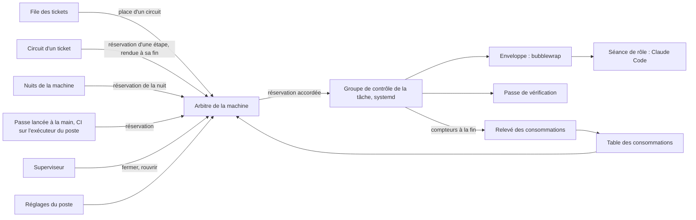
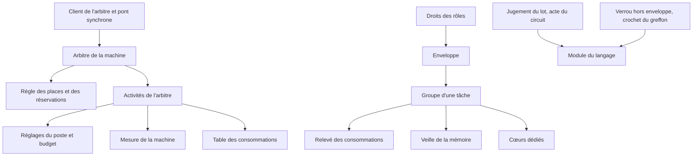
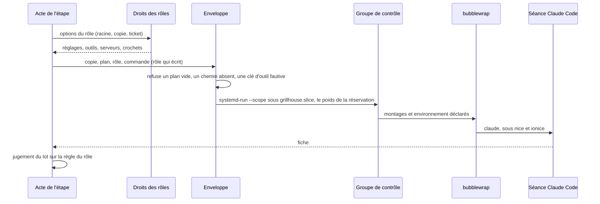
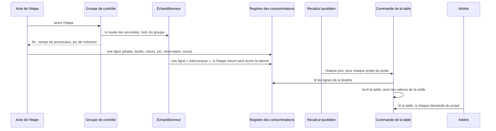

# La machine et l'enveloppe — architecture

La machine et l'enveloppe décident de ce qui tourne sur le poste et de ce qu'une séance de rôle a le droit d'y faire : un arbitre unique admet chaque circuit et chaque étape contre le budget de la machine et n'arrête une étape que devant une menace réelle sur la mémoire du poste, le système protège la machine entière, et l'enveloppe montre tout le dépôt à une séance tout en n'ouvrant en écriture que les paquets de son plan, sous les droits de son rôle. Ce document, à l'adresse `packages/grillhouse/docs/architecture/machine.md`, décrit la construction cible du budget, des réservations, de l'arbitre, du relevé et de la table des consommations, des groupes de contrôle, de l'enveloppe, des droits des rôles, du jugement du lot et du verrou hors enveloppe, de l'infrastructure à la donnée. Il détaille le document de tête (`docs/ARCHITECTURE.md`, §2.3, §3.2, §4, §6, §7) ; ce que le circuit demande à la machine, et quand il garde ou rend sa place, vit dans le document du circuit (§5.2, §5.4, §5.7), que celui-ci ne répète pas. La section 9 dit, chantier par chantier, où le code ne l'a pas rejoint.

## 1. Contexte



Ce qui traverse les bords du mécanisme :

- **les demandes** : la place d'un circuit, que demande la file des tickets ; la réservation de chaque étape, que demande le déroulé qui la lance, ou le processus d'une passe lancée hors d'un déroulé ; la fermeture et la réouverture, que demande le superviseur ;
- **les réglages du poste** (`~/.config/grillhouse/machine.env`) et **les réglages du projet** (`grillhouse.circuits`, `grillhouse.mesure`, `grillhouse.outils`), lus dans l'arbre principal ;
- **le matériel et le système** : les cœurs, la mémoire et leur topologie, le gestionnaire systemd du compte et ses groupes de contrôle délégués ;
- **la séance de rôle** : la commande `claude` que lance un acte du circuit, avec les options de son rôle, sous l'enveloppe quand son rôle écrit ;
- **les compteurs** d'un groupe de contrôle à la fin de sa tâche, qui deviennent une ligne du registre des consommations.

Le circuit, la passe de vérification, la nuit et le greffon ont chacun leur document (document de tête, §10) ; celui-ci dit ce qu'ils reçoivent de la machine.

## 2. Stratégie

Les sept choix portent un numéro fixe, qu'un ticket cite (§2.3) et qui ne se réattribue pas.

1. **Une tâche de la machine est admise une fois, par un seul arbitre, au lancement de chaque étape.** L'arbitre est un déroulé du serveur Temporal, un pour toute la machine, qui tient deux choses et elles seules : la place de chaque circuit, comptée dans la limite de son projet et dans le plafond de la machine, et la réservation de chaque étape en cours, ses cœurs et sa mémoire. Un déroulé lui demande sa réservation par un signal et la reçoit par un signal, un processus par une mise à jour qu'il relit ; une tâche n'en tient aucune autre, et rien d'autre ne l'admet. Raison : une attente a une seule cause, que l'arbitre dit, et l'état de la machine a un seul propriétaire (document de tête, §2.1, §2.3). Modèle : le verrou des exemples de Temporal (samples-typescript, « mutex »), où un déroulé coordinateur reçoit les demandes par signal, accorde par un signal au demandeur et attend son signal de rendu (lu) ; l'ordonnanceur de Kubernetes, qui place un pod d'après ses demandes (« the kube-scheduler uses this information to decide which node to place the Pod on », lu).
2. **La réservation suit la consommation observée de chaque étape de chaque projet, recalculée chaque jour.** Chaque jour, la table des consommations se recalcule depuis le registre, par projet et par phase, sur une fenêtre glissante de huit jours : la réservation vaut le 90ᵉ centile mesuré plus quinze pour cent, en cœurs comme en mémoire. Une étape peut dépasser sa réservation : la réservation sert à l'admission, elle ne borne pas l'étape. Raison : une réservation écrite à la main, ou figée, dérive de ce que les tâches consomment, et une borne par étape arrête des tâches qui ne menaçaient rien. Modèle : le recommandeur du Vertical Pod Autoscaler de Kubernetes, dont la recommandation part du 90ᵉ centile de l'usage (`target-memory-percentile` et `target-cpu-percentile` : 0.9), plus une marge (`recommendation-margin-fraction` : 0.15, « Fraction of usage added as the safety margin to the recommended request »), sur huit intervalles de 24 h (`memory-aggregation-interval-count` : 8) (docs/flags.md du dépôt kubernetes/autoscaler, lu) ; Kubernetes, où un conteneur peut consommer au-delà de sa demande (« it's possible (and allowed) for a container to use more resource than its request for that resource specifies », lu). Écart : le recommandeur pondère ses échantillons par une demi-vie de 24 h ; ici chaque ligne est une exécution entière, et la fenêtre seule fait l'oubli.
3. **Le système protège la machine entière ; une étape ne s'arrête que devant une menace réelle.** Toutes les étapes du cadre tournent sous une tranche de systemd, `grillhouse.slice`, dont le plafond de mémoire tient la réserve de l'utilisateur hors de portée du cadre ; une étape n'a pas de plafond de mémoire à elle, et son groupe ne porte que son poids de processeur et, pour une mesure de temps, ses cœurs dédiés. Quand la mémoire de la machine est menacée, l'arbitre cesse d'admettre, puis arrête une étape à la fois, celle qui dépasse le plus sa réservation d'abord (§5.3) ; le système ne tue qu'en dernier recours. Raison : une étape qui dépasse sa réservation sur une machine qui a de la place ne gêne personne, et l'arrêter coûte le travail fait. Modèle : l'éviction sous pression de Kubernetes, « the process by which the kubelet proactively terminates pods to reclaim resource on nodes », qui choisit d'abord selon que l'usage d'un pod dépasse sa demande, puis par priorité, puis par l'usage relatif à la demande (node-pressure-eviction, lu) ; les propriétés de mémoire et de processeur de systemd (systemd.resource-control, lu).
4. **Le budget est la machine moins la réserve de l'utilisateur.** Le budget compte les cœurs et la mémoire du matériel, moins une réserve que nulle tâche ne réserve jamais ; la somme des réservations tenues ne dépasse pas le budget, en mémoire multiplié par le cran de surréservation en vigueur (§5.2). Raison : le poste reste celui de l'utilisateur pendant que le cadre travaille. Modèle : le `client.reserved` de Nomad, que le code cite (non lu).
5. **Une séance voit tout le dépôt, a tous les outils, et n'écrit que son plan.** Un rôle qui écrit tourne dans l'enveloppe, un bac à sable de bubblewrap qui monte tout en lecture et n'ouvre en écriture que les paquets du plan : la frontière d'écriture est celle du système de fichiers, quel que soit l'outil qui écrit (l'outil d'édition, un script, une redirection du shell, le client d'une base). Les droits de chaque rôle vivent dans une seule liste, d'où se tirent les options de sa séance ; la configuration personnelle de l'utilisateur reste hors de toute séance de rôle. Raison : un agent lit ce dont il a besoin et prend l'outil que son travail demande, et une frontière de l'architecture tient sans dépendre de sa bonne volonté ni d'une lecture de ses commandes. Modèle : le bac à sable de Bazel, dont `linux-sandbox` « makes the entire filesystem read-only except for the sandbox directory » (lu, bazel.build/docs/sandboxing) ; les `permissions:` d'un travail de GitHub Actions, que le code cite (non lu).
6. **Un verrou juge par le code du cadre installé, jamais par celui qu'il garde, et échoue fermé.** Un verrou d'écriture est un crochet de Claude Code qui lance la commande du cadre de l'arbre principal, ou la version publiée que le projet nomme ; une commande absente refuse l'écriture. Raison : un agent ne peut pas désarmer son verrou en écrivant dans sa copie, et un cadre manquant ne laisse rien passer. Modèle : un pare-feu, dont la règle par défaut refuse (non lu).
7. **La règle des rôles se juge sur le lot, à la fin de la séance.** Le testwriter n'écrit que des tests, la matière de test et ce dont ses tests dépendent ; le développeur n'écrit aucun test ; un rôle qui n'écrit pas laisse un lot vide. À la fin de chaque séance de rôle, le circuit lit le lot de la séance et rend l'étape dont le lot sort de la règle du rôle, les fichiers fautifs nommés. Raison : la règle porte sur ce que le lot change, non sur l'outil qui l'écrit, et un jugement sur le lot tient quel que soit l'outil. Modèle : les CODEOWNERS de GitHub, qui jugent un changement par les fichiers qu'il touche (« Code owners are automatically requested for review when someone opens a pull request that modifies code that they own », lu, docs.github.com, « About code owners ») ; les fichiers OWNERS de Chromium (non lu).

## 3. Composants



### 3.1 Les composants du mécanisme

| Composant | Responsabilité | Possède | Appelle |
|---|---|---|---|
| Arbitre de la machine (déroulé `placesDeLaMachine`, `src/temporal/places/deroule.ts`, `contrat.ts`) | tenir la place de chaque circuit et la réservation de chaque étape, accorder dans l'ordre d'arrivée, rendre ce que le demandeur rend ou ce dont le demandeur a disparu, tenir la fermeture de la machine et le cran de surréservation, cesser d'admettre et arrêter une étape quand la mémoire de la machine est menacée | les places, les réservations, les attentes, le rang d'arrivée, la fermeture, le cran | la règle, ses activités |
| Règle des places et des réservations (`scripts/regles-des-places.mjs`) | décider, sans entrée ni sortie, si une place ou une réservation s'accorde maintenant, et sinon pourquoi | rien | rien |
| Activités de l'arbitre (`src/temporal/places/activites.ts`) | lire les réglages du poste et le budget, la table des consommations d'un projet, et si chaque demandeur vit encore ; veiller sur la mémoire de la machine (la veille, §5.3) ; arrêter le groupe d'une étape | rien | les réglages du poste, la table, le serveur Temporal, `/proc`, systemd |
| Client de l'arbitre (`src/temporal/places/client.ts`) et pont synchrone (`scripts/places-du-serveur.mjs`) | démarrer l'arbitre s'il ne tourne pas ; pour un processus, demander une réservation, attendre qu'elle soit accordée, la rendre ; lire la vue de l'arbitre ; fermer et rouvrir | rien | le serveur Temporal |
| Réglages du poste et budget (`scripts/plafond-de-la-machine.mjs`) | lire le plafond des places et la réserve de l'utilisateur, et calculer le budget | rien | `machine.env`, le matériel |
| Groupe d'une tâche (`scripts/passe-de-la-machine.mjs`, `commandeDuGroupe`) | lancer une étape dans un groupe de contrôle à elle, sous `grillhouse.slice`, son poids tiré de ses cœurs | rien | systemd |
| Veille de la machine (une activité de l'arbitre ; aujourd'hui `scripts/garde-de-la-memoire.mjs`, une par passe) | mesurer la pression de la mémoire, l'échange et la mémoire de chaque étape, et rendre la main à l'arbitre dès qu'un seuil de menace est franchi | rien | `/proc/meminfo`, `/proc/pressure/memory`, `/proc/swaps`, les groupes |
| Cœurs dédiés (`scripts/coeurs-dedies.mjs`) | choisir, sur la topologie, les cœurs entiers d'une mesure de temps, et lire leur repos | rien | `/sys`, `/proc/stat` |
| Relevé des consommations (`scripts/consommation-des-passes.mjs`, `scripts/echantillonneur-de-la-passe.mjs`) | lire les compteurs du groupe d'une étape à sa fin, ou à sa mort, et en écrire une ligne au registre | le registre des consommations | systemd |
| Commande de la table (`grillhouse consommation`, `scripts/consommation.mjs`) | tirer du registre la table d'un projet sur la fenêtre glissante, l'écrire, et dire ce qui change | la table des consommations | le registre |
| Recalcul quotidien (un planning du serveur Temporal, sur le travailleur de la machine) | lancer chaque jour la commande de la table pour chaque projet du poste | rien | la commande de la table |
| Fermeture de la machine (`grillhouse machine fermer`, `rouvrir`, `scripts/machine.mjs`, `scripts/fermeture-de-la-machine.mjs`) | fermer la machine à tout travail neuf, laisser finir ce qui tourne, la rouvrir | rien : la fermeture est chez l'arbitre | le client de l'arbitre |
| Droits des rôles (`scripts/droits.mjs`, `ROLES`) | donner, pour chaque rôle, ses options de Claude Code : ses réglages, ses outils, ses serveurs d'index, ses refus | rien : des données fixes | rien |
| Enveloppe (`grillhouse enveloppe`, `scripts/enveloppe/enveloppe.mjs`, `lancer.sh`, `paquets-du-plan.mjs`) | lancer la séance d'un rôle qui écrit dans un bac à sable aux montages et à l'environnement déclarés | rien : montages et environnement se refont à chaque lancement | bubblewrap, le groupe d'une tâche |
| Jugement du lot (un acte du circuit, à la fin de chaque séance de rôle) | lire le lot de la séance, classer chaque fichier par le module de son langage, et rendre l'étape dont un fichier sort de la règle du rôle, en le nommant | rien | le module du langage |
| Verrou hors enveloppe (`grillhouse verrou-hors-enveloppe`, `scripts/verrous/ecriture-hors-enveloppe.mjs`) | refuser le code et les tests d'un paquet à toute séance qui n'est pas un rôle sous son enveloppe | rien | le module du langage |

Tous sont du paquet `grillhouse` ; les adresses sous `scripts/` sont celles d'avant la migration (§9, chantier 6). L'arbitre tourne sur le travailleur de la machine (document de tête, §3.3).

### 3.2 Les droits des rôles

Chaque séance de rôle reçoit ses options d'une seule source, la liste des rôles ; ce que chaque rôle écrit dans la copie et au ticket est au document du circuit (§3.3).

| Rôle | Sous enveloppe | Outils d'écriture | Écrit au ticket | Index | Jugement du lot |
|---|---|---|---|---|---|
| explorateur | à 1.1 seulement, où la commande du plan écrit | non | non | oui | un lot vide ; à 1.1, aucun : l'enveloppe seule borne la commande |
| questionneur | non | non | non | oui | un lot vide |
| testwriter | oui | oui | sa passation | oui | ses tests, la matière de test, ce dont ses tests dépendent |
| développeur | oui | oui | sa passation | oui | aucun test, ni la matière de test |
| direct | oui | oui | sa passation | oui | aucun : il écrit tests et code |
| relecteur | non | non | non | oui | un lot vide |

Toute séance de rôle reçoit, en plus :

- **les sources de réglages du projet seules** (`--setting-sources project,local`), la charte personnelle de l'utilisateur exclue par son chemin (`claudeMdExcludes`) et absente de l'enveloppe ; la mémoire automatique, les compétences intégrées de Claude Code, les compétences propres du projet et les greffons autres que celui du cadre coupés ; les tâches de fond coupées, si bien qu'une séance finit avec sa fiche ; le mode code de Claude Code (le REPL) activé par le bloc `env` des réglages, que `claude -p` ne prend que là : les crochets et les permissions du rôle s'appliquent aux outils que le REPL appelle, et la fiche sort comme avant ;
- **aucune ligne d'attribution de commit ni de pull request** (`attribution`, ses deux textes vides dans `--settings`), quels que soient les réglages du projet et du poste : une séance de rôle ne commite pas ;
- **le style de sortie du poste** (`outputStyle` de `~/.claude/settings.json`, repris dans `--settings`), aucun quand le poste n'en choisit pas. Un style choisi par le projet prime, selon la précédence de Claude Code : quand `.claude/settings.json` de la copie, ou `.claude/settings.local.json` de l'arbre principal ou de la copie, en porte un, `--settings` n'en porte aucun, car la ligne de commande primerait sur ces fichiers. Seul le nom du style passe : un style que la séance sait résoudre, intégré à Claude Code ou défini par le projet, s'applique ; un style défini dans `~/.claude/output-styles` ou porté par un greffon que la séance ne charge pas ne s'applique pas, et la séance part sans style. La référence est qu'une séance sans interlocuteur ne reçoit aucune préférence d'affichage ; l'écart tient à la mesure, sur cinq séances d'un même rôle et d'une même tâche avec et sans le style « Concise » : 155 136 jetons en moyenne par séance avec lui, 196 359 au style par défaut ;
- **ses permissions** : toute commande, sans lecture de ce qu'elle écrit, et la lecture de sa compétence et du métacadre dans le greffon installé, plus, pour le développeur, le direct et l'explorateur, celle des fichiers de la compétence `systematic-debugging` (`skills/systematic-debugging/`), et d'aucune autre ; refusés, le changement de son auteur au ticket, la relecture de son propre ticket pour un rôle dont la consigne le porte (testwriter, développeur, direct, relecteur), et pour un rôle qui n'écrit pas au ticket toute écriture de `bd` ;
- **pour un rôle qui écrit**, refusé de plus l'outil de test lancé directement, que le module du langage nomme ;
- **ses outils** (`--tools`) : la lecture, l'écriture pour un rôle qui écrit, la recherche d'outils pour un rôle à index ; **ses serveurs** (`--strict-mcp-config`) : ceux de l'index, codegraph et rtfm, lus dans le `.mcp.json` du projet et les greffons qu'il active, aucun autre ; une entrée du projet dont la commande est le seul nom du programme qu'un greffon activé porte (`rtfm-serve`) lance ce programme, au chemin du greffon, que l'enveloppe monte.

Les modèles et l'effort d'un rôle sont des réglages de sa définition d'agent, non des droits.

### 3.3 La garde de chaque frontière

- **Une séance et le dépôt** : les montages de l'enveloppe refusent toute écriture hors du plan (« Read-only file system »), quel que soit l'outil qui la tente ; l'agent dit le paquet qui lui manque dans sa fiche, et le superviseur étend le plan ou refuse.
- **Un rôle et son lot** : le jugement du lot rend l'étape d'un testwriter dont le lot touche du code, d'un développeur dont le lot touche un test, et d'un rôle qui n'écrit pas dont le lot n'est pas vide, les fichiers fautifs nommés (§5.5).
- **Une séance hors enveloppe et le code** : le verrou hors enveloppe, crochet du greffon dans chaque séance d'un projet installé, refuse le code et les tests d'un paquet ; les documents passent.
- **Le cadre et la réserve de l'utilisateur** : la tranche `grillhouse.slice` refuse au cadre entier la mémoire de la réserve ; aucune garde ne refuse une tâche lourde lancée hors de l'arbitre, et la passe qui joue sans groupe le dit.
- **L'arbitre et le reste** : le déroulé n'importe que l'interface de Temporal, son contrat et la règle pure ; un test tient la règle sans entrée ni sortie.
- **« Un état, un propriétaire »** : aucune garde ; le tableau de la section 4 fait foi à la relecture.

## 4. Données

### 4.1 Les états et leur propriétaire

| Donnée | Forme et adresse | Écrite par | Lue par | Durée de vie |
|---|---|---|---|---|
| Les places, les réservations, le cran et la fermeture | `EtatDeLArbitre` (§4.2), dans l'histoire du déroulé `grillhouse-places-de-la-machine` | l'arbitre | la vue de l'arbitre (le tableau, la commande de fermeture), les demandeurs par leurs réponses | la place : tant que son circuit la garde ; la réservation : une étape ; la fermeture : jusqu'à la réouverture |
| Les réglages du poste | `GRILLHOUSE_PLACES` (le plafond de la machine, 3 sans lui), `GRILLHOUSE_RESERVE_COEURS` et `GRILLHOUSE_RESERVE_MEMOIRE_GO` (la réserve, §2.4 ; sans eux, min(4, max(0, cœurs − 4)) cœurs et 4 Go), `GRILLHOUSE_ATTENTE_MACHINE_MS` (la borne d'attente d'un processus) ; `~/.config/grillhouse/machine.env`, l'environnement d'abord | l'utilisateur | les activités de l'arbitre, à chaque jugement | le poste |
| La limite d'un projet | `grillhouse.circuits` du `package.json` de l'arbre principal | le projet | la file des tickets, qui la porte dans sa demande | le projet |
| Le registre des consommations | une ligne JSON par étape jouée (§4.2) ; `<dossier commun de git>/grillhouse/consommation.jsonl` | le relevé des consommations | la commande de la table, le bilan | le dépôt |
| La table des consommations | par phase : cœurs, mémoire, la fenêtre lue et les valeurs de la veille (§4.2) ; `<dossier commun de git>/grillhouse/table-des-consommations.json` | la commande de la table, chaque jour | les activités de l'arbitre | jusqu'au recalcul du lendemain |
| Le groupe d'une étape | un scope transitoire de systemd du compte sous `grillhouse.slice`, `grillhouse-<tâche>-<id>.scope` | systemd, sur la demande du groupe d'une tâche | le relevé | l'étape |
| La marque d'une réservation tenue | la variable `GRILLHOUSE_RESERVATION_TENUE`, l'identifiant de la réservation, dans l'environnement de l'étape | le lanceur de l'étape | toute commande du cadre lancée sous elle, qui n'en demande pas une seconde | l'étape |
| Les droits des rôles | `ROLES` de `scripts/droits.mjs` | le code du cadre | les actes du circuit, l'enveloppe | une version du cadre |
| Le plan d'une séance | la variable `GRILLHOUSE_ENVELOPPE`, les paquets du plan joints par le séparateur des chemins | l'enveloppe, depuis le plan que l'acte lui passe | les commandes du cadre, dans la séance | la séance |

Un fichier que ce tableau ne nomme pas est une trace : la ligne du journal des états qui dit une attente et sa cause, le témoin de démarrage d'une enveloppe, le relevé de charge.

La réserve de cœurs par défaut laisse 0 cœur sur un poste de 4 cœurs ou moins, 2 sur 6, 4 à partir de 8 ; zéro est admis. Une valeur qui n'est pas un entier positif ou nul, ou une réserve qui ne laisse au budget aucun cœur ou aucune mémoire, est refusée par son nom. Le journal des états est décrit au document du circuit (§4.1).

### 4.2 Les formes

```ts
interface EtatDeLArbitre {
  rang: number;                         // le dernier rang d'arrivée tiré
  circuits: PlaceDeCircuit[];
  reservations: Reservation[];          // les réservations accordées
  attentes: DemandeDeReservation[];     // celles qui attendent, avec leur raison
  fermeture: { auteur: 'superviseur'; depuis: number } | null;
  cran: { facteur: 1 | 1.2 | 1.5; depuis: number; raison: string };  // la surréservation de la mémoire
  alerte: { depuis: number; raison: string } | null;                 // l'admission suspendue sous menace
}
interface PlaceDeCircuit {
  racine: string; ticket: string; rang: number;
  accordee: boolean;                    // la place tenue, comptée dans la limite et le plafond
  max: number;                          // la limite du projet que sa dernière demande portait
  raison: string | null;                // pourquoi elle attend (le disque des copies, la limite, le plafond)
  groupe?: string; priorite?: number; creation?: string;  // l'ordre entre les projets d'un groupe
}
interface DemandeDeReservation {
  id: string;                           // tiré par le demandeur : une demande renvoyée est la même
  demandeur: { deroule: string } | { pid: number; depart: string | null };
  racine: string; ticket: string | null;
  phase: string;                        // la clé de la table (ci-dessous)
  rang: number;                         // le rang d'arrivée du circuit, ou tiré à la demande
  dediee: boolean;                      // une mesure de temps : des cœurs entiers à elle
  disques: string[];                    // le dossier temporaire et la racine de la copie, où 4 Go libres sont exigés
  raison?: string;                      // tant qu'elle attend
}
interface Reservation extends DemandeDeReservation {
  coeurs: number; memoire: number;      // ce qui est compté contre le budget ; l'étape peut le dépasser
  groupe: string;                       // le scope de l'étape, que la veille lit et qu'un arrêt vise
  fils: number[] | null;                // les cœurs précis d'une mesure de temps
  depuis: number;
}
// table-des-consommations.json
interface TableDesConsommations {
  actualisee: string;                   // l'instant de l'écriture
  fenetre: { jours: 8; minimum: 5 };
  phases: Record<string, {
    mesures: number; de: string; a: string;          // les lignes lues et leurs dates
    coeurs: number; memoire: number;                 // la réservation du jour
    veille: { coeurs: number; memoire: number } | null;  // celle de la veille, pour l'écart
  }>;
}
// une ligne de consommation.jsonl
interface LigneDeConsommation {
  phase: string; ticket: string | null; dureeMs: number; cpuNs: number; memoirePic: number;
  coeurs: number; memoire: number;                   // la réservation qu'elle tenait
  issue: string; fin: string;
}
```

**La phase** est la clé qui lie une ligne du registre, une ligne de la table et une demande. Dans un circuit, elle vaut `<étape>:<rôle>` pour une séance et `<étape>:passe` pour une passe, le numéro de l'étape étant celui de la liste des étapes (document du circuit, §5.1) : `1:explorateur`, `1:questionneur`, `1.1:explorateur`, `2:testwriter`, `2.1:passe`, `3:developpeur`, `3:direct`, `3.1:passe`, `4.1:passe`, `4.2:passe`, `4.3:relecteur`, `5.3:explorateur`. Hors d'un circuit, elle vaut `verification` (une vérification lancée à la main), `tests` (un lancement ciblé), `nuit` et `ci` (la CI sur l'exécuteur du poste).

**La table d'une phase** se recalcule chaque jour depuis les lignes de ses huit derniers jours : `coeurs` est le 90ᵉ centile des cœurs occupés (le temps de processeur divisé par la durée) plus 15 %, arrondi à l'entier supérieur, au moins un ; `memoire` est le 90ᵉ centile du pic de mémoire plus 15 %. Une phase qui a moins de cinq lignes dans la fenêtre prend ses cinq dernières, quelle que soit leur date ; une phase sans ligne prend la valeur de départ : 3 cœurs, et en mémoire le tiers du budget. Chaque valeur est bornée par le budget. Huit jours couvrent une semaine de travail et le jour qui la suit, comme le recommandeur de Kubernetes ; cinq lignes au moins évitent qu'une phase rare réserve sur une seule exécution.

### 4.3 Ce qui traverse l'arbitre

Les noms sont ceux du contrat de l'arbitre (`src/temporal/places/contrat.ts`) ; `demander`, `reservationAccordee`, `rendreSaPlace`, `veillerLaMachine` et `arreterUneEtape` sont neufs.

| Message | Porteur | De | Vers |
|---|---|---|---|
| Rang d'arrivée | mise à jour `tirerUnRang` ; rend le rang | le circuit, à son départ | l'arbitre |
| Places de circuit | mise à jour `reserverDesCircuits`, `{ racine, candidats, reprise?, max, disque, groupe?, priorites? }` ; rend les tickets accordés | la file des tickets ; le circuit qui sort de l'écart (`reprise`), par une activité | l'arbitre |
| Rendu d'une place | signal `rendreSaPlace`, `{ racine, ticket }` | le circuit mis à l'écart ou fini | l'arbitre |
| Demande d'une réservation, par un déroulé | signal `demander`, une `DemandeDeReservation` dont le demandeur est le déroulé | le circuit, la nuit | l'arbitre |
| Réservation accordée | signal `reservationAccordee`, `{ id, coeurs, memoire, groupe, fils }` | l'arbitre | le déroulé demandeur |
| Demande d'une réservation, par un processus | mise à jour `prendre`, qui inscrit la demande et rend son rang ; puis la requête `laDemande`, relue jusqu'à `donnee` | le pont synchrone, pour une passe hors d'un déroulé | l'arbitre |
| Rendu d'une réservation | signal `rendre`, l'identifiant | le demandeur, à la fin de l'étape | l'arbitre |
| Rattachement | signal `rattacher`, `{ id, pid, depart }` : le processus qui tient désormais la réservation | le pont synchrone | l'arbitre |
| Fermeture, réouverture | mises à jour `fermerLaMachine`, `rouvrirLaMachine` ; rendent `fermee` ou `deja-fermee`, `rouverte` ou `deja-ouverte` | la commande de fermeture | l'arbitre |
| Menace | activité `veillerLaMachine`, ouverte tant que l'arbitre tourne, son signe de vie toutes les dix secondes ; rend, au premier seuil franchi, la pression, l'échange, la mémoire disponible et la mémoire de chaque groupe d'étape | l'arbitre | sa veille |
| Arrêt d'une étape | activité `arreterUneEtape`, le groupe de l'étape : `systemctl --user kill`, puis l'étape finit « à repasser » | l'arbitre | systemd |
| Vue | requête `lesPlaces` : le plafond, le budget, le cran, l'alerte, les places, les réservations, les attentes et leur raison, la fermeture | le tableau, la commande de fermeture | l'arbitre |

## 5. Déroulé

### 5.1 La réservation d'une étape

```mermaid
sequenceDiagram
  participant D as Déroulé du circuit
  participant A as Arbitre
  participant T as Activités de l'arbitre
  participant X as Acte de l'étape
  participant G as Groupe de contrôle
  D->>A: demander (id, phase, rang)
  A->>T: table du projet, réglages du poste
  T-->>A: cœurs, mémoire ; budget, mémoire libre
  A->>A: règle : accordée, sinon en attente avec sa raison
  A-->>D: reservationAccordee (cœurs, mémoire, groupe, fils)
  D->>X: acte, la réservation en argument
  X->>G: lance l'étape sous grillhouse.slice, son poids tiré de ses cœurs
  G-->>X: fin de l'étape
  X->>X: relevé : une ligne au registre
  X-->>D: issue
  D->>A: rendre (id)
```

Le déroulé publie « attend ses ressources » tant qu'il n'a pas reçu `reservationAccordee` ; l'arbitre dit la raison de l'attente dans sa vue, et le journal des états du projet en garde une ligne à son début et à sa fin. Le déroulé rend la réservation quand l'acte finit, quelle que soit son issue, et aussi quand un arrêt annule l'acte. Une demande renvoyée sous le même identifiant, après le rejeu d'un déroulé, est la même demande.

Une passe lancée hors d'un déroulé (une vérification à la main, un lancement ciblé, la CI sur l'exécuteur du poste) joue la même séquence par le pont synchrone : `prendre`, puis `laDemande` relue jusqu'à l'accord, puis `rendre`. Son attente dit sa raison à son début et toutes les trente secondes ; à la borne `GRILLHOUSE_ATTENTE_MACHINE_MS` (soixante minutes sans elle), elle retire sa demande et finit « à repasser » (75), sauf sous une fermeture de la machine, qui n'a pas de borne (§5.7). Sous une réservation déjà tenue (`GRILLHOUSE_RESERVATION_TENUE`), une commande n'en demande aucune : les tests qu'un agent lance dans sa séance jouent sous la réservation de sa séance. Une machine où l'arbitre ne répond pas refuse la passe, nommée ; la CI de GitHub ne demande rien.

### 5.2 Le jugement de l'arbitre

L'arbitre juge les demandes en attente à chaque changement de son état et toutes les `veilleMs`, dans l'ordre de leur rang, et accorde chacune qui passe ces conditions, dans cet ordre :

1. la machine n'est pas fermée, et l'admission n'est pas suspendue par une alerte (§5.3) ;
2. aucune demande d'un rang plus petit n'attend encore : un rang réservé ne se double pas ;
3. **sa réservation tient dans le budget** : ses cœurs dans ce que les réservations accordées laissent des cœurs du budget, sa mémoire dans ce qu'elles laissent de la mémoire du budget multipliée par le cran en vigueur ;
4. **la machine a réellement de quoi la jouer à cet instant** : la mémoire réellement disponible, moins la réserve de l'utilisateur, couvre sa mémoire ; les cœurs réellement libres couvrent ses cœurs ; le dossier temporaire et le disque de sa copie ont chacun 4 Go libres ;
5. pour une mesure de temps, des cœurs entiers sont libres, et aucune autre mesure ne joue.

Le refus nomme la première condition manquée et ses chiffres (« cœurs : 3 demandés, 1 libre sur 28 »). Avant de juger, l'arbitre retire, par une activité pour tous, les réservations et les demandes dont le demandeur a disparu : un déroulé qui ne tourne plus, un processus mort ou remplacé. Le budget et le plafond se relisent à chaque jugement, si bien qu'un réglage changé compte sans redémarrer l'arbitre. **La disponibilité réelle se lit** à la veille de la machine (§5.3), qui la mesure toutes les deux secondes : la mémoire disponible est le champ `MemAvailable` de `/proc/meminfo` ; les cœurs réellement libres sont les fils de la machine multipliés par la part de temps inoccupé que donne `/proc/stat` sur les dix dernières secondes, mesure plus fraîche que la charge moyenne d'une minute (`/proc/loadavg`) qu'on lit aujourd'hui ; le disque libre se lit par `statfs` sur le dossier temporaire et la racine de la copie que la demande nomme. L'arbitre juge sur la dernière lecture, vieille de deux secondes au plus. Une étape qui vient de partir ne consomme pas encore : après chaque accord, l'arbitre retranche de la disponibilité lue la réservation des étapes accordées depuis moins de trente secondes, et attend une lecture neuve avant l'accord suivant. Le délai fixe de dix secondes entre deux départs, qui servait à laisser paraître la consommation d'un départ avant le suivant, devient inutile et part.

**Les crans de surréservation.** Le cran vaut 1, 1,2 ou 1,5 : la mémoire réservée peut dépasser la mémoire du budget de ce facteur, la mémoire réellement libre restant exigée à chaque accord ; les cœurs ne se surréservent pas, leur poids les partage. L'arbitre descend d'un cran dès que la mémoire d'échange sur disque sert, ou qu'une étape est arrêtée faute de mémoire (§5.3), et il monte d'un cran après trois jours sans l'un ni l'autre ; le cran, l'instant et la raison de chaque changement entrent dans sa vue et au journal des états.

**La réservation et la limite par sorte, palier 1 de la surréservation** (décision du responsable, 2026-11-23 et 2026-11-25). Tant que la table des consommations (§5.6) et la veille de l'arbitre (§5.3) ne sont pas construites, la part de mémoire d'une passe se tire du registre de son projet, par sorte de ligne (`verification`, `passe-finale`, `regeneration-des-references`, `nuit`, `seance-<rôle>`) : **la réservation**, que l'admission compte, est le 95ᵉ centile des pics de mémoire de la sorte (le rang le plus proche, sur tout le registre) ; **la limite**, le plafond de mémoire du groupe de la passe, qui coupe la passe qui la dépasse, est leur maximum plus un quart ; chacune est bornée par le budget. Sous 20 pics lisibles, la mémoire déclarée par `grillhouse.part`, sinon la mémoire par défaut (§9.1), vaut pour les deux ; à partir de 20, la mesure l'emporte sur la mémoire déclarée. Les cœurs n'en changent pas, et une mesure de temps garde la part de ses cœurs dédiés. Une séance réserve de la même façon et son groupe n'a pas de plafond de mémoire : l'arrêter perd son travail. Chaque séance d'agent écrit au registre le pic de son groupe : l'enveloppe pour un rôle qui écrit, le circuit pour un rôle hors enveloppe, dont le groupe garde le poids par défaut. Le panneau et la ligne d'attente disent la réservation et la limite de chaque passe. Modèle : les `requests` et `limits` de Kubernetes (et les `resources` de Nomad), l'admission comptant la demande et le noyau coupant à la limite, la demande tirée du centile des pics mesurés comme le recommandeur du Vertical Pod Autoscaler (non relus). Écart à la cible (§2, choix 2 et 3) : le centile (95 au lieu de 90 plus 15 %), la fenêtre (tout le registre) et le plafond d'une passe, que la table et la veille remplacent.

### 5.3 Une menace sur la mémoire de la machine

La veille de la machine, une activité de l'arbitre ouverte tant qu'il tourne, lit toutes les deux secondes la pression de la mémoire (`/proc/pressure/memory`, ligne `full`, champ `avg10`), la mémoire disponible, l'échange en mémoire (zram) et l'échange sur disque, et la mémoire de chaque groupe d'étape ; elle ne rend la main à l'arbitre qu'à un seuil franchi. Une étape au-delà de sa réservation, sur une machine sans menace, continue. Trois niveaux, dans cet ordre :

1. **L'alerte**, quand la pression dépasse 10 % ou que l'échange sur disque commence à servir. L'arbitre décide : il suspend toute admission neuve et descend d'un cran ; rien ne s'arrête. Il lève l'alerte quand la pression est restée sous le seuil une minute et que l'échange sur disque ne grandit plus.
2. **La menace**, quand la pression atteint 50 %, ou que la mémoire disponible et l'échange en mémoire réunis tombent sous 4 Go. L'arbitre décide : il arrête une étape (`arreterUneEtape`), remesure, et en arrête une autre tant que la menace dure. L'ordre : d'abord les étapes dont la mémoire dépasse leur réservation, la plus grande en proportion de sa réservation d'abord ; puis les autres, la plus grande en mémoire d'abord ; à rang égal, une passe avant une séance, parce qu'une passe se rejoue sans perte quand une séance perd son travail, puis la plus récente avant la plus ancienne. L'étape arrêtée finit « à repasser » (75), que le circuit rejoue par son geste (document du circuit, §5.5) et qu'une passe à la main dit ; le registre la compte, issue « arrêtée faute de mémoire ».
3. **Le dernier recours**, quand la veille n'a pas suffi ou ne tourne pas. Le système décide seul : systemd-oomd tue, sous la pression, un groupe de `grillhouse.slice` ; le noyau, au plafond de la tranche, tue dans le cadre, jamais dans la session de l'utilisateur.

Les seuils de la menace, 50 % et 4 Go, sont ceux de la veille d'aujourd'hui ; celui de l'alerte est neuf.

### 5.4 La place d'un circuit

L'arbitre accorde une place à un ticket candidat quand le disque des copies de son projet a la place d'une copie de plus, que les places tenues par son projet sont sous sa limite (`max`), et que les places tenues par tous les projets sont sous le plafond de la machine ; il accorde dans l'ordre d'arrivée de tous les projets, et, entre les projets d'un même groupe (`grillhouse.groupe`), les places en attente se répartissent leurs rangs par priorité de Beads, puis par âge. Une place accordée reste accordée jusqu'à ce que son circuit la rende (`rendreSaPlace`) ou que son déroulé disparaisse. La place d'une copie de plus se mesure à la taille attendue d'une copie du projet : la plus grande copie mesurée, sinon la taille que donnent les modules de ses langages (1 Go, 8 Go pour cargo), plus une marge de 4 Go ; la taille d'une copie se mesure une fois et se garde (`<ticket>.taille`), jamais à chaque jugement. Un candidat sans cette place attend, sa raison nommant les copies en pause et leur taille, sans retenir les autres candidats, et le panneau dit « attend le disque ». Quand un circuit garde sa place, et quand il la rend : document du circuit, §5.4. Un circuit qui sort de l'écart redemande la sienne à son rang d'origine (`reprise`), et passe devant les tickets arrivés après lui.

### 5.5 Le lancement d'une séance de rôle



Un rôle qui n'écrit pas (questionneur, relecteur, explorateur hors de 1.1) se lance sans enveloppe, dans l'arbre principal ou la copie, avec les mêmes options de rôle et dans le même groupe de contrôle à la mesure de sa réservation.

**Le plan d'une séance** se lit sur les composants du module du langage : un chemin du plan hors de tout composant ouvre la racine, donc toute la copie ; un crate à la racine est le composant `.`, nommé par son crate ; le circuit résout les composants du titre d'un ticket sur la même liste.

**La préparation de la copie** est une seule, que le lanceur joue avant chaque séance et le circuit avant chaque passe qui juge le lot : la garde des sous-modules, qui refuse une copie dont un sous-module porte du travail local ; l'avance sur la pointe de main, le travail local gardé (document du circuit, §5.5, les conflits de l'avance) ; la pose des sous-modules, les partagés liés à ceux du dépôt principal, les autres au commit de HEAD ; l'essai du montage en lecture des sous-modules partagés ; l'installation des dépendances (`npm install --no-save`) quand `node_modules` manque ou que le verrou des versions est plus récent que l'installation. La première étape qui échoue arrête la préparation, nommée : c'est le code `4` de l'enveloppe. Le travail d'une copie ne passe jamais par la remise de git (`refs/stash`), commune à toutes les copies d'un dépôt : il reste dans la copie, comme une fusion en conflit. Une branche que la file renvoie redevient le travail local de sa copie, appliquée en trois voies, ses conflits marqués dans leurs fichiers, que la séance de l'agent résout.

**Les montages de l'enveloppe**, dans l'ordre de bubblewrap :

| Chemin | Montage |
|---|---|
| `/`, la copie comprise, ses index (`.codegraph`, `.rtfm`) et les paquets hors du plan | lecture |
| `/tmp` | vide et propre à la séance ; seul le dossier de travail de la séance y revient, en écriture |
| la maison et `$XDG_RUNTIME_DIR` | vides et scellées ; y reviennent `~/.claude` (sa configuration, ses greffons et ses compétences en lecture, l'état de séance et le dossier de projet de la copie en écriture, la charte personnelle absente), une copie jetable de `~/.claude.json`, le cache npm en écriture, les programmes de Claude Code, de Node, de `bd` et la configuration de git en lecture, `~/.cargo` et `~/.rustup` en lecture, et pour un rôle à index le programme de codegraph et ses versions |
| `~/.config/grillhouse/` | hors de vue |
| les outils du projet (`grillhouse.outils`) et la version publiée du cadre (`~/.cache/grillhouse/outil`) | lecture |
| les paquets du plan | écriture |
| la matière de test partagée | écriture pour le testwriter, lecture pour les autres |
| les fichiers de verrou des versions de la racine (`Cargo.lock`) | écriture pour le testwriter quand la racine est hors du plan |
| ce qu'écrivent Turborepo, que le noyau déclare pour chaque langage (son cache de l'arbre principal, un magasin ; `.turbo`, propre à la séance), et les outils du langage : les magasins (le registre de cargo) ; les sorties dans la copie ; les sorties propres à la séance | écriture ; écriture ; vides et propres à la séance |
| chaque `.git`, celui de la copie compris | lecture |
| la base des tickets (`.beads/` de l'arbre principal) | écriture |
| la copie d'un autre ticket | lecture, facultative |
| les processus | un espace à elle (`--unshare-pid`) |

L'environnement de la séance est celui que l'enveloppe déclare, et rien d'autre : la base d'une session de connexion, la configuration et l'identifiant de Claude Code, l'auteur au ticket (`BEADS_ACTOR`), le plan (`GRILLHOUSE_ENVELOPPE`), la marque de la réservation tenue, le nombre de travailleurs (les cœurs de la réservation), le cache npm et `npm_config_ignore_scripts=true`, `TMPDIR` sur le dossier de travail, la variable de chaque outil du projet ; une variable qui nomme un chemin n'entre que si son chemin est en vue. Ce qu'un agent doit avoir pour reprendre vit dans la copie du ticket ou dans sa passation, jamais dans le dossier temporaire, qui part avec la séance, comme l'espace temporaire d'un job de GitHub Actions ou le dossier temporaire d'un test de Bazel (non lu). La commande écrit d'abord un témoin de démarrage dans le dossier de travail : une enveloppe qui finit sans lui est un lancement refusé.

**La clé d'API du poste.** Avec `~/.config/grillhouse/api.env`, une séance de rôle, sous enveloppe ou non, part avec sa clé (`ANTHROPIC_API_KEY`) ; la séance du superviseur n'est pas touchée, et sans le fichier, ou quand l'environnement du circuit porte déjà une clé, rien ne change. Une séance que l'API refuse pour crédit épuisé ou pour clé refusée (statut 401) repart aussitôt sur l'abonnement, une fois, sans clé, en reprenant la conversation ouverte sous le même identifiant : ce n'est pas un échec. Le circuit note le mois par un fichier de présence vide (`api-epuise-<AAAA-MM>`, à côté de `api.env`), que la première séance refusée crée et dit au journal, jamais avec la clé ; tant qu'il existe, les séances partent sur l'abonnement, et un mois neuf rend la clé. Toute autre erreur (limite de débit, surcharge, erreur du serveur) suit le chemin des séances en échec et garde la clé. Les codes de sortie de l'enveloppe et de son lanceur sont `2` (appel mal formé), `3` (lancement refusé) et `4` (copie impossible à préparer) (`scripts/enveloppe/codes.mjs`).

**Les outils dans la séance.** Une séance a tous les outils : un script (`python`, `sed -i`), une redirection du shell ou le client d'une base écrivent comme l'outil d'édition, et les montages de l'enveloppe bornent chacun au plan ; aucun crochet ne lit les commandes ni les écritures d'une séance sous enveloppe. Une écriture hors du plan échoue sur le montage ; l'agent la dit dans sa fiche (`BESOIN`, le paquet nommé), et le superviseur répond (`--etendre`). Une base qu'une séance lit est un fichier sous un montage en lecture : son client s'y lance comme tout outil, et le montage refuse toute écriture. Hors de toute enveloppe, le verrou hors enveloppe du greffon refuse le code et les tests d'un paquet, le greffon `mods/grillhouse` compris, et laisse passer les documents, les fichiers de la racine et le dossier temporaire ; quand il ne lit pas son entrée il laisse passer, et l'absence de la commande du cadre refuse (§2.6).

**La règle des rôles, sur le lot.** À la fin de chaque séance de rôle, le circuit lit le lot de la séance, les fichiers qu'elle change dans la copie ou dans l'arbre où elle tourne, et classe chacun par le module de son langage. Le testwriter écrit ses fichiers de test, la matière de test partagée, la part de test d'un manifeste, rien d'autre d'un manifeste, et les fichiers de verrou des versions ; en cargo, d'un fichier de code, il n'écrit que la déclaration de son module de test. Le développeur n'écrit aucun fichier de test ni la matière de test partagée. L'explorateur, le questionneur et le relecteur laissent un lot vide : un fichier changé rend l'étape ; à 1.1, le lot de l'explorateur est celui de la commande du plan, que l'enveloppe seule borne. L'agent direct écrit tests et code, et son lot n'est pas jugé. Un lot qui sort de la règle de son rôle rend l'étape à son auteur, chaque fichier fautif et chaque partie nommés (document du circuit, §5.5).

Le jugement charge son code du cadre installé, jamais de la copie qu'il juge (§2.6) : une copie dont un module ne se charge plus est jugée comme une copie saine, et le lot qui la répare se juge. Quand ni le cadre installé ni la copie ne se chargent, le jugement échoue fermé : l'étape ne passe pas, et l'arrêt nomme la version, les deux causes et l'arbre principal. Limite voulue : un lot qui change le jugement, les règles des paquets du plan ou un langage est jugé par la version installée, donc l'ancienne ; ses changements ne jugent qu'après la montée. La réparation d'un arbre principal cassé revient au superviseur, hors séance d'agent.

### 5.6 Le relevé et la table



Le relevé écrit une ligne pour chaque étape, séance comme passe. Une étape qui consomme nettement plus que sa réservation (une fois et demie, au-delà de cinq secondes) le dit au tableau ; elle n'est pas arrêtée pour autant. Le recalcul quotidien lance `grillhouse consommation --actualiser` pour chaque projet du poste, chaque jour à 23 h, heure locale ; la commande écrit la table sans attendre d'accord, garde en regard les valeurs de la veille, et dit au journal chaque phase dont la réservation change de plus d'un quart. Lancée à la main, elle montre la table recalculée et l'écart, et ne l'écrit qu'avec `--ecrire`.

### 5.7 La fermeture de la machine

`grillhouse machine fermer` inscrit la fermeture chez l'arbitre : aucune place ni réservation ne s'accorde plus, à aucun projet, et ce qui tourne finit son étape. La commande rend la main aussitôt, en disant ce qui tourne par projet et par ticket ; avec `--attendre`, elle attend que la machine soit vide. `grillhouse machine rouvrir` retire la fermeture, et les demandes en attente s'accordent d'elles-mêmes. La fermeture refuse le travail neuf seul, ni les étapes déjà admises ni les gestes de la maintenance (le drain d'un nœud garde les pods du système) : une passe lancée par une séance déjà admise, sous sa place tenue (`GRILLHOUSE_PLACE_TENUE`), prend sa part, si bien que chaque étape en cours finit ; la montée se fait une fois les étapes finies, et sa vérification (sorte « Montée », que pose `grillhouse maj`, ou le superviseur par `GRILLHOUSE_VERIFICATION_SORTE=Montée`) prend sa part sous la fermeture ; quand `grillhouse maj` la laisse au superviseur, son rapport la lui nomme (`GRILLHOUSE_VERIFICATION_SORTE=Montée npm run verifier`). La fermeture survit au redémarrage du poste. Sous elle, une demande neuve attend sans borne, ni « à repasser » ni retrait, sa raison « machine fermée par le superviseur », comme un nœud fermé par `kubectl cordon` ne reçoit plus de travail, sans délai (non lu) ; la fermeture n'a ni battement ni péremption. Fermer une machine fermée, ou rouvrir une machine ouverte, réussit sans effet et le dit.

## 6. Exécution

- **Où** : l'arbitre tourne sur le travailleur de la machine, file de tâches `grillhouse-machine`, un par compte ; il démarre au premier appel s'il ne tourne pas (`USE_EXISTING`). Le groupe d'une étape est un scope transitoire de systemd du compte, sous le service de l'utilisateur, avec les contrôleurs de processeur, de mémoire et de cœurs délégués.
- **Le groupe** : `CPUWeight` vaut cent fois les cœurs de la réservation, `MemoryAccounting=yes`, sans plafond de mémoire ; il vit sous `grillhouse.slice`, dont `MemoryMax` vaut la mémoire de la machine moins la réserve de l'utilisateur, et que systemd-oomd surveille sous la pression (`ManagedOOMMemoryPressure=kill`) ; une mesure de temps reçoit ses cœurs par `AllowedCPUs`, sinon par l'affinité de son lancement. Quand le contrôleur `cpuset` est délégué au compte, les programmes hors du cadre (`app.slice`) sont tenus hors des cœurs dédiés le temps de la mesure ; sans délégation, la mesure le dit une fois, avec le réglage du poste qui la donne ; dans l'enveloppe d'un agent, une mesure ne réserve ni n'attache rien, le dit, et n'est jamais refusée pour cela. Les outils de l'étape reçoivent ses cœurs dans `GRILLHOUSE_TRAVAILLEURS`.
- **La mémoire de la machine** : la veille de l'arbitre (§5.3) la tient pour toutes les étapes ; aucune passe ne porte de veille à elle.
- **Le disque** : l'arbitre exige 4 Go libres sous le dossier temporaire et sur le disque de la copie de chaque étape (§5.2), et dit ce qui les occupe ; la place d'un circuit attend le disque d'une copie de plus (§5.4).
- **Ce qui survit** : les places, les réservations, les attentes et la fermeture survivent au redémarrage du serveur et des travailleurs, dans l'histoire de l'arbitre ; au-delà de deux mille événements, l'arbitre continue dans une exécution neuve, son état en argument. Une réservation dont le demandeur est mort se libère au jugement suivant.
- **Ce qui est synchrone** : un déroulé attend son signal d'accord sans tenir d'activité ouverte ; un processus relit la demande toutes les deux cent cinquante millisecondes, sous sa borne.
- **Sans gestionnaire de groupes** : l'étape joue sans groupe, et le journal du circuit le dit une fois ; sa réservation reste comptée.

## 7. Concepts transverses

- **L'identité** : une réservation se nomme par l'identifiant que son demandeur tire, et se rattache à son demandeur : un déroulé par son identifiant, un processus par son numéro et l'instant de son départ. Une place se nomme par son projet et son ticket.
- **L'arrêt** : seule une menace sur la mémoire de la machine arrête une étape, et l'arbitre seul en décide, le système gardant le dernier recours.
- **Les fautes** : l'arbitre ne meurt pas d'une faute ; un réglage du poste fautif garde la valeur lue avant et se dit dans la vue, par son nom. Une commande et l'enveloppe refusent avant tout travail, par le nom de la clé ou de la variable fautive. Une attente bornée finit « à repasser » (75), jamais rouge.
- **Le déterminisme** : l'arbitre décide par la règle pure ; tout ce qu'il lit de la machine, du poste et des projets passe par une activité.
- **L'isolement** : la configuration personnelle de l'utilisateur, sa charte comprise, reste hors de toute séance de rôle, sous enveloppe ou non ; une séance sous enveloppe ne voit ni les identifiants de la machine, hors ceux de Claude Code, ni les processus, ni les sockets de la session de l'utilisateur.
- **La réserve de l'utilisateur** : rien ne la réserve, ni une tâche, ni la nuit, ni une mesure de temps.

## 8. Qualité

- **Le budget tient** : la somme des réservations accordées ne dépasse pas le budget, en mémoire multiplié par le cran. Mesure : la vue de l'arbitre ; la cause de chaque attente au journal des états.
- **La réservation suit la consommation** : l'écart entre la réservation d'une phase et sa consommation se lit chaque jour à la table. **Peu d'arrêts** : mesure, le nombre d'étapes arrêtées faute de mémoire par semaine au registre, et le cran que l'arbitre tient.
- **Une seule admission** : une étape a une réservation, un circuit une place. Mesure : la vue de l'arbitre, où une étape ne paraît qu'une fois.
- **L'isolement** : les tests de l'enveloppe lancent bubblewrap et vérifient chaque montage, l'environnement, la maison, l'index et le témoin.

## 9. Risques

### 9.1 L'écart entre la cible et le code, par chantier du document de tête

1. **Les documents de référence.** Les places et les parts sont décrites à une douzaine d'adresses (l'architecture du paquet, son interface, son cadre, la charte du projet, les en-têtes de quatre scripts), qui se contredisent sur qui tient une place, sur ce qu'une place et une part couvrent et sur le plafond (3 au défaut, 12 écrit comme une règle). La description des clés `grillhouse.circuits`, `grillhouse.part` et `GRILLHOUSE_PLACES` vit dans la charte de chaque projet et dit l'existant (« un circuit arrêté n'occupe aucune place de la machine », la réservation de 3 cœurs, 2 pour un direct, et le plafond dur de processeur d'une séance). Les droits des rôles n'avaient aucun document, et leur liste laisse le relecteur écrire au ticket, ce que le document du circuit lui refuse (§3.3 de celui-ci). Le chantier verse ces descriptions ici et dans le document de l'installation.
2. **Le circuit direct passe par le moteur.** Aujourd'hui une séance du rôle `direct` prend la part que prend toute séance sous enveloppe, sans réservation par sa phase. Le chantier fait réserver l'agent direct comme toute séance, par la phase `3:direct`.
3. **Un état, un propriétaire.** Aujourd'hui les parts vivent hors de l'arbitre, un fichier par passe sous `~/.local/state/grillhouse/parts`, admises sous un verrou de fichier ; et les places de circuit se refont des listes que la file des tickets renvoie à chaque réveil, une place qu'aucune demande ne renouvelle en dix minutes étant oubliée. Le chantier retire le dossier des parts et son verrou, et fait de la place un état de l'arbitre, rendue par `rendreSaPlace` et purgée sur la seule fin de son déroulé.
4. **L'admission unique.** Aujourd'hui une séance sous enveloppe est admise trois fois : la place de son circuit, une place de séance prise par l'acte, et une part prise par l'enveloppe ; une séance hors enveloppe (explorateur, questionneur, relecteur) prend une place, sans groupe ni part ; le groupe d'une séance a un plafond dur de processeur et pas de plafond de mémoire ; ses travailleurs sont les cœurs de la machine divisés par les places, ceux d'une passe les cœurs de sa part. La réservation d'une passe vaut 3 cœurs fixes, ou ceux que déclare `grillhouse.part` ; sa mémoire se sépare, par sorte, en une réservation et un plafond du groupe, qui tue la passe qui le dépasse (§5.2), et une sorte qui a moins de 20 pics au registre garde pour les deux la mémoire déclarée, sinon le plus grand pic des passes de jour plus un quart, jamais sous un plancher. La veille de la mémoire tourne dans chaque passe et coupe la sienne ; la tranche `grillhouse.slice` existe, mais sans plafond de mémoire, et seules les mesures de temps y tournent. Aucun cran de surréservation n'existe : la mémoire réservée ne dépasse jamais le budget. Le registre relève les passes et les séances, par sorte (vérification, passe finale, régénération, nuit, séance de chaque rôle), et aucune table ne s'en tire. Une place de séance attend aussi la charge de la machine, 4 Go de mémoire libres et dix secondes d'espacement. Le circuit a deux places, comptées à deux endroits (document du circuit, §9.1). Le chantier fait demander par le déroulé la réservation de chaque étape, retire la place de séance et la part de l'enveloppe, fait écrire au relevé une ligne par étape et la table par son recalcul quotidien, retire le plafond de mémoire de chaque étape, lance toute étape, séance comprise, sous la tranche, réunit la veille de la mémoire chez l'arbitre avec ses trois niveaux, pose les crans de surréservation, lit la disponibilité réelle à la veille, sur dix secondes plutôt que sur la charge moyenne d'une minute, retire l'espacement fixe des départs, et retire la clé `grillhouse.part`, que la table remplace.
5. **La montée et les retraits.** Restent à retirer : une fonction `surUnePart` en double, `avecUnePlace` que seul un test de nuit appelle, des commentaires qui disent la nuit réservant la machine, et le rang premier des passes du dépôt du cadre ; la garde du ticket d'un sous-agent, que plus aucun lancement de rôle à la main ne sert.
6. **TypeScript.** La règle, les réglages du poste, le relevé, l'enveloppe, les droits et le verrou hors enveloppe sont des modules JavaScript sous `scripts/` ; le chantier les migre et leur donne leur adresse sous `src/`.

### 9.2 Ce qui reste fragile ou inconnu

- **Les seuils** : l'alerte à 10 % de pression est neuve, la menace à 50 % et 4 Go reprend la veille d'aujourd'hui, et la montée d'un cran après trois jours n'a pas encore tourné ; leur effet se lit au nombre d'arrêts et au cran tenu.
- **La veille dans l'arbitre** : quand le travailleur de la machine meurt, la veille s'arrête avec lui jusqu'à sa relance ; systemd-oomd et le plafond de la tranche restent.
- **La surréservation** : au cran 1,5, plusieurs étapes au-delà de leur réservation à la fois peuvent mener à la menace ; le retour au cran d'en dessous suit le premier signe.
- **La valeur de départ** d'une phase sans mesure n'est pas mesurée : elle réserve large tant que le registre n'a pas de ligne.
- **La charge hors du cadre** : ce que l'utilisateur lance hors de l'arbitre ne se compte que par la réserve ; aucune mesure ne refuse une réservation quand le poste est chargé d'autre chose.
- **Le serveur de développement** : l'arbitre vit sur la base SQLite du serveur Temporal ; une perte de la base perd les places et les réservations, que les circuits redemandent à leur étape suivante.
- **La charte personnelle et l'index dans l'enveloppe** : le code les tient (charte exclue, programme de codegraph monté) ; leur effet sur les transcriptions n'a pas été remesuré depuis.
