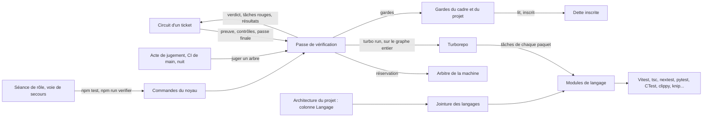
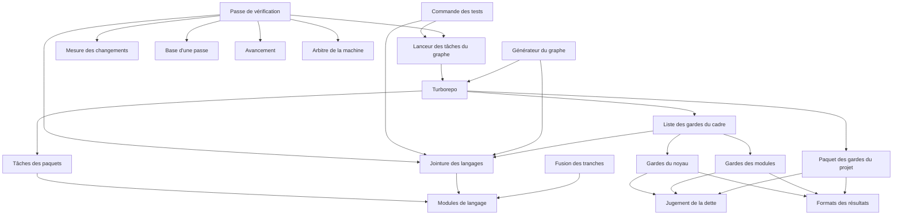

# Les tests et les langages — architecture

Ce mécanisme juge un arbre d'un projet, quels que soient ses langages : la passe de vérification joue sur le graphe des paquets les gardes, le typage, la mise en forme, le lint et les tests, et rend un verdict ; le choix des tests ne rejoue que ce qu'un changement atteint ; un module par langage fournit les tâches et les gardes de l'outil de son langage ; les gardes refusent un lot qui franchit une règle vérifiable, et la dette inscrite gèle les constats connus. Ce document, à l'adresse `packages/grillhouse/docs/architecture/tests.md`, décrit la construction cible de ces composants, de l'infrastructure à la donnée ; il détaille le document de tête (`docs/ARCHITECTURE.md`, §2.4, §3, §4, §6, §7) et renvoie au document du circuit pour les étapes qui demandent une passe, et au document de l'entrée sur main pour le jugement, la CI de main et la nuit, qui la jouent. Sa section 9 dit, chantier par chantier, où le code ne l'a pas rejoint.

## 1. Contexte



Ce qui traverse les bords du mécanisme :

- **l'arbre à juger et sa base** : une copie ou un arbre principal, et la base contre laquelle la passe se mesure, que le circuit et la file d'intégration donnent (la pointe de main de la copie) ;
- **le verdict** : 0 vert, 1 rouge, 75 « à repasser », avec chaque tâche rouge nommée et la commande qui la rejoue seule, et le dossier des résultats où le circuit lit ce qui a joué ;
- **la déclaration des langages** : la colonne « Langage » du tableau des composants du `docs/ARCHITECTURE.md` du projet, et le manifeste de chaque paquet ;
- **les réservations** de cœurs et de mémoire, que chaque passe demande à l'arbitre de la machine (document de la machine et de l'enveloppe) ;
- **les outils des langages**, pairs facultatifs du paquet du cadre ou binaires du poste, que la montée installe (document de l'installation et des réglages d'un projet) ;
- **la dette inscrite**, `grillhouse-dette.json`, commitée à la racine du projet.

Ce qu'une étape du circuit fait d'un verdict, et quand elle demande une passe, vit au document du circuit ; qui inscrit un arbre jugé, au document de l'entrée sur main.

## 2. Stratégie

Les six choix portent un numéro fixe, qu'un ticket cite (§2.3) et qui ne se réattribue pas.

1. **Une seule passe, celle du noyau, juge tous les langages d'un projet sur un seul graphe de Turborepo.** Chaque paquet, quel que soit son langage, est un nœud du graphe par un `package.json` à côté de son manifeste, et porte des tâches aux noms neutres (`build`, `typecheck`, `test:unit`, `lint`, `format:check`) ; la passe joue en une exécution de Turborepo toutes les tâches de tous les paquets et rend un seul verdict. Un module de langage ne joue aucune passe : il décrit le corps de ses tâches, ses gardes et ce que ses outils écrivent. Raison : un projet se vérifie de la même façon quel que soit son langage, et un langage s'ajoute sans toucher la passe (document de tête, §2.4). Modèle : le guide des dépôts de plusieurs langages de Turborepo, « For a language without native workspace support, add a `package.json` beside each independently cacheable project and invoke its toolchain from package scripts » (lu, `node_modules/turbo/docs/guides/multi-language.mdx`, l. 191) ; Bazel, dont les règles d'un langage déclarent des actions qu'un seul moteur exécute (non lu).
2. **Le langage d'un paquet se déclare à la conception, et le noyau ne parle à un module que par la jointure.** La colonne « Langage » du tableau des composants du projet est la seule lecture des langages ; un projet a plusieurs langages, un paquet un seul ; le noyau charge les modules déclarés et n'importe aucun autre de leurs fichiers, et un module n'importe du noyau que ses entrées publiées. Raison : rien ne se devine aux fichiers, et la frontière entre le noyau et les langages se vérifie. Modèle : Pants, « Most Pants functionality is opt-in by adding the relevant _backend_ to the `[GLOBAL].backend_packages` option » (lu, pantsbuild.org, « Backends ») ; le fichier BUILD de Bazel, qui nomme la règle de chaque cible (non lu).
3. **Le jour joue ce qu'un lot atteint, mesuré contre une base ; la passe complète joue sur main et la nuit.** Une passe du jour se mesure contre une base : celle que le circuit ou la file lui donne (la pointe de main dont part la copie), sinon le dernier commit de son histoire dont l'arbre est jugé, la même règle hors circuit ; le noyau calcule les fichiers qui diffèrent de la base, Turborepo relit de son cache les paquets dont les entrées n'ont pas bougé, et l'outil de test de chaque paquet rejoué ne joue que les tests que ces fichiers atteignent. La CI de main et la nuit jouent la passe complète, sans base. Raison : un ticket n'attend pas une passe complète, et main est rejoué entier ensuite (document de l'entrée sur main, §2.3). Modèle : `vitest --changed`, « Run tests that are affected by the changed files » (lu, vitest.dev/guide/cli) ; Nx, « The recommended approach is to set the base SHA to the latest successful commit on the `main` branch » (lu, nx.dev/ci/features/affected). Écart : Vitest lit ses changements dans git ; le noyau lui donne les fichiers qui diffèrent d'un arbre, parce qu'un lot se juge avant d'être commité.
4. **Ce qui a été vert tient en deux registres : le cache de Turborepo et les arbres jugés.** Le cache dit ce qu'il est inutile de rejouer, tâche par tâche ; le registre des arbres jugés dit ce qui a le droit d'entrer sur main, et seul l'acte de jugement l'écrit. La passe n'écrit ni l'un ni l'autre elle-même : Turborepo tient son cache, et la passe rend un verdict. Raison : un état a un seul propriétaire (document de tête, §2.1), et un vert inscrit à plusieurs endroits oblige à savoir lequel lever. Modèle : le cache de Turborepo, « Inputs are hashed by Turborepo, creating a "fingerprint" for the task run », qui restitue à l'identique les sorties déclarées et le journal (lu, turborepo.dev, « Caching »).
5. **Un test a une taille, et sa taille fixe son moment.** Un test petit ou moyen joue le jour ; un grand test, qui monte un projet d'essai et y lance le produit, est un test de nuit ; une mesure de temps et un test qui exige de la charge jouent la nuit, sur des cœurs dédiés. Le jour exclut ces tests de toute passe, et un module dit pour chaque fichier s'il est hors du jour. Raison : le jour reste court et la preuve longue se prend au repos (charte, « La taille d'un test suit la pyramide », « Une mesure de temps joue la nuit »). Modèle : Bazel, « Unit tests are considered "small", integration tests "medium", and end-to-end tests "large" or "enormous" », et l'étiquette `manual`, qui « will exclude the target from expansion of target pattern wildcards » (lu, bazel.build/reference/be/common-definitions) ; la pyramide des tests de Google (non lu).
6. **Une garde juge l'arbre de travail et gèle sa dette.** Une garde refuse tout constat au-delà des comptes inscrits pour sa clé (la garde, le fichier, la règle), signale un compte inscrit au-dessus de ce qu'elle trouve, et ne fait jamais remonter un compte ; une garde à dette neuve arrive avec la migration qui inscrit la dette des projets. Raison : un projet adopte une règle sans tout corriger d'un coup, et la dette ne fait que baisser (charte, « Une dette connue s'inscrit et se gèle »). Modèle : les suppressions en masse d'ESLint, « When you suppress violations, ESLint creates a `eslint-suppressions.json` file in the root of the project », « While the rule will be enforced for new code, the existing violations will not be reported », `--prune-suppressions` pour retirer celles qui ne servent plus (lu, eslint.org/docs/latest/use/suppressions) ; betterer (non lu).

## 3. Composants



### 3.1 Les composants du mécanisme

| Composant | Responsabilité | Possède | Appelle |
|---|---|---|---|
| Commande des tests (`grillhouse tests` ; `npm test`, `npm run test:forcer` ; aujourd'hui `scripts/langages/typescript/tests.mjs`) | jouer un lancement ciblé : rendre chaque chemin à son paquet, porter les chemins et les options dans la variable des tests, jouer la tâche `test:unit` des seuls paquets nommés avec les constructions qu'elle attend ; refuser un chemin hors de tout paquet, un test de nuit nommé, un lancement qui ne joue aucun test | rien | le lanceur, la mesure des changements (sous la marque d'un circuit), la base d'une passe |
| Passe de vérification (`grillhouse verifier` ; `npm run verifier` ; aujourd'hui `scripts/langages/typescript/verifier.mjs`, et `scripts/commandes-composees.mjs` pour un projet sans paquet TypeScript) | jouer sur un arbre, en une exécution de Turborepo sur le graphe entier, la construction, les gardes, le typage, la mise en forme, le lint et les tests de tous les langages, chaque tâche jusqu'au bout de ce que ses préalables permettent ; lire le code de chaque tâche au résumé de l'exécution ; rendre 0, 1 ou 75, et nommer chaque tâche rouge avec la commande qui la rejoue seule | rien | l'arbitre, la mesure, le lanceur, la lecture du verdict de chaque module, la base, l'avancement |
| Mesure des changements (aujourd'hui `scripts/dernier-vert.mjs`) | trouver la base d'une passe : la base du lot qu'on lui donne, sinon le dernier commit de l'histoire de HEAD dont l'arbre est au registre des arbres jugés ; calculer les fichiers changés, ajoutés et supprimés entre l'arbre de travail et cette base, sans toucher l'index ni HEAD, et les écrire au fichier des changements ; dire qu'aucune base ne vaut (sans git, un sous-module qui diffère), la passe étant alors complète | rien | git, le registre des arbres jugés (lecture) ; le module typescript, pour les fichiers sans effet |
| Lanceur des tâches du graphe (`scripts/taches-du-graphe.mjs`) | lancer `turbo run <tâches> --continue=dependencies-successful --concurrency=<n>`, `n` la moitié des cœurs de la réservation ; porter la variable des tests ; lire une tranche ; construire le plan d'une séance (`construire --echec`) et ce qu'attendent les gardes (`construire --gardes`) | rien | Turborepo |
| Générateur du graphe (aujourd'hui `scripts/langages/typescript/turbo-des-paquets.mjs`) | écrire le `turbo.json` de la racine (les tâches, l'`env` des tests, ce que les gardes attendent, les variables qui passent sans entrer dans un hachage) et celui de chaque paquet (les dépendances de sa construction, ses entrées de hachage, ce que ses tests lisent) ; refuser un `turbo.json` en retard | rien : les `turbo.json` sont des fichiers engendrés, réécrits par leur commande | la jointure, pour les entrées de hachage de chaque langage |
| Jointure des langages (`scripts/langages.mjs`, `scripts/composition-des-langages.mjs` ; types `scripts/jointure.d.ts`, entrée publiée `./jointure`) | lire les langages déclarés, charger chaque module une fois, composer les modules d'un projet de plusieurs langages : chaque fichier au module du composant qui le tient, l'union de ce que demandent le verrou, l'enveloppe et la montée, un seul index des interfaces | rien | les modules de langage |
| Modules de langage (`scripts/langages/<nom>/` : `typescript`, `cargo`, `python`, `c`) | décrire, pour les paquets de leur langage, le corps des tâches, la lecture de leur verdict, ce qui est un test et ce qui est hors du jour, leurs gardes, leurs fichiers engendrés, ce que leurs outils écrivent ; détail en §3.3 | rien | l'outil de leur langage ; du noyau, ses entrées publiées seules |
| Liste des gardes du cadre (`grillhouse gardes-du-cadre`, tâche `//#grillhouse:gardes` ; `scripts/gardes-du-cadre.mjs`) | jouer, dans l'ordre, les gardes du noyau puis celles de chaque module déclaré, chacune quel que soit le verdict des précédentes ; écrire un constat sans lieu pour une garde rouge qui n'en a écrit aucun ; rendre 1 quand l'une est rouge | rien | chaque garde, par Node |
| Gardes du noyau (`scripts/langages-des-paquets.mjs`, `dependances-internes.mjs`, `flux-des-paquets.mjs`, `migrations-des-gardes.mjs`) | refuser ce que §3.4 dit de chacune | rien | la jointure, git |
| Jugement de la dette (`scripts/dette.mjs` ; entrée publiée `./dette`, `trancher`) | comparer les constats d'une garde aux comptes inscrits pour leur clé ; sous `GRILLHOUSE_DETTE=inscrire`, écrire la part de la garde ; sous `elaguer`, baisser les comptes à ce qu'elle trouve ; dans l'enveloppe d'un plan, ne juger que les fichiers de ses paquets | rien : la dette est aux gardes (§4.1) | rien |
| Formats des résultats (`scripts/resultats.mjs` ; entrée publiée `./resultats`) | écrire et lire en SARIF les constats d'une garde dans le dossier des résultats, chacun avec son fichier et sa ligne | rien | rien |
| Base d'une passe (`scripts/mesure/base-de-passe.mjs`) | ouvrir le dossier temporaire d'une passe, le nommer dans `TMPDIR`, `TMP` et `TEMP`, le retirer à sa fin même rouge ou interrompue, balayer celui d'une passe tuée, et refuser ce qu'un test y laisse | le dossier temporaire de la passe | rien |
| Avancement d'une passe (`scripts/avancement.mjs`, `scripts/mesure/avancement.mjs`) | écrire le plan des tâches de tests et, tâche par tâche, les fichiers faits et prévus, que le tableau lit | la trace d'avancement | rien |
| Fusion des tranches (`grillhouse fusion-des-tranches` ; module typescript, `tranches.mjs`) | contrôler que chaque fichier de test d'une passe en tranches a joué dans une tranche exactement, puis réunir les rapports ; verte dans un projet dont aucun langage n'écrit de rapport de tranche | rien | Vitest |
| Témoin du repos (`grillhouse pression` ; `scripts/mesure/pression.mjs`) | dire si le processeur est au repos (pression d'attente sous 25 %) et attendre le repos, quinze minutes au plus, avant de rejouer une mesure de temps | rien | `/proc/pressure/cpu` |
| Paquet des gardes d'un projet (dans le projet, déclaré à son tableau des composants ; script racine `gardes`) | porter les gardes propres au projet, en TypeScript, lancées par Node sans construction, chacune jugée contre la dette par l'entrée `./dette` | ses gardes | l'entrée `./dette` |

Tous, hors le paquet des gardes d'un projet, sont du paquet `grillhouse`, en TypeScript à terme ; les adresses sous `scripts/` sont celles d'avant la migration (§9, chantier 6). La passe, la commande des tests, la mesure et le générateur du graphe sont du noyau dans la cible ; aujourd'hui les trois premiers vivent en tout ou partie dans le module typescript (§9, chantier 6).

### 3.2 Les voisins, et ce que le mécanisme leur demande

| Voisin | Ce qu'il demande, ou ce qui lui est demandé | Son document |
|---|---|---|
| Actes du circuit | la preuve du rouge, les contrôles et la passe finale demandent chacun une passe, avec la base du lot (§5.2) ; ils lisent le verdict et le dossier des résultats | Le circuit, §5.1, §5.3, §5.5 |
| Acte de jugement, file d'intégration, CI de main, nuit | juger un arbre : mesuré contre une base (la passe finale, le rejugement), en tranches (la CI), complet pour de vrai (la nuit), et les tests de nuit et les mesures de temps de chaque module (`tests-de-nuit`) ; inscrire l'arbre vert | L'entrée sur main, la CI et la nuit, §2.1 à §2.4, §5 |
| Arbitre de la machine | la réservation de chaque passe, et les cœurs dédiés d'une mesure de temps ; sous une réservation tenue, une commande n'en demande aucune | La machine et l'enveloppe, §5.1 |
| Enveloppe et droits | ouvrir à une séance ce que les outils du langage écrivent (`sorties`) ; refuser à un rôle qui écrit l'outil de test lancé directement (`droits`) ; le plan, que lisent la commande des tests et la dette | La machine et l'enveloppe, §3.2, §5.5 |
| Installation et montée | poser les outils et les binaires des langages déclarés, les scripts des paquets, le gabarit ; jouer les migrations, celles des gardes comprises ; écrire le squelette d'un paquet neuf (`grillhouse paquet`) | L'installation et les réglages d'un projet |
| Greffon et panneau | lire l'avancement d'une passe | Le greffon et le panneau |
| Turborepo, Vitest, git | tiers | document de tête, §3.3 |

### 3.3 Les modules de langage

Un module répond aux demandes de la jointure (`scripts/jointure.d.ts`), que l'interface du noyau écrit (`packages/grillhouse/docs/INTERFACE.md`) ; elles se rangent par le mécanisme qui les pose : la passe (le corps des tâches, la lecture du verdict, les tranches, les tests de nuit, les fichiers engendrés, les gardes), le circuit (ce qui est un test, ce qui est hors du jour, ce qu'un manifeste déclare pour les tests, les éléments d'un lot, les lecteurs d'un composant, un module absent ou un échec de compilation), l'enveloppe (où les outils écrivent, ce qu'un rôle ne lance pas), la montée et la naissance d'un paquet (outils, binaires, gabarit, migrations, squelette).

| Module | Manifeste d'un paquet | Tests du jour | Hors du jour | Typage | Gardes propres | Écrit dans le projet | Outils |
|---|---|---|---|---|---|---|---|
| `typescript` | `package.json` | Vitest : `*.test.*`, `*.spec.*` | tests de nuit `*.nuit.test.*`, `*.nuit.spec.*` ; bancs `*.budget.*` ; témoins de temps (un test qui importe `mesurerAuRepos`) | `tsc --noEmit` | treize (§3.4) | `.vitest-reports`, `.cache-outils` | Vitest, TypeScript, ESLint, Prettier, knip, dependency-cruiser, API Extractor, pairs facultatifs |
| `cargo` | `Cargo.toml`, et un `package.json` à côté | nextest puis les doctests ; les tests par l'interface, modules de `tests/it/main.rs` ; les tests unitaires près de leur module | `tests/it_nuit/main.rs` ; bancs `tests/it_budget/main.rs` | `cargo check --all-targets` | tailles des tests, un exécutable de tests par moment, clippy, frontières entre crates, index des interfaces | `target` | nextest, cargo-deny, sccache, binaires du poste |
| `python` | `pyproject.toml`, et un `package.json` à côté | pytest par uv : `test_*.py`, `*_test.py` | tests de nuit `*_nuit_test.py` ; aucun banc | `python -m compileall` | tailles des tests, index des interfaces | `.venv`, `.pytest_cache`, `__pycache__` | uv, binaire du poste |
| `c` | `CMakeLists.txt` dont `project(<nom>` nomme le paquet, et un `package.json` à côté | CTest : `tests/test_*.c`, un fichier, un exécutable | aucun | la compilation rejouée | clang-format, clang-tidy, index des interfaces, sans dette | `.build-cmake` | uv, clang-format, clang-tidy ; CMake et CTest du poste |

Chaque module joue ses tests sous la base de la passe et refuse ce qu'ils y laissent. Dans une passe en tranches, Vitest et nextest découpent chacun leurs fichiers ; pytest et CTest jouent tous leurs tests dans la première tranche. La commande `tests-de-nuit` de chaque module joue ses tests hors du jour, que la nuit lance (document de l'entrée sur main, §5.3).

### 3.4 Les gardes

Une garde est un script de Node qui lit l'arbre de travail, jamais l'index de git, écrit ses constats en SARIF dans le dossier des résultats et sort à 1 sur un constat refusé. Les gardes du cadre jouent dans la tâche `//#grillhouse:gardes`, celles du projet dans la tâche `//#gardes` ; chacune attend dans le graphe les constructions qu'elle lit.

| Garde | Porteur | Ce qu'elle refuse | Outil | Dette |
|---|---|---|---|---|
| `langages-des-paquets` | noyau | un paquet que l'architecture ne déclare pas, un paquet dont le manifeste suit un autre langage ou qui n'a pas celui du sien, une interface qui nomme un autre langage | la jointure | non |
| `dependances-internes` | noyau | un `package.json` d'un crate ou d'un projet Python qui ne nomme pas les mêmes paquets internes que son manifeste | — | non |
| `flux-des-paquets` | noyau | un flux de la CI sans entrée dans `grillhouse.flux`, un flux déclaré absent, un paquet que le graphe ne porte pas | — | non |
| `migrations-des-gardes` | noyau, au dépôt du cadre seul | une garde à dette née après la plus ancienne migration gardée, sans la migration qui inscrit la dette des projets | — | oui |
| `turbo-des-paquets` | typescript (le noyau, dans la cible) | un `turbo.json` en retard, une lecture ou une trace déclarée fautive | — | non |
| `index-interfaces` | chaque module ; le noyau pour plusieurs langages | un index des interfaces en retard | — | non |
| `consommateurs` | typescript | un usage d'un composant que son interface ne déclare pas, un nom déclaré que rien n'utilise, une ligne mal formée | — | oui |
| `consommateurs-arbitres` | typescript | une ligne de consommateur que le lot ajoute sans arbitrage tranché ni plan qui la nomme | Beads | oui |
| `frontieres` | typescript | un cycle, un import par chemin dans un autre paquet, un import de test ou de dépendance de développement dans le code publié, un import que le `package.json` ne déclare pas | dependency-cruiser | oui |
| `interfaces-contre-code` | typescript | une API changée sans son rapport, une partie engendrée de l'interface en retard, un résumé, un paramètre ou une faute manquant au commentaire d'un export | API Extractor | oui |
| `code-mort` | typescript | un fichier, un export, un type ou une dépendance que rien de vivant n'utilise ; une mesure vide ; le greffon (`mods/grillhouse`) est mesuré, le gabarit (`templates/**`) et le site (`website/**`) restent exclus, car ce n'est pas du code du dépôt qui tourne : le gabarit est copié dans un projet, le site est publié | knip | oui |
| `tailles-des-tests` | typescript, cargo, python | un grand test de jour ; en typescript, un test de jour qui lance la commande du cadre hors d'un dossier `e2e/` | — | oui |
| `tests-du-poste` | typescript | un test de nuit qui dépend du poste sans l'étiquette `@poste` | — | oui |
| `titres-de-tests` | typescript | un titre de test qui nomme un ticket ou un critère | — | oui |
| `chemins-des-tests` | typescript | un chemin qu'un test lance ou lit et que le choix des tests ne sait pas relier | — | oui |
| `resumes` | typescript | une première phrase de résumé d'un export au-delà de 80 caractères | — | oui |
| `verrou-des-dependances` | typescript | un `package-lock.json` en retard sur les `package.json` | npm | non |
| `executables-de-tests` | cargo | plus d'un exécutable de tests d'intégration par crate et par moment | cargo | oui |
| `clippy` | cargo | un avertissement de clippy ou du compilateur, toutes cibles comprises | clippy | oui |
| `frontieres` (cargo) | cargo | une dépendance entre crates que la liste permise du manifeste de l'espace ne porte pas | cargo | oui |
| `clang-format`, `clang-tidy` | c | un fichier mal mis en forme ; un avertissement de clang-tidy | clang | non |

La vérification des dépendances par cargo-deny joue aujourd'hui dans la commande `verifier` du module cargo, après le graphe ; dans la cible elle est une garde du module (§9, chantier 6).

### 3.5 La garde de chaque frontière

- **Le noyau et les modules** : la garde des frontières refuse un import du noyau dans un fichier d'un module hors de la jointure, et un import d'un module dans le noyau hors de ses entrées publiées (`.dependency-cruiser.projet.cjs`) ; un test lit le code du noyau et y refuse le nom d'un outil de langage (`tests/unit/jointure.spec.ts`), Turborepo étant l'outil du noyau.
- **Un module et un autre** : aucune garde ne refuse qu'un module décrive les paquets d'un autre langage ; la relecture le tient.
- **Un paquet et son langage** : la garde des langages des paquets.
- **Un test et son moment** : la garde des tailles des tests, celle des tests du poste et, en Rust, celle des exécutables de tests ; la commande des tests refuse un test de nuit nommé.
- **Un agent et l'outil de test** : les droits d'un rôle qui écrit refusent l'outil de test lancé directement, que chaque module nomme (document de la machine, §3.2).
- **Un lot et la dette** : chaque garde à dette refuse un compte qui monte.

## 4. Données

### 4.1 Les états et leur propriétaire

| Donnée | Forme et adresse | Écrite par | Lue par | Durée de vie |
|---|---|---|---|---|
| La déclaration des langages | la colonne « Langage » des tableaux des composants de `docs/ARCHITECTURE.md`, reprise par la ligne `**Langage** : <nom>` de l'interface de chaque paquet | le projet, à la conception d'un paquet | la jointure, la garde des langages | le projet |
| Les scripts des tâches d'un paquet | `build`, `typecheck`, `test:unit`, `lint`, `format:check` du `package.json` du paquet, qui appellent les commandes du module | la montée et le squelette d'un paquet | Turborepo | le projet |
| Ce qu'un test lit hors de ses imports | `grillhouse.lit` du `package.json` d'un paquet (des motifs depuis la racine) ; une ligne `// @lit <motif>…` en tête d'un fichier de test ; `grillhouse.donnees` et `grillhouse.traces` d'un paquet | l'auteur du paquet ou du test | le générateur du graphe, le module typescript | le projet |
| Le graphe des tâches | `turbo.json` de la racine et de chaque paquet, commités | le générateur du graphe | Turborepo | jusqu'à la régénération |
| Ce qu'il est inutile de rejouer | par tâche : hachage des entrées, sorties déclarées, journal ; `.turbo/` de l'arbre principal, commun aux copies, et le cache distant signé, que seul le passage de la CI déclenché sur main écrit | Turborepo | Turborepo | jusqu'à l'éviction |
| La dette inscrite | `grillhouse-dette.json` à la racine du projet, commité (§4.3) | les gardes, par la commande d'inscription et d'élagage, et les migrations des gardes à la montée | les gardes, par le jugement de la dette | jusqu'à zéro |

Le registre des arbres jugés est à l'acte de jugement (document de l'entrée sur main, §4.1) ; le registre des consommations, que remplissent les phases `verification`, `tests` et les passes du circuit, au relevé des consommations (document de la machine, §4.1).

### 4.2 Ce qui ne vit que le temps d'une passe

| Donnée | Forme | Écrite par | Lue par |
|---|---|---|---|
| La base du lot | la variable `GRILLHOUSE_BASE_DU_LOT` : un commit, la pointe de main dont part la copie | le circuit, la file d'intégration | la mesure des changements |
| Les changements | un fichier JSON que nomme `GRILLHOUSE_CHANGEMENTS`, dans le dossier temporaire de la passe | la mesure des changements | la tâche de tests de chaque paquet, qui le retire de son environnement une fois lu |
| La variable des tests | `GRILLHOUSE_TESTS`, JSON, que l'`env` de la tâche `test:unit` nomme, si bien qu'elle n'entre que dans le hachage des tests | la commande des tests, la passe | la tâche de tests de chaque paquet |
| Le dossier des résultats | le dossier que nomme `GRILLHOUSE_RESULTATS` : les résumés des exécutions de Turborepo, les rapports des outils de test, les constats des gardes en SARIF | la passe, les modules, les gardes | le circuit, chaque module (`verdict`) |
| Les tâches rouges | le fichier que nomme `GRILLHOUSE_ROUGES` : une ligne par tâche rouge, `<paquet>#<tâche>`, une tabulation, la commande qui la rejoue seule | la passe | la nuit, pour sa bissection |
| La base de la passe | `<dossier temporaire>/grillhouse-<genre>-XXXXXX/` : son propriétaire, et `t/`, où la passe et ses processus écrivent | la base d'une passe | la passe et ses tests |
| L'avancement | `<dossier>/taches/<tâche>.json` : `{ hash, faits, prevus, a }`, sous le dossier que nomme `GRILLHOUSE_AVANCEMENT` | l'outil de test de chaque module | le tableau |
| Les rapports des tranches | `.vitest-reports/blobs/<paquet>-<i>-<n>.json` et `.vitest-reports/fichiers/<paquet>-<i>-<n>.json` | le module typescript | la fusion des tranches |

Un fichier que ces tableaux ne nomment pas est une trace ou un cache. La base d'une passe hors circuit se dérive de git et du registre des arbres jugés, sans fichier à elle ; le dernier vert d'une branche, le registre des résultats et les régressions, que la passe écrit aujourd'hui sous le dossier commun de git, ne sont pas des états de la cible et partent (§9.1, chantier 3).

### 4.3 Les formes

```ts
// grillhouse-dette.json : par garde, par fichier depuis la racine, par règle, le compte inscrit
type Dette = Record<string, Record<string, Record<string, { count: number }>>>;
// un constat d'une garde, tel que le SARIF le porte et que la dette le clé (jamais par sa ligne)
interface Constat { garde: string; fichier?: string; regle?: string; ligne?: number; message: string }
// GRILLHOUSE_CHANGEMENTS
interface Changements {
  racine: string;                 // le haut du dépôt
  fichiers: string[];             // changés ou ajoutés depuis la base, depuis la racine
  supprimes: string[];
  sansEffet: string[];            // changés sans effet : un document, ou un code dont la transpilation isolée est identique
  cible: boolean;                 // une passe du circuit, mesurée contre la base de son lot
}
// GRILLHOUSE_TESTS
interface TestsCibles {
  arguments: string[];            // les chemins, absolus, et les options de l'outil
  rejouer?: string;               // l'instant d'un lancement pour de vrai : il déplace le seul hachage
  tranche?: string;               // « i/n »
}
// une tâche d'une exécution, telle que la lit la passe
interface TacheJouee { tache: string; paquet: string; tests: boolean; code: number | null; cache: string | null; journal: string | null }
```

Un constat sans fichier ou sans règle ne s'inscrit jamais : la garde le refuse à chaque fois (un fichier engendré en retard, une mesure qui échoue).

## 5. Déroulé

### 5.1 Une passe de vérification

```mermaid
sequenceDiagram
  participant D as Demandeur (circuit, file, nuit, à la main)
  participant P as Passe de vérification
  participant A as Arbitre
  participant M as Mesure des changements
  participant T as Turborepo
  participant X as Tâches des paquets (modules)
  participant G as Gardes
  D->>P: npm run verifier [--base, --tout, --force, --gardes, --sans-tests, --tranche i/n]
  P->>A: réservation (sauf sous une réservation tenue)
  A-->>P: accordée, ou attente bornée puis 75
  P->>P: ouvre sa base, balaie celles des passes tuées
  P->>M: fichiers changés depuis la base
  M-->>P: changements, ou passe complète
  P->>T: turbo run --dry=json : plan, avancement
  P->>T: turbo run grillhouse:gardes gardes typecheck test:unit format:check lint --continue --summarize
  T->>X: chaque tâche que le cache n'a pas : construction, typage, tests, style
  T->>G: les gardes du cadre, puis celles du projet
  X-->>T: codes, rapports
  T-->>P: résumé de l'exécution
  P->>P: un code par tâche ; écrit les tâches rouges ; retire sa base
  P->>A: rend la réservation
  P-->>D: 0, 1 ou 75
```

- **La mesure** : une base donnée (`--base`, ou `GRILLHOUSE_BASE_DU_LOT`) fait une passe ciblée ; sans base donnée, la passe se mesure contre le dernier commit de son histoire dont l'arbre est jugé ; sans base valable, ou avec `--tout` ou `--force`, la passe est complète. `--force` et `--tout` portent dans la variable des tests l'instant du lancement, si bien qu'aucune tâche de tests ne se relit du cache.
- **Le verdict** : le code de chaque tâche se lit au résumé de l'exécution, parce que Turborepo sort au plus grand code de ses tâches. Une tâche à 0 est verte ; toute autre, 75 compris, est rouge le jour. La passe rend 75 dans deux cas seulement : l'attente de sa réservation atteint sa borne, ou l'arbitre arrête la passe devant une menace sur la mémoire de la machine (document de la machine, §5.3).
- **Les formes** : `--gardes` joue les gardes, la mise en forme et le lint, le dépôt entier, ce que joue le relecteur ; `--sans-tests` joue tout sauf les tests ; `--tranche i/n` ne joue que les tâches de tests, avec leurs constructions, chaque outil jouant sa i-ième part. Les n tranches et la passe sans tests font la passe complète, chaque tâche une fois ; une tranche mal formée ou donnée avec `--gardes` ou `--sans-tests` est refusée avant tout travail.
- **Ce qu'elle n'écrit pas** : la passe n'inscrit aucun arbre ; l'acte de jugement inscrit l'arbre d'une passe finale verte (document de l'entrée sur main, §2.1), et une passe lancée à la main rend son verdict sans rien inscrire, hors celle de la voie de secours (document du circuit, §5.8).

### 5.2 Les passes d'un circuit

Chaque étape du circuit qui juge le lot joue une forme de la passe, dans la copie, sous la base du lot ; le circuit décide sur le verdict (document du circuit, §5.5).

| Étape | Ce qu'elle joue | Où |
|---|---|---|
| 2.1 Preuve du rouge | par paquet, `npm test -- --force <fichiers de test du lot>` ; sans fichier de test au lot, `npm test -- <paquet>` pour chaque paquet du plan ; les fichiers hors du jour mis de côté, nommés | la copie |
| 3.1 Contrôles | `npm test -- <paquet>` pour chaque paquet du plan et chaque paquet que le lot touche, `npm test -- <tests du lot>` hors d'eux, puis `construire --gardes` hors de l'enveloppe, puis les gardes dans l'enveloppe du plan, dont seuls comptent les constats sur ses fichiers | la copie, l'enveloppe du plan pour les gardes |
| 4.1 Passe finale | `npm run verifier` mesuré contre la base du lot, hors de toute enveloppe, la copie avancée sur la pointe de main | la copie |

La preuve lit, pour chaque test du lot, son état au rapport de son outil : un test qui ne se charge pas parce qu'il importe un module que le ticket crée, ou une cible qui ne compile pas, est rouge (`moduleAbsent`, `echecDeCompilation` du module) ; un test vert que la fiche du testwriter dit porter le travail (`portent_le_travail`) refuse la preuve, même quand main le tenait déjà vert ; tout autre vert est accepté. La preuve ne lit aucun registre des résultats : elle se juge de la même façon dans tous les langages.

### 5.3 Le choix des tests d'un paquet rejoué

1. Turborepo relit de son cache chaque tâche dont le hachage des entrées n'a pas bougé : les fichiers du paquet, ceux que ses constructions attendent, `grillhouse.lit`, la variable des tests. Pour un paquet cargo, python ou c, le choix s'arrête là : le paquet rejoué joue tous ses tests.
2. Dans un paquet de Vitest rejoué, la tâche de tests lit les changements et joue les tests que Vitest relie aux fichiers changés par le graphe de leurs imports, les tests qui déclarent lire un fichier changé (`// @lit`) et les fichiers qu'un lancement ciblé nomme ; hors d'une passe ciblée, aussi les tests qui lisent un fichier changé par son chemin, et le paquet entier quand un changement sort du graphe de Vitest (un fichier supprimé, une configuration, un chemin de `grillhouse.lit`, un fichier que lit la construction d'un paquet dont il dépend, un fichier qu'aucun module n'importe).
3. Un fichier sans effet ne relie aucun test par le graphe et ne rejoue aucun paquet entier ; les tests qui le lisent par `grillhouse.lit` ou `// @lit` gardent leur règle.

### 5.4 Un lancement ciblé

`npm test -- <chemins>` : chaque chemin, écrit depuis la racine, va au paquet qui le tient ; Turborepo joue la tâche `test:unit` de ces seuls paquets, avec les constructions et les traces qu'elle attend, relues du cache quand rien n'a bougé ; un paquet nommé entier ne porte aucun chemin et joue sous le hachage de la passe complète. Dans l'enveloppe d'un agent, les paquets hors du plan arrivent construits et en lecture seule. Un banc ou un témoin de temps joue quand son propre fichier est nommé, sous la mesure du temps ; un test de nuit nommé est refusé ; un lancement qui ne joue aucun test échoue. Sous la marque d'un circuit, le lancement se mesure contre la base du lot comme la passe.

### 5.5 Une garde et sa dette

```mermaid
sequenceDiagram
  participant L as Liste des gardes
  participant G as Garde
  participant J as Jugement de la dette
  participant F as grillhouse-dette.json
  participant R as Dossier des résultats
  L->>G: lance (Node), sous GRILLHOUSE_DETTE et l'enveloppe éventuelle
  G->>G: lit l'arbre de travail, dresse ses constats
  G->>J: trancher(constats)
  J->>F: lit les comptes de la garde
  alt inscrire, ou élaguer
    J->>F: écrit la part de la garde, ou baisse ses comptes
  end
  J-->>G: refusés : chaque clé au-delà de son compte ; signalés : comptes trop hauts
  G->>R: constats en SARIF
  G-->>L: 0 ou 1
```

Une clé au-delà de son compte refuse avec tous ses constats ; un compte au-dessus de ce que la garde trouve se signale pour être élagué. Dans l'enveloppe d'un plan, la dette ne se juge que sur les fichiers des paquets du plan ; la passe finale, hors de toute enveloppe, juge les autres. Une garde à dette neuve du cadre arrive avec sa migration, que la montée joue dans chaque projet (`trancher(projet, garde, constats, 'inscrire')`), et la garde des migrations des gardes refuse celle qui n'en a pas ; une garde née avant la plus ancienne migration gardée n'y est plus soumise, sa dette restant inscrite telle quelle chez les projets.

### 5.6 Un langage déclaré

Le projet écrit la ligne du paquet, avec son langage, au tableau des composants ; `npx grillhouse paquet <chemin>` lit cette ligne et écrit ce que le module du langage demande (le manifeste, le `package.json` à côté, la configuration des tests, le dossier des tests), et la montée pose les outils du langage la première fois. Dès lors la jointure charge le module, la garde des langages tient le paquet, et le paquet entre au graphe : la passe le joue comme les autres.

## 6. Exécution

- **Où** : une passe tourne sur le poste, dans un groupe de contrôle à elle sous la tranche du cadre, avec la réservation que l'arbitre lui accorde (document de la machine, §5.1, §6) ; sur l'exécuteur de la CI, la même passe joue en tranches sans rien demander (document de l'entrée sur main, §5.2). Une commande lancée dans une séance de rôle joue sous la réservation de la séance, sans en demander une seconde.
- **Le parallélisme** : Turborepo joue côte à côte au plus la moitié des cœurs de la réservation, une tâche au moins ; les travailleurs de l'outil de test de chaque tâche se partagent les cœurs (`GRILLHOUSE_TRAVAILLEURS`), si bien que les processus de tests d'une passe ne dépassent pas ses cœurs.
- **Le dossier temporaire** : chaque passe et chaque exécution de tests joue sous une base à elle, retirée à sa fin, même rouge ou interrompue, et balayée par la suivante quand son processus est tué ; un cache de compilation vit sous `~/.cache/grillhouse/<outil>`, jamais dans le dossier temporaire.
- **Les caches** : le cache de Turborepo est celui de l'arbre principal, que toutes les copies partagent et que l'enveloppe ouvre en écriture ; le cache distant, signé, n'est écrit que par le passage de la CI déclenché sur main.
- **Le jour et la nuit** : le jour joue la passe ciblée ou la passe complète, jamais un test hors du jour ; la nuit joue la passe complète pour de vrai, puis les tests de nuit, puis les mesures de temps sur des cœurs dédiés, au repos (document de l'entrée sur main, §5.3).
- **Ce qui survit** : rien d'une passe ne survit à sa fin, hors le cache de Turborepo, le registre des consommations et, par l'acte de jugement, l'arbre qu'elle a jugé.
- **Les codes de sortie** : 0 vert, 1 rouge, 75 « à repasser », 2 un appel refusé (un chemin hors de tout paquet) ; une commande de plusieurs modules rend 0 quand chacun est vert, 75 quand les seuls rouges sont à 75, sinon le premier autre code.

## 7. Concepts transverses

- **Les trois verdicts** : vert, rouge, « à repasser » ; « à repasser » dit que la machine a manqué, jamais que le code est faux, et ne juge rien. Une mesure de temps qui échoue sous charge est « à repasser » la nuit ; le jour, un délai dépassé est rouge.
- **L'adresse d'un test** : un test vit dans un fichier à lui, que le testwriter écrit, à l'adresse qu'attend l'outil de son langage (§3.3) ; il porte le nom du comportement qu'il prouve ; un test de jour valide le code en l'important, et seul un test de bout en bout, sous `e2e/`, lance la commande du cadre.
- **Ce qu'un test déclare** : un test déclare ce qu'il lit hors de ses imports, et un paquet ce dont ses tests dépendent (`grillhouse.lit`, `grillhouse.donnees`), comme les `data` d'une cible de Bazel ; la garde des chemins des tests refuse un chemin qu'aucune déclaration ne relie.
- **Les fautes** : une commande refuse avant tout travail ce qu'elle ne peut pas jouer, par son nom (une tranche mal formée, un chemin hors de tout paquet, un langage hors de la liste) ; une garde qui n'a rien mesuré est rouge, un vert vide étant le pire vert.
- **L'identité** : une tâche se nomme `<paquet>#<tâche>`, `//#<tâche>` à la racine ; un constat, par sa garde, son fichier et sa règle.
- **Le langage** : le code du cadre et des gardes d'un projet s'écrit en TypeScript typé, et le typage de chaque paquet couvre ses sources et ses tests.

## 8. Qualité

- **Un test ne rejoue que si ce qu'il lit a bougé** : mesure, la part des tâches relues du cache au résumé de chaque exécution, et le nombre de fichiers de tests joués que l'avancement compte.
- **La durée d'une passe** : aucune borne chiffrée ; mesure, au registre des consommations, les phases `verification`, `tests` et la passe finale par ticket.
- **Les frontières** : les gardes de §3.4 jouent dans chaque passe finale et chaque passe complète, sur le dépôt entier ; aux contrôles, dans l'enveloppe du plan, seuls comptent leurs constats sur les fichiers du plan.
- **La dette ne remonte pas** : mesure, le total par garde de `grillhouse-dette.json`, que chaque lot ne fait que baisser.
- **Le dossier temporaire reste vide** : chaque passe de tests échoue en nommant ce qu'un test laisse sous sa base.

## 9. Risques

### 9.1 L'écart entre la cible et le code, par chantier du document de tête

1. **Les documents de référence.** La passe et le choix des tests sont racontés à neuf adresses (la charte du projet, sa rubrique « Commandes », la charte commune, l'architecture du paquet, son interface, son cadre, et les en-têtes de la commande des tests, de la passe et de la mesure), avec des écarts : l'interface dit que la commande composée ne garde aucun vert, alors qu'elle en garde un pour un projet sans paquet TypeScript ; l'architecture du paquet dit qu'un test de nuit nommé se joue, alors que la commande le refuse ; l'interface dit qu'un paquet hors TypeScript joue tous ses tests dans chaque tranche, et ailleurs dans la première seule, ce que le code fait ; l'interface prête au module typescript `.turbo`, qui est au noyau ; l'architecture du paquet dit que le noyau ne demande que « cinq choses » à un module, quand la jointure en type trente-sept ; le cadre du noyau interdit au noyau de nommer Turborepo, que §2.1 lui donne ; aucun document ne liste les gardes ni ce que chacune refuse ; l'architecture du paquet promet « moins de 5 minutes » à une vérification, borne que rien ne tient. La garde des consommateurs arbitrés lit encore la section « Architecture » du plan d'un ticket, là où la cible lit « Régi par ». La garde du code mort laisse `mods/**`, `templates/**` et `website/**` hors de sa mesure sans raison écrite, et les tests du greffon jouent par le script `gardes` de la racine, hors du graphe. Le chantier fait de ce document la seule adresse de la passe, du choix des tests, des modules et des gardes, et ramène les autres à un renvoi, la promesse des 5 minutes retirée ; dans le cadre du noyau, la règle R4 retire Turborepo de sa liste et les règles R2.3 à R2.6 deviennent des renvois aux documents de mécanisme ; le greffon devient un paquet dont les tests sont des tâches du graphe et qui entre dans la mesure du code mort, le gabarit et le site gardant leur exclusion avec sa raison écrite : ce n'est pas du code du dépôt qui tourne.
2. **Le circuit direct passe par le moteur.** Aujourd'hui la vérification entière lancée à la main, celle du lot direct comprise, inscrit son arbre au registre des arbres jugés et le dernier vert de sa branche, d'un même geste (`garderLeVert`). Le chantier retire ce droit à la passe ; seule la vérification de la voie de secours le garde, par l'acte qui l'inscrit.
3. **Un état, un propriétaire.** « Ce qui a été vert » tient aujourd'hui, pour ce mécanisme, en quatre fichiers à côté du cache de Turborepo : le dernier vert de chaque branche (`<dossier commun de git>/grillhouse/dernier-vert/<branche>.json`), base de la mesure hors circuit ; le registre des résultats (`resultats/<branche>.json`), écrit par la seule nuit verte et par le seul module typescript, que la preuve du rouge lit pour accepter le vert d'un test que main tenait ; les régressions (`regressions/<branche>.json`), que rien ne lit ; et, dans la mémoire du circuit, les verts d'étape. Le chantier retire les régressions et les verts d'étape ; puis, après la mesure de l'usage du dernier vert et du registre des résultats, qui ne décide que du moment, il dérive la base d'une passe hors circuit du registre des arbres jugés et retire le dernier vert et le registre des résultats, la preuve du rouge refusant alors le vert d'un test que le testwriter dit porter le travail, même tenu par main. Restent sur les postes, sans lecteur trouvé, `dernier-vert.json`, `suites/` et `constructions/` sous le même dossier.
4. **Le jugement unique, puis l'admission unique.** Aujourd'hui la passe prend une part de la machine par son propre chemin (`avecLaPasse`), réglée par la clé `grillhouse.part`, et joue sous sa propre veille de la mémoire, qui la coupe à 75 ; une passe du dépôt du cadre passe avant celle d'un projet. Le chantier fait demander à chaque passe sa réservation à l'arbitre, retire la veille de chaque passe au profit de celle de l'arbitre et retire la clé (document de la machine, §9.1).
5. **La montée en une commande, et les retraits.** Le retrait des migrations d'avant la version courante emporte celles qui inscrivent la dette des gardes existantes ; la garde des migrations des gardes compterait alors ces gardes comme sans migration. Le chantier ramène cette garde aux seules gardes nées après la plus ancienne migration gardée ; la dette déjà inscrite chez les projets reste telle quelle.
6. **La frontière entre le noyau et les langages, puis la migration TypeScript.** Aujourd'hui la passe de tous les langages vit dans le module typescript, que le noyau reconnaît à son manifeste ; un projet sans paquet TypeScript passe par la commande composée, qui garde elle-même son vert ; la commande des tests vit aussi dans le module typescript ; la mesure, au noyau, charge le compilateur TypeScript pour classer les fichiers sans effet ; le générateur du graphe, dans le module typescript, porte une branche par autre langage ; la vérification des dépendances de cargo joue dans la commande `verifier` du module, sous la marque que la commande composée lui pose. Le typage du paquet du cadre ne couvre que `src/` et `tests/temporal/`, et ses tests unitaires échappent au typage ; l'essentiel du noyau est en JavaScript non typé. Le chantier remonte la passe, la commande des tests et le générateur du graphe au noyau, chaque module déclarant les entrées de hachage de ses paquets ; donne au module typescript le classement des fichiers sans effet ; fait de cargo-deny une garde du module cargo ; retire la commande composée de la vérification ; puis migre par paquet, d'un geste.

### 9.2 Ce qui reste fragile ou inconnu

- **Le choix des tests empile quatre couches** : le hachage de Turborepo par paquet, la base et ses changements par fichier, le graphe de Vitest et ses sept règles, le classement sans effet ; et ce qu'un test lit hors de ses imports se dit de trois façons (`grillhouse.lit`, `// @lit`, la lecture des chemins qu'il lance), dont deux ne servent pas dans une passe ciblée. Rien n'a mesuré ce que chaque couche épargne ; aucune ne se simplifie avant cette mesure.
- **La durée d'une vérification** : elle n'a pas de borne chiffrée ; au registre des consommations du dépôt du cadre, une vérification sur quatre et une passe finale sur quatre dépassent cinq minutes.
- **Hors TypeScript, la sélection s'arrête au paquet** : un paquet cargo, python ou c rejoué joue tous ses tests, et pytest et CTest jouent tous les leurs dans la première tranche de la CI.
- **La preuve du rouge en Rust** compile deux fois les cibles de tests ; son coût n'est pas mesuré.
- **La dette du cadre sur ses propres règles** : deux mille quatre-vingt-neuf titres de tests nomment un ticket, quarante-six tests de jour lancent la commande, onze gardes à dette n'ont pas de migration ; elle reste gelée, sans chantier à elle, et ne baisse que par les lots qui touchent ces fichiers.
- **Le cache distant** dépend d'une clé de signature et d'un serveur que la CI de main seule écrit ; un cache vidé rejoue tout une fois, sans rien juger faux.
